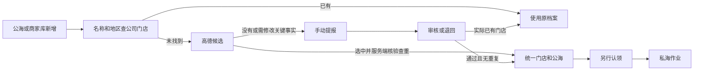

# 门店新增、经营状态与客户视图

## 本轮边界

公司门店以 `crm_store_master.id` 为唯一内部身份；高德 POI 是外部身份。保留已存在的统一门店和所有归属、拜访、订单历史。本轮不关联、不迁移旧客户档案。

新增仅出现在公海、商家库管理，共用一个流程及 `crm:lead:create` 权限。商家库查看权限不包含新增、维护、审核。不能从“我的客户”新增后直接成为私海，也不能通过新增记录伪造成交。

## 页面与数据关系

| 页面 | 数据范围 | 主要操作 |
| --- | --- | --- |
| 商家库管理 | 权限范围内全部统一门店，包含公海、私海、合作、停业和归档 | 查询全部、维护资料、维护经营状态；新增另验权限 |
| 公海 | 正常档案、未被认领、经营状态待核实或营业中 | 查找、补充缺失门店、认领 |
| 我的客户 | 当前本人归属；团队模式另验部门权限 | 跟进、拜访、退回、核实经营状态 |
| 合作客户 | 权限范围内存在合作事实的门店，经营状态独立展示 | 查询合作及历史；停业不清除合作事实 |
| 门店提报 | 本人提报或有权限的待审核提报 | 查看结果、修改退回提报、审核；无需重复新增入口 |

### 列表与操作重点

- **我的客户**：门店名称及合作/价值标签、所在地区、地址定位、经营状态、跟进阶段、保护期限、最近有效拜访与累计次数、公开电话。团队模式增加负责人。跟进打开客户作业详情；只有当前归属人能拜访、退回和核实状态，各动作分别检查权限。没有新增入口。
- **合作客户**：门店名称、客户价值、交易活跃度、首次合作、最近成交、经营状态、客户池、当前负责人、地区/地址/电话。当前负责人可跳转自己的客户作业；符合条件且有权限的公海记录跳转公海认领；管理员可跳转商家库维护。此页不直接认领、新增或维护档案。
- **门店提报**：门店名称、地区/地址、来源、审核状态、提交时间、审核时间、审核意见、入库结果；待审核列表增加提报人，详情展示提报人和审核人实名。名称进入提报详情，待审核记录由有权限者处理，退回记录可在原提报修改重提，已通过记录可进入有权查看的原门店。名称/地址关键词和审核状态筛选、服务端分页；不截断为最近100条。
- 三个列表沿用固定表头和底部分页、内容区内部滚动；门店名为详情入口，地址定位保持可点击。公共基础资料、审核和销售作业不再使用同一组功能按钮。

停业之后 `pool_type` 仍由“是否有当前归属”派生，表示未分配不等于可认领。可认领公海还必须满足档案、经营状态及地区权限条件。

## 新增流程

- 查库、查高德和提交均检查动作权限及目标地区；查询父地区不扩大其下实际允许的范围。
- 高德直入只接受 POI ID 和请求 ID；名称、地址、位置、公开电话、分类来自服务端重新读取的详情，客户端不能篡改这些字段获得免审。
- 高德分类映射启用的门店类型字典，地址/区县/坐标缺失或类别无法映射时转手动提报核验。
- 手动新增必须有名称、地址、有效县级或合法无县级城市、门店分类及位置；电话可空；无 POI 允许建公司门店。
- 高德来源不自动等于实地确认营业，初始经营状态为 `UNKNOWN`，销售或维护人员核实后更新。
- 手动提报未审核前只保存提报，不创建正式门店；审核人可关联已有可见档案，而不复制其业务历史。被退回资料在原提报上修改重提并留痕。
- 创建、审核通过和重新开业都不自动认领；24小时/7天/本轮成交后60天/本人48小时冷却仍由认领周期控制。

## 查重、并发和追溯

- 查重覆盖本租户全部门店，而非当前页面、当前业务员或仅营业门店。跨权限只提示存在冲突，不返回其他员工私海资料。
- POI 使用现有 `(tenant_id, provider_code, identity_scope, external_id)` 数据库唯一约束，包含失效绑定，不可通过停用旧关联绕过。
- 名称、地址、区县组成规范化键，去空白、统一全半角括号与大小写，保留地址中的连字符、斜杠等有意义字符。库内有确定重复时不允许新建，审核确认也不能绕过。
- 同名或近位置且名称相似为疑似重复，转人工核验。不同门店可以共用坐标，坐标不作唯一键。
- 提报、审核入库、高德入库、资料维护通过 V32 的 `crm_store_admission_guard` 租户行串行查重，事务第一步即写入并锁定该行，避免等待锁期间建立旧快照。锁表不关联归属策略或业务外键，不与认领、退回的策略锁形成反向锁序；POI唯一约束再次兜底。
- 幂等请求不能被其他用户或不同内容复用。修改资料同样执行查重，不能通过“先新增、后改名改地址”绕过。
- V31 仅回填查重索引和独立经营状态，不擅自合并已有疑似重复。已有存量并非本次宣称“已全部清洗无重复”的范围。

## 经营状态字典

`CRM_STORE_BUSINESS_STATUS` 属于 Foundation 公共字典服务，类型 CRM。状态编码承载行为，禁止任意新增、改码、删除/停用及合并；名称、说明和排序走现有字典维护。前端通过有效字典读取，不把中文写入业务表。

| 编码 | 默认名称 | 公海认领 | 新拜访/新订单授权 | 当前归属 |
| --- | --- | --- | --- | --- |
| UNKNOWN | 待核实 | 允许 | 允许 | 正常规则 |
| OPEN | 营业中 | 允许 | 允许 | 正常规则 |
| TEMP_CLOSED | 暂时停业 | 禁止 | 禁止 | 保留；保护期不暂停，到期正常回收 |
| CLOSED | 已停业 | 禁止 | 禁止 | 结束本轮；原负责人保留48小时冷却 |

- 业务员须有 `crm:store:status-write`，只可核实当前本人私海门店，必填依据；不允许替别人操作或把已核实状态随意改回未知。
- 商家库有 `crm:store:manage` 的人员可在授权地区维护状态，含恢复营业；查看商家库本身不授予维护权。
- 已停业恢复营业使用原 `store_id`，不会恢复旧归属，不重置历史拜访/成交数据，不解除既有冷却。
- 停业变更记录操作者、依据、前后状态、发生时间、关联归属周期。新作业在服务端校验；已存在历史记录保留。
- 经营状态不替代 `record_status`（正常/停用/合并等档案有效性），也不替代公私海、交易活跃度、价值分层和合作历史。

## 验证记录

### 已验证

- CRM 79 项定向测试通过：新增直入/人工审核/退回重提、全库与POI查重、跨员工与地区权限、并发、请求幂等、经营状态、历史保留、地图及原归属规则；独立 MySQL 测试库已迁移至 V32。
- 新增提报人/审核人返回字段后，退回→重提→通过的持久化测试单独再通过。
- IAM / Foundation 77 项定向测试通过，验证权限迁移、范围复制和字典约束。
- Web 68 项定向测试通过；typecheck、ESLint、差异检查通过。覆盖不同页面入口、审核与重试、服务端分页及旧接口响应保护。
- 数据库基线检查通过：16 个冻结基线、684 个历史迁移未改。
- 真实浏览器已验证商家库“维护”直接打开编辑弹窗；高德按「浩盛台球俱乐部 / 江西省 / 赣州市 / 宁都县」返回1条候选，POI `B0KBRUN2Z4`，确认填入成功。此次未保存该真实门店修改。
- 真实页面刷新后确认合作客户默认列已换为价值/活跃度/首次合作/最近成交/负责人等；1440×900 下固定表头、内容滚动与底部分页布局正常。尚未以新接口数据完成闭环验收。

### 2026-11-05 共享 DEV 与浏览器验收

用户已在既有 IDEA 运行项重启服务。数据库确认 IAM V149、CRM V31/V32、Foundation V57 成功，IAM/CRM/Foundation/Sales/HR 健康检查正常。未另起服务进程。

- 使用现有管理员正常登录会话，通过真实页面创建 `【DEV1105验收】杭州门店新增闭环`：手动提报→退回→补充楼层→原提报重提→审核通过。提报 `2118157543366639618` 由 revision 1 推进至 4，始终只有一条；审核前没有正式门店，通过后生成门店 `2118157944417599489`，未自动认领。
- 状态从 `UNKNOWN→TEMP_CLOSED→CLOSED→OPEN` 均通过页面保存，数据库与详情一致；操作者解析为管理员，原因和前后状态留痕。停业时公海关键词查询0条，商家库和新增查库仍可查到；恢复营业后原门店重新显示在公海，ID 未变化。
- 对上述暂时停业门店强行重复手动提报，服务端拒绝“商家库中已存在该门店”，没有多出提报或主档案。
- 真实高德查询「台球 / 拱墅区」返回候选。选择原库未绑定的 POI `B0L2PHQNOA`，服务端再次核验后直接入公海，门店 `2118160847505113089`；名称、地址、区县330105、分类 `POI_080113`、GCJ02 经纬度、公开电话已持久化，负责人为空。再次提交同一 POI 被拒绝，数据库只有一条绑定。该验收只证明本次身份查重和入库，不代表存量异名/改名门店已经人工核清。
- 为分页直接准备了21条 `【DEV1105分页】` 虚拟提报（未创建正式门店）。真实页面筛选后第一页20条、第二页1条；待我审核显示提报人姓名与审核/退回按钮。全库跨100条边界另有前述隔离测试覆盖。
- 我的客户/团队客户、合作客户、门店提报均无新增入口；团队列包含负责人；合作列表使用价值、活跃度、首次合作、最近成交等字段。旧客户未迁移，当前正式合作视图为空；这不能算有合作行数据的视觉验收。
- 修复初次选择区县时错误显示“所属区县已变化”的提示，已有位置更换区县仍清空旧坐标并要求重新选点。11项相关前端测试、typecheck、定向ESLint及差异检查通过。

首轮共享DEV新增2条正式门店（1条虚拟手动审核门店、1条真实高德来源门店），以及21条分页虚拟提报；后续轮询验收将其中01号提报审核入库，合计新增3条门店，没有额外新增提报。旧客户档案只读核对仍为2,933条，未关联、未迁移；未发布到生产。

### 2026-11-05 正常员工会话与轮询冲突修复

用户随后正常登录向韬账号，该账号已关联员工，页面实际授权范围为全国，并已有商家库维护权限。本次未修改账号或扩大授权；不能将该账号的验收描述为“仅杭州城市权限”的验证。

- 通过正常页面认领 DEV 门店 `2118157944417599489`，从公海移入我的客户，新增归属周期 `2118164671393349633`；数据库首访保护精确为86,400秒。
- 在我的客户标记暂时停业，归属仍为当前本人，原首访截止时间不变。
- 本人标记已停业后门店退出我的客户，归属结束原因为 `STORE_CLOSED`，结束时间至冷却截止精确为172,800秒。通过账号已有的商家库维护权限恢复营业后，同一门店重新出现在公海；负责人仍为空，原归属未恢复，认领按钮禁用并显示“本人冷却中 / 还需48小时”。
- 原有真实门店“浩盛台球俱乐部”为用户自行认领，本轮验收没有修改该门店及其归属。
- 验收发现每分钟生命周期轮询无条件递增门店摘要版本，导致没有业务变化也可能阻止经营状态保存。已修复为仅在归属、阶段、期限、成交、拜访或暂缓原因等可见业务状态变化时递增摘要版本；轮询时间及内部归属版本仍更新，过期回收候选仍拒绝。
- 新增回归覆盖：连续无变化轮询后原状态表单可保存；真实订单变化仍使旧表单失效；内部旧回收候选仍返回RETRY；订单事实重复同步不再次使表单失效。CRM 55项回归通过（43项门店池、12项生命周期），编译与差异检查通过。

用户已在既有 IDEA 运行项重启CRM（26883），健康检查UP。使用同一正常员工会话，将 `【DEV1105分页】审核列表测试01` 审核生成门店 `2118167109609390082` 并认领；保持经营状态表单打开跨过后台轮询。数据库内部归属版本从2推进至3、检查时间更新，门店摘要版本始终为2；随后提交原表单成功，经营状态持久化为OPEN，摘要版本才变成3。说明无变化轮询不再误报保存冲突，后台检查仍在运行。

跨人/跨城市拒绝有隔离集成测试覆盖，本轮没有再登录第二个受限城市账号，不宣称已完成这部分新的浏览器复验。原管理员未关联员工时认领禁用仍为正确行为。

一次尝试读取运行进程信任材料来构造测试身份的操作被自动审批拒绝，未执行；相关临时脚本已删除。员工流程采用用户正常登录的会话验收。

证据：工作区 `outputs/crm-store-intake-20261105/` 的 `manual-approved.png`、`closed-store-lookup.png`、`duplicate-rejected.png`、`amap-admitted.png`、`amap-store-detail.png`、`amap-duplicate-rejected.png`、`lead-page-two.png`、`status-audit.png`、`reopened-public.png`。前期维护补全截图在 `outputs/crm-store-intake-20261104/amap-maintenance-fill.png`。测试日志：`/tmp/crm-intake-tests-20261104.log`、`/tmp/crm-intake-review-actors-20261104.log`、`/tmp/crm-intake-permissions-tests-20261104.log`、`/tmp/crm-intake-ui-20261105.log`、`/tmp/crm-intake-typecheck-20261105.log`。

员工会话补充证据：`outputs/crm-store-intake-20261105/sales-claimed-private.png`、`sales-cooldown-public.png`、`sales-polling-save-passed.png`，以及同目录 `polling-before.json`、`polling-after.json`、`polling-saved.json`；本轮回归日志 `/tmp/crm-private-polling-tests-20261105.log`。
