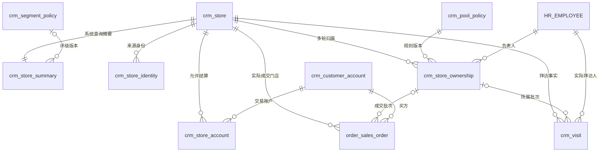
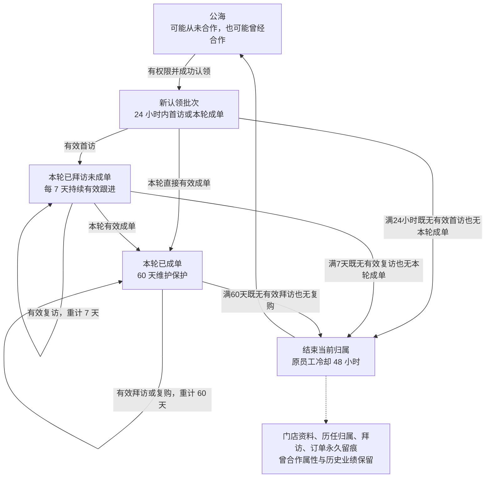
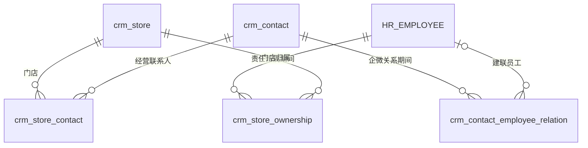

# 开发依据

2026-10-27 用户确认图3并授权开始开发；公海默认显示全部授权范围，全国授权账号可按七大区域、省、市、县筛选。下文为开发前第三版设计快照，其历史“待确认／未授权开发”表述仅描述原文时点。来源：https://chatgpt.com/space/page_5af2527f84f88191ae8f38e37f1f132c

2026-10-28 实施决定：用户要求保留现有客户和关联，待新功能完整后再映射、合并迁移及切换。因此本文目标门店主档的实际表名为 `crm_store_master`；原 `crm_store` 是兼容期间保留的旧表，新公海私海不向其双写。失败 V28 已改为仅新增功能表，不修改成功历史迁移、旧主键或旧外键。后续旧数据映射与切换单独验收。

版本：第三版完整表结构设计，待整体确认。更新日期：2026 年 10 月 27 日。客户价值门槛、交易活跃度和归属回收规则已确认并统一合并；本页同时包含字段、索引、行政区划、数据权限和查询设计，作为统一评审与后续开发依据。表名为目标设计名称，现有模块可以演进复用，不另外维护同义主数据。

已确认：每次新认领都按本轮作业执行 24 小时首访、7 天持续跟进、本轮成单后 60 天维护。曾经合作的门店重新认领也从 24 小时开始。回收只结束当前负责关系，保留门店、联系人、拜访和订单；原负责人的 48 小时冷却沿用此前约定，与新的 24 小时首访期限分开。

已确认分层：按每家门店滚动近 365 天净成交额评级，A≥3000元，1000元≤B＜3000元，已合作且净成交额＜1000元为 C，包含完整窗口内零成交的老客户；从未成交保持 UNRATED。成交次数仅辅助展示。潜力由业务员人工评定、主管可修改并留痕；交易活跃度按 60 天有效订单独立判断。门槛确认不代表规则已发布，全文仍待整体确认，不包含开发、建表、迁移或上线授权。

# 统一门店与独立业务维度

门店基础资料只在 crm_store 维护一份，所有关联都使用公司稳定的 store_id。名称、当前地址、公开电话、行政归属和坐标不会分别维护在公海、私海、合作客户中。

| 维度 | 编码或判断 | 权威来源与查询位置 |
| --- | --- | --- |
| 门店状态 | ACTIVE、SUSPENDED、CLOSED、MERGED | crm_store；摘要同步状态 |
| 公海私海 | PUBLIC、PRIVATE | 当前有效 ownership；summary 派生 |
| 合作历史 | NEVER、COOPERATED | 有效交易或已核实基线；summary 只读摘要 |
| 本轮保护 | FIRST_VISIT、FOLLOW_UP、COOPERATING | 当前 ownership 的本轮事实和期限 |
| 潜力 | UNKNOWN、HIGH、MEDIUM、LOW | crm_store 人工核实；summary 同步 |
| 价值 | A≥3000；1000≤B＜3000；已合作且＜1000为C（含0）；从未成交UNRATED | 近365天净成交额，CNY；已发布规则与完整窗口；summary |
| 交易活跃 | UNKNOWN、NEVER_ORDERED、ACTIVE、DORMANT | 60 天订单事实及历史完整性；summary |

这些维度分别判断，不能合成一个 status。公海和私海互斥；合作历史、潜力、价值和活跃度可以交叉筛选。原成交仍在365天窗口内时，“公海＋历史合作＋A级＋沉睡”是合法组合；两年没有再成交时可为“公海＋历史合作＋C级＋沉睡”。价值降级或交易沉睡本身不触发回收，回收不清除合作历史，也不把价值等级改成未评级。持续有效拜访可以延长当前归属，但不增加成交金额或恢复交易活跃。

| 查询入口 | 条件 | 页面建议 |
| --- | --- | --- |
| 公海 | 有效门店且无有效归属；资料未完善或处于本人冷却时可看但不可认领 | 可筛选未合作、曾合作，展示“已合作·公海” |
| 我的客户即私海 | 当前归属为本人 | 包括本人的未合作及已合作门店，按合作状态筛选 |
| 合作客户 | 已合作且满足原有归属／地域可见规则 | 可显示我的合作客户、团队合作客户及授权公海合作客户 |
| 全国商家库 | 获授权范围内的统一门店集合 | 维护基础资料、去重、覆盖统计 |

合作客户是交叉筛选，不是与公海和私海并列互斥的第三个池。统计不能把三个菜单的数量直接相加。这里的视图是统一业务查询，可使用 SQL、API 或查询模型实现，不强制建立数据库 VIEW。

# 表关系与流转图

## 主数据归属和业务事实



图中一对多归属是历史期间，一店在同一时刻只有一条未结束归属。拜访必须同时保留 store_id、salesperson_id 和正常作业的 ownership_id；订单同时保留 store_id、买方账户及正常销售作业的 ownership_id。所有跨服务连线为业务引用，不是跨库外键。

| 关系 | 基数与连接键 |
| --- | --- |
| 门店与摘要 | 1:1，tenant_id＋store_id；摘要不存在是待修复异常 |
| 门店与来源身份 | 1:N，同租户 store_id；来源身份唯一定位一家店 |
| 门店与归属 | 1:N 历史、0或1 当前；ownership.store_id |
| 归属与回收政策 | N:1，ownership.policy_id |
| 摘要与分层政策 | N:0或1，summary.segment_policy_id |
| 门店与拜访 | 1:N，visit.store_id；普通拜访另关联一轮 ownership |
| 拜访与证据 | 1:N，evidence.visit_id |
| 门店与账户 | M:N，经 crm_store_account |
| 订单与门店 账户 归属 | 分别通过 store_id、buyer_account_id、ownership_id；未匹配历史显式为空 |
| 门店与联系人 | M:N，经 crm_store_contact |
| 联系人与员工 | M:N 并保留期间，经 crm_contact_employee_relation |
| 门店与行政节点 | N:1，admin_area_version＋admin_area_code |
| 部门与行政范围 | M:N，经 department_admin_scope；同租户部门引用 HR |
| 门店与业务审计 | 1:N，store_id；尚未建店事件允许为空 |

## 每一轮重新执行保护规则



同一家门店从 A 到 B 再到 C，store_id 不变，ownership_id 每轮不同。回收结束一个责任期间，不删除该期间已经发生的业务。曾合作门店重新认领不会自动继承前任的 60 天。

## 建联不等于归属



企微记录“员工联系了谁”，归属记录“谁负责哪家店”。二者可以交叉，但不能互相替代。

# 目标领域与表清单

| 领域 | 目标表 | 唯一职责 |
| --- | --- | --- |
| CRM | crm_store | 实体门店唯一主档 |
| CRM | crm_store_summary | 一店一行的系统查询摘要 |
| CRM | crm_segment_policy | 已确认3000／1000元门槛、365天及60天口径的独立发布版本 |
| CRM | crm_store_identity | 高德及其他来源身份，不绑定地图厂商主键 |
| CRM | crm_store_lead | 新店或纠错提报与审核，批准后关联正式门店 |
| CRM | crm_store_ownership | 一次认领或分配形成一个责任期间，包含当前归属及历史 |
| CRM | crm_pool_policy | 有版本的 24 小时、7 天、60 天和冷却参数 |
| CRM | crm_visit | 一次实际拜访的唯一业务事实 |
| CRM | crm_visit_evidence | 拜访照片等文件引用及证据状态 |
| CRM | crm_followup | 电话、微信等普通沟通事实，不冒充到店拜访 |
| CRM | crm_store_event | 归属、资料、规则干预等业务审计 |
| CRM | crm_customer_account | 开单结算账户，不是另一份门店档案 |
| CRM | crm_store_account | 哪个结算账户可用于哪个门店 |
| CRM | crm_contact | 经营联系人及企微外部身份 |
| CRM | crm_store_contact | 联系人与实体门店的关系 |
| CRM | crm_contact_employee_relation | 员工与联系人的企微建联关系及时间段 |
| Order | order_sales_order | 订单头，直接持久化 store_id 和 ownership_id |
| Order | 订单明细、支付、退款和履约表 | 按交易职责继续存在，不复制到 CRM |
| Foundation | admin_division、admin_division_version 与现有数据字典 | 版本化行政树、七区和固定编码 |
| IAM | department_admin_scope、现有角色授权与个人范围 | 部门地理范围及动作与人员授权 |
| HR | 现有员工、部门、岗位任职及部门树 | 员工和部门身份、在职与任职事实 |
| 集成基础设施 | 复用可靠消息、幂等受理、同步检查点 | 不承载另一份客户主档 |

这是一份目标领域模型，不表示所有列出的表都要新增。现有订单、账户、拜访数据应迁移或演进到对应唯一权威表，完成替代后收敛旧写入路径。客户拜访事实建议由 CRM 持有，销售工作台调用 CRM；Sales 可继续负责行程、任务及独立外勤功能，不再另存一套同义客户拜访主记录。

不建立公海表、私海表、合作客户表、复访表或额外归属历史副本。查询摘要是受控冗余，CRM 事实与权限敏感字段必须有唯一权威写者。分层政策使用一张小型版本表保存金额门槛及审批依据，与归属回收政策独立发布；不引入评分表达式、通用规则引擎。

# 门店和身份

## 通用列与存储规范

| 字段 | 类型 | 可空与默认 | 用途与约束 |
| --- | --- | --- | --- |
| id | BIGINT | 非空 | 普通业务表主键，应用生成稳定 ID；不把自增序号作为对外业务编号 |
| tenant_id | VARCHAR(64) | 非空 | 租户隔离；来自认证上下文 |
| revision | BIGINT | 非空；1 | 乐观锁；每次修改递增 |
| created_at | DATETIME(6) | 非空 | 服务端创建时点，UTC |
| updated_at | DATETIME(6) | 非空 | 最近修改时点，UTC |
| created_by | VARCHAR(64) | 非空 | 平台账号或明确系统主体 |
| updated_by | VARCHAR(64) | 非空 | 最近修改主体 |

除各表明确声明的复合主键、全局行政表和只追加审计表外，以下 CRM 可变业务表均包含上述七列。普通表 PK(id)，UK(tenant_id,id) 用于同租户复合引用；表内列出其他 UK 和 IDX。员工和部门引用均为 BIGINT，账号引用 VARCHAR(64)，不会使用旧稿中的 BINARY(16) 部门类型。

新建关系由 CRM 在同一事务核对租户和父对象；可建立同库 (tenant_id,关联ID) 复合外键，ON DELETE RESTRICT。跨服务通过契约校验，不建跨库外键。核心事实禁止物理删除；状态码采用受控 VARCHAR，不存中文、不用数据库 ENUM。普通文字使用 utf8mb4 / utf8mb4_general_ci，不透明外部 ID 用 VARBINARY。经纬度必须成对、范围合法并声明坐标系。金额 DECIMAL(24,6)，币种 CHAR(3)，不使用浮点。API 的 BIGINT 以字符串返回，避免前端精度丢失。审计或附件 JSON 不能承担需索引的主要筛选字段。

## 门店主档 crm_store

| 字段 | 类型 | 可空与默认 | 用途与约束 |
| --- | --- | --- | --- |
| name | VARCHAR(200) | 非空 | 门店当前名称 |
| address | VARCHAR(500) | 非空 | 实际经营地址 |
| public_phone | VARCHAR(50) | 可空 | 公开门店电话；私人电话在联系人维护 |
| admin_area_code | CHAR(6) | 非空 | 最细可靠行政编码 |
| admin_area_version | VARCHAR(32) | 非空 | 对应行政数据版本，与编码共同解析 |
| area_resolution | VARCHAR(24) | 非空 | COUNTY、LEGAL_CITY_LEAF、PENDING_COUNTY；区分合法无县与待补区县 |
| longitude | DECIMAL(10,7) | 可空 | 经度；正常认领和作业前必须有效 |
| latitude | DECIMAL(10,7) | 可空 | 纬度，与经度同时有值或同时为空 |
| coordinate_system | VARCHAR(16) | 可空 | 有坐标必填；一期 GCJ02 |
| record_status | VARCHAR(16) | 非空；ACTIVE | ACTIVE、SUSPENDED、CLOSED、MERGED |
| status_reason | VARCHAR(500) | 可空 | 非 ACTIVE 以及恢复时记录依据 |
| merged_into_store_id | BIGINT | 可空 | MERGED 时必填；同租户且不能自指或成环 |
| table_count | SMALLINT UNSIGNED | 可空 | 核实后的球桌数量；未知不填 0 |
| potential_level | VARCHAR(16) | 非空；UNKNOWN | HIGH、MEDIUM、LOW、UNKNOWN；有权销售和主管维护 |
| potential_reason | VARCHAR(500) | 可空 | 已评级时必填，说明规模或需求依据 |
| profile_verified_at | DATETIME(6) | 可空 | 最近核实潜力资料的时间 |
| profile_verified_by | VARCHAR(64) | 可空 | 核实人；与时间配套 |
| historical_cooperation_confirmed | BOOLEAN | 非空；false | 无完整交易明细但经过核实的历史合作基线 |
| historical_first_cooperated_at | DATETIME(6) | 可空 | 已核实历史首次合作时间；未知不补造 |
| historical_cooperation_evidence | VARCHAR(1000) | 可空 | 基线为 true 时必填，保存来源或证据引用 |
| historical_cooperation_verified_at | DATETIME(6) | 可空 | 基线确认时必填 |
| historical_cooperation_verified_by | VARCHAR(64) | 可空 | 基线确认人 |

PK(id)；UK(tenant_id,id)；IDX(tenant_id,admin_area_version,admin_area_code,record_status,id)。按地图场景评估 IDX(tenant_id,longitude,latitude)，它只提供候选范围筛选，不承诺两维同时高效。名称、公开电话和坐标均不设全局唯一约束。其他列表索引在 summary，不重复在主档堆叠。 IDX(tenant_id,merged_into_store_id,id) 支持查找合并来源门店。

历史合作基线由专门权限核实、撤销并审计；首次日期未知保持 NULL。cooperation_status 与 first_cooperated_at 统一放 summary，由有效订单和历史基线生成，不在主档另存同义可编辑值。主档保留原始基线，因此摘要可以重建。

主档不保存可独立修改的负责人、私海姓名、初访次数或订单明细。省、市、县名称通过行政树取得；私人联系方式放联系人。已确认的门店资料由本系统管理，来源同步只能提出变更，不能覆盖人工确认内容。

## 外部身份 crm_store_identity

| 字段 | 类型 | 可空与默认 | 用途与约束 |
| --- | --- | --- | --- |
| store_id | BIGINT | 非空 | 关联同租户 crm_store |
| provider_code | VARCHAR(24) | 非空 | AMAP 或其他稳定来源代码 |
| identity_scope | VARBINARY(128) | 非空 | 来源身份范围，不存密钥 |
| external_id | VARBINARY(191) | 非空 | POI 或外部门店标识，保留大小写 |
| acquisition_method | VARCHAR(24) | 非空 | API、BATCH_IMPORT、VERIFIED_LINK |
| source_batch_ref | VARCHAR(64) | 可空 | 来源批次，可追溯到原始文件 |
| source_record_ref | VARCHAR(500) | 可空 | 原始行或保留文件引用；含来源 adcode、名称和坐标时可追溯 |
| observed_at | DATETIME(6) | 可空 | 来源数据真实时点 |
| verified_at | DATETIME(6) | 非空 | 系统或人员核验时点 |
| status_code | VARCHAR(16) | 非空；ACTIVE | ACTIVE、RETIRED；退役仍保留来源唯一性 |

唯一 tenant_id＋provider_code＋identity_scope＋external_id；索引 tenant_id＋store_id。外部标识保留大小写原值，避免字符排序规则造成身份误合并。一个门店可以有多个厂商或历史 POI，一个来源身份不能同时指向两个门店。

手工线索获批后即使用 store_id；不需要虚构 POI。坐标相同或接近只触发重复核查，同楼两家门店不能因经纬度相同被直接合并。

## 新增与纠错 crm_store_lead

| 字段 | 类型 | 可空与默认 | 用途与约束 |
| --- | --- | --- | --- |
| request_type | VARCHAR(24) | 非空 | CREATE_STORE、CORRECT_STORE |
| target_store_id | BIGINT | 可空 | 纠错必填；关联同租户门店 |
| target_revision | BIGINT | 可空 | 纠错必填，防止覆盖他人最新修改 |
| proposed_name | VARCHAR(200) | 可空 | 新建必填；纠错为空表示不改 |
| proposed_address | VARCHAR(500) | 可空 | 新建必填 |
| proposed_admin_area_code | CHAR(6) | 可空 | 新建必填，纠错与版本成对 |
| proposed_admin_area_version | VARCHAR(32) | 可空 | 对应公共行政版本 |
| proposed_longitude | DECIMAL(10,7) | 可空 | 新建必填，纠错坐标成对 |
| proposed_latitude | DECIMAL(10,7) | 可空 | 新建必填 |
| proposed_coordinate_system | VARCHAR(16) | 可空 | 有提议坐标时必填 |
| proposed_public_phone | VARCHAR(50) | 可空 | 公开电话；清空请求须显式字段掩码 |
| changed_fields | JSON | 可空 | 纠错必填的字段名白名单数组，区分不修改与清空；不用于业务检索 |
| evidence_refs | JSON | 可空 | 图片等文件引用 |
| submitter_employee_id | BIGINT | 非空 | 提报人 HR 身份 |
| status_code | VARCHAR(24) | 非空；PENDING_REVIEW | PENDING_REVIEW、APPROVED、REJECTED、WITHDRAWN |
| submitted_at | DATETIME(6) | 非空 | 提交时间 |
| reviewed_at | DATETIME(6) | 可空 | 审核完成时填 |
| reviewer_user_id | VARCHAR(64) | 可空 | 审核账号 |
| review_reason | VARCHAR(1000) | 可空 | 拒绝、匹配已有店或特殊批准必填 |
| result_store_id | BIGINT | 可空 | 通过后指向新建或匹配的正式门店 |
| request_id | VARCHAR(64) | 非空 | 幂等键 |

UK(tenant_id,request_id)；IDX(tenant_id,status_code,submitted_at,id)；IDX(tenant_id,submitter_employee_id,submitted_at,id)。批准后保留冻结申请快照；核对目标版本并更新主档。新建与资料纠错都不自动认领。审批时跨全部公私海查重，隐藏无权限门店细节。

高德后台核验且查重通过的门店直接准入，不强加人工审批；手工新店必须审核。准入与认领分开，申请人不自动取得门店归属。已经正式入库的“Leads”在业务上就是未合作门店，后续流转统一使用 store_id 和 ownership，不再复制到一张销售线索主表。

认领前另外校验有效门店、必要资料与合法坐标、员工在职及身份映射、动作与地域权限、无当前归属、本人对本店及合并来源店均不在冷却。高德资料后台验证、已有 POI 查重、名称地址与距离疑似重复检查均通过才直接建店；已匹配已有店则返回匹配结果，不能另造一店。资料维护不续保护期，地图查询读取自有库；地图厂商停用只影响底图或检索适配，不改变 store_id。

# 客户分层与查询摘要

## 分层规则 crm_segment_policy

包含通用七列。这张小表保存已经确认的分层口径和金额门槛审批版本；与 crm_pool_policy 独立，修改客户评级不会改变某轮归属的截止时间。

| 字段 | 类型 | 可空与默认 | 用途与约束 |
| --- | --- | --- | --- |
| policy_version | INT | 非空 | 同租户分层版本 |
| value_window_days | SMALLINT UNSIGNED | 非空；365 | 已确认固定 365 天 |
| value_metric | VARCHAR(32) | 非空；NET_ORDER_AMOUNT | 净成交额评级，次数仅辅助展示 |
| currency_code | CHAR(3) | 非空；CNY | 一期人民币；不同币种不直接相加 |
| value_enabled | BOOLEAN | 非空；false | 草稿默认不启用；正式发布已确认政策时置 true |
| tier_a_min_amount | DECIMAL(24,6) | 非空；无数据库默认 | 已确认首版为3000.000000元，A档包含下限 |
| tier_b_min_amount | DECIMAL(24,6) | 非空；无数据库默认 | 已确认首版为1000.000000元；B含下限、不含A下限，0＜B＜A |
| activity_days | SMALLINT UNSIGNED | 非空；60 | 已确认交易活跃窗口，不受拜访刷新 |
| status_code | VARCHAR(16) | 非空；DRAFT | DRAFT、PUBLISHED、RETIRED |
| effective_from | DATETIME(6) | 可空 | 发布时必填 |
| approved_by | VARCHAR(64) | 可空 | 业务确认账号；发布时必填，写入可核实的实际账号 |
| approved_at | DATETIME(6) | 可空 | 业务确认时间 |
| approval_evidence | VARCHAR(1000) | 可空 | 本次3000／1000元门槛及零成交老客户规则的确认依据；发布必填 |
| published_by | VARCHAR(64) | 可空 | 发布账号 |
| published_at | DATETIME(6) | 可空 | 发布操作时间 |

UK(tenant_id,policy_version)；UK(tenant_id,effective_from)；IDX(tenant_id,status_code,effective_from,id)。使用生效时间不晚于计算时点的最新 PUBLISHED 版本；发布后参数不可原地修改。已确认首版参数为 value_window_days=365、tier_a_min_amount=3000.000000、tier_b_min_amount=1000.000000、activity_days=60。开发并验收后的首次正式发布启用 value_enabled=true；发布前保持草稿和未启用，不自动修改现有客户等级。后续金额门槛修改通过新政策版本发布，与归属回收政策分开。

设统计截止时点为 T，北京时间每日零点换算为 UTC，金额窗口为 [T−365天,T)，按真实 effective_at 选取同一门店的多笔有效订单合计。扣除截至 T 已确认且对应这些订单的商品退货退款，先按订单归集退款，避免多对多连接重复扣减。金额口径使用 Order 提供的净商品成交额（折扣后、不含运费，含税口径与订单一致），与应收余额、回款金额区分；一次退款只能扣一次，单笔净额不低于0。实际经营不足365天也不年化放大：已确认本业务从2026年4月20日开始，此前无订单的区间按0计入完整性核对。尚未核清退款、运费、实际门店或同步范围的记录会使受影响门店保持 DATA_INCOMPLETE，不把部分金额当完整净额评级。10月26日旧客户档案快照只作为门槛测算依据，正式分层以统一 store_id 的核准净额执行。

| 判定顺序与条件 | customer_tier | 说明 |
| --- | --- | --- |
| 政策未发布或未启用 | UNRATED | tier_unrated_reason=RULE_PENDING |
| 365天窗口未完整核对，或净额未知 | UNRATED | tier_unrated_reason=DATA_INCOMPLETE；NULL不是0 |
| 已核实从未成交，即无合作事实或核实基线 | UNRATED | tier_unrated_reason=NO_COOPERATION；不归C |
| COOPERATED 且净成交额≥3000元 | A | 3000元属于A |
| COOPERATED 且1000元≤净成交额＜3000元 | B | 1000元属于B，3000元不属于B |
| COOPERATED 且0元≤净成交额＜1000元 | C | 包含合作过但近365天没有成交的门店；保留历史合作标记 |

交易活跃与价值等级、当前归属独立。已确认最近有效订单，且 now＜last_order_at＋60天时为 ACTIVE；达到60天边界且近期来源已完整核对、没有更晚有效订单时为 DORMANT。已合作门店只要最近60天已核实无有效订单，即可判沉睡，包括仅有更早合作基线但旧日期不明的门店；不能仅因 last_order_at 为空而忽略已核实的近期无交易事实。已完整核对且从未成交为 NEVER_ORDERED；近期来源不完整、事实不足则为 UNKNOWN。拜访、普通跟进、加企微不刷新交易活跃度。正常退货影响净额，不刷新订单时间，也不抹除真实履约后的合作历史。来源中断时不把旧的完整性标记当作当前完整。

示例：门店仅在本轮成交一次5000元，此后两年没有再成交；假设订单有效、没有退款、数据完整且分层政策已发布。以下同时展示价值、活跃与归属，历史订单始终保留。

| 时点或行为 | 近365天净额与价值 | 交易活跃度 | 当前归属 |
| --- | --- | --- | --- |
| 本轮刚成交5000元 | 5000元，A | ACTIVE | 私海，本轮进入60天维护 |
| 满60天未复购，也没有有效拜访 | 原订单仍在窗口内，5000元，A | DORMANT | 到期核验回公海；原员工冷却48小时 |
| 原订单滑出365天窗口，直至两年无交易且无人认领 | 日切重算为0元，C | DORMANT | 公海；历史合作标记和原5000元订单保留 |
| 两年没复购，但当前负责人一直在到期前有效拜访 | 0元，C | DORMANT | 可持续保留私海；从最新有效拜访重计60天 |
| 老客户回公海后由另一员工认领 | 仍按窗口金额评级，不因认领升级 | 无新有效订单仍DORMANT | 新归属从24小时开始，首访后7天，本轮成单后60天 |
| 从未成交，只拜访或加企微 | 完整窗口金额可为0，仍UNRATED | NEVER_ORDERED | 公私海及保护阶段按归属事实单独判断 |

列表可由 cooperation_status='COOPERATED'、order_data_status='COMPLETE'、net_order_amount_365d=0 派生“近一年未成交”标签，不新增一份可编辑客户状态。C档表示当前采购贡献较低，不代表门店潜力低；历史累计成交与原订单从Order事实查询，不能拿历史累计金额替代近365天金额。

潜力保存在主档：业务员须具有当前门店作业和潜力维护权限，主管在获授权范围内可改；已评级必填理由，所有修改写审计。球桌数是依据，不自动决定等级。公海基础资料由获授权管理员维护，普通销售可提交纠错，不能利用改资料获得归属。

## 门店查询摘要 crm_store_summary

复合主键 (tenant_id,store_id)，不继承普通表的 id 和人工维护审计列。每家正式门店恰好一行；它是事实的只读投影，不能通过管理页面独立编辑。无摘要行属于数据异常，不等于公海。

| 字段 | 类型 | 可空与默认 | 用途与约束 |
| --- | --- | --- | --- |
| tenant_id | VARCHAR(64) | 非空 | 租户 |
| store_id | BIGINT | 非空 | crm_store.id，与 tenant_id 联合主键 |
| revision | BIGINT | 非空；1 | 摘要更新版本 |
| updated_at | DATETIME(6) | 非空 | 最近更新 |
| record_status | VARCHAR(16) | 非空 | 同步门店状态 |
| current_ownership_id | BIGINT | 可空 | 未结束的归属；公海为空 |
| owner_employee_id | BIGINT | 可空 | 与 current_ownership_id 同时为空或有值 |
| ownership_revision | BIGINT | 可空 | 同步的归属版本 |
| pool_type | VARCHAR(16) GENERATED STORED | 非空派生 | current_ownership_id 为空取 PUBLIC，否则 PRIVATE |
| phase | VARCHAR(24) | 可空 | 当前保护阶段；公海为空 |
| deadline_at | DATETIME(6) | 可空 | 当前保护截止时间；公海为空 |
| admin_area_code | CHAR(6) | 非空 | 从主档同步最细行政节点 |
| admin_area_version | VARCHAR(32) | 非空 | 本行地区解析版本 |
| area_resolution | VARCHAR(24) | 非空 | 从主档同步区县完善程度 |
| geo_region_code | VARCHAR(16) | 非空 | 七大区域，按行政版本派生 |
| province_code | CHAR(6) | 非空 | 省级编码 |
| city_code | CHAR(6) | 可空 | 正常地级市；直辖市采用其省级编码作为城市查询键 |
| county_code | CHAR(6) | 可空 | 县级节点；合法地级叶节点和待补县保持空 |
| cooperation_status | VARCHAR(16) | 非空；NEVER | NEVER、COOPERATED；合作事实不会因回收、沉睡或窗口金额归零而清除，未知另示数据状态 |
| first_cooperated_at | DATETIME(6) | 可空 | 可确认的真实首次合作时间，未知历史不取首次同步时间 |
| potential_level | VARCHAR(16) | 非空；UNKNOWN | 同步主档人工潜力 |
| customer_tier | VARCHAR(16) | 非空；UNRATED | 按已发布365天净额政策生成A/B/C；从未成交或资料不足为UNRATED |
| tier_unrated_reason | VARCHAR(32) | 可空 | RULE_PENDING、DATA_INCOMPLETE、NO_COOPERATION；评级后空 |
| segment_policy_id | BIGINT | 可空 | 本次分层引用的 crm_segment_policy.id |
| tier_calculated_at | DATETIME(6) | 可空 | 价值评级计算时点 |
| activity_status | VARCHAR(24) | 非空；UNKNOWN | ACTIVE、DORMANT、NEVER_ORDERED、UNKNOWN；不受价值等级或归属变化影响 |
| activity_expires_at | DATETIME(6) | 可空 | 已知最近有效订单时间加60天；与ownership.deadline_at分开，不因拜访改写 |
| valid_visit_count | BIGINT UNSIGNED | 可空 | 全店有效拜访数，未完成来源核对为空 |
| first_valid_visit_at | DATETIME(6) | 可空 | 公司首次有效拜访，支持新增拜访覆盖 |
| last_visit_at | DATETIME(6) | 可空 | 全店最后有效到店时间，不是普通跟进 |
| visit_data_status | VARCHAR(16) | 非空；UNKNOWN | UNKNOWN、PARTIAL、COMPLETE |
| visit_synced_at | DATETIME(6) | 可空 | 拜访摘要核对时间 |
| last_order_at | DATETIME(6) | 可空 | 全店最后有效订单生效时间 |
| order_count_365d | BIGINT UNSIGNED | 可空 | 窗口内有效订单数，不以退款行数计次数 |
| net_order_amount_365d | DECIMAL(24,6) | 可空 | 窗口净商品成交额，CNY；完整窗口无成交写0，无法核准写NULL |
| order_metrics_as_of | DATETIME(6) | 可空 | 金额与次数共同截止时间 T |
| order_data_status | VARCHAR(16) | 非空；UNKNOWN | 窗口 UNKNOWN、PARTIAL、COMPLETE |
| order_history_complete_from | DATETIME(6) | 可空 | 已核实连续完整区间起点，含有依据的无业务零记录区间，不等于第一笔订单时间 |
| order_history_complete_to | DATETIME(6) | 可空 | 对应连续完整区间终点，判断60天及365天数据是否齐全 |
| order_synced_at | DATETIME(6) | 可空 | 最近订单来源核对时间 |
| wecom_active_contact_count | BIGINT UNSIGNED | 可空 | 已确认门店关系且存在企业有效建联的联系人去重数 |
| wecom_data_status | VARCHAR(16) | 非空；UNKNOWN | UNKNOWN、PARTIAL、COMPLETE |
| wecom_synced_at | DATETIME(6) | 可空 | 企微摘要核对时间 |

UK(tenant_id,current_ownership_id) 保证一个归属批次不会投影到两个门店；公海 NULL 不互相冲突。基础索引：IDX(tenant_id,city_code,pool_type,record_status,store_id)；IDX(tenant_id,owner_employee_id,record_status,store_id)；IDX(tenant_id,province_code,record_status,store_id)；IDX(tenant_id,activity_status,activity_expires_at,store_id)。高频组合经过压测再增加 IDX(tenant_id,city_code,cooperation_status,customer_tier,store_id) 或到期排序索引，不把全部可选条件塞进一条索引。全国大区统计先用省级编码集合或受权全表扫描，不默认再加一组低选择性索引。

| 摘要字段 | 更新责任与一致性 |
| --- | --- |
| 状态、当前归属、负责人、地理、潜力 | 与 CRM 主档或归属变更同一事务更新 |
| 有效拜访及本轮保护 | CRM 有效性变更事务更新，撤销时重算 |
| 订单合作事实、最近成交 | Order 可靠事件触发权威核对，按同店串行刷新；允许有界来源延迟 |
| 365天金额、次数、价值等级 | 相同截止点一次写入，订单或退款事件触发、每日重算滑出窗口；完整无单为0并对已合作客户评C |
| 企微人数 | 关系变化触发去重重算，定期对账 |
| 交易活跃 | 订单变化及到期调度更新；读接口按 activity_expires_at 复核边界 |

事件只作为重算触发信号，禁止每次收到消息直接“金额加一次、次数加一次”。CRM 同店同类刷新使用持久化任务串行或带 fencing 版本的锁，过期任务结果不能覆盖新结果；来源接口读一致快照并返回截止点。基础设施的消息去重和重试检查点仍须持久化。跨服务网络调用不占用数据库写锁；最终短事务只更新该来源负责的字段，不用整行旧快照覆盖当前负责人或城市。

权限敏感字段必须保持主库提交一致；读副本和缓存也要满足撤权约束，不能将其分钟级延迟当作允许越权的理由。归属授权、冷却与回收最终核对 crm_store_ownership，不用摘要金额字段授权。历史缺失与未同步用状态和 NULL 表达，不把未知当0；经核实完整窗口内无成交是确定的0，已合作客户归C，与从未成交的UNRATED分开。

行政版本切换先发布主数据、逐条核实拆并关系，再同时更新门店与对应摘要；过渡期权限按该行 admin_area_version 解析，个人与部门的当前区域映射须经过明确迁移，不能盲目截码猜归属。

有历史合作基线但首次日期未知时，first_cooperated_at 保持 NULL；不能把后来补同步的第一笔已知订单误认作公司首次成交。真实日期完整时，才在可信基线与有效订单之间取首次时点。门店合并后的次数、金额、首次和最近时间基于主门店及来源别名集合重算；旧摘要标 MERGED，不进入有效门店底数。

批量重算期间，各行保留实际 segment_policy_id 和 order_metrics_as_of。按 A/B/C 筛选和生成同口径分布时，固定目标政策与截止点；旧版本或未完成当期计算的门店单列“本期未完成评级”。金额按每日截止点滚动，即使没有新订单，也要处理旧订单滑出365天窗口引起的降级。聚合以门店底数驱动，不能只扫描窗口内有订单的客户而遗漏零成交老客户；来源完整且无窗口订单时，金额和次数明确写0。当前覆盖量独立实时统计，等级重算不改负责人、保护阶段、deadline_at或历史月末快照。

# 归属期间和动态回收

## 版本化规则 crm_pool_policy

| 字段 | 类型 | 可空与默认 | 用途与约束 |
| --- | --- | --- | --- |
| policy_version | INT | 非空 | 租户内单调版本，发布后参数不可修改 |
| first_visit_hours | SMALLINT UNSIGNED | 非空；24 | 新归属首访或有效成交窗口 |
| followup_days | SMALLINT UNSIGNED | 非空；7 | 本轮未成交的有效复访周期 |
| cooperating_days | SMALLINT UNSIGNED | 非空；60 | 本轮成单后维护周期 |
| return_cooldown_hours | SMALLINT UNSIGNED | 非空；48 | 原员工对本门店的冷却 |
| status_code | VARCHAR(16) | 非空；DRAFT | DRAFT、PUBLISHED、RETIRED |
| effective_from | DATETIME(6) | 可空 | 发布时必填 |
| published_at | DATETIME(6) | 可空 | 发布操作时间 |
| published_by | VARCHAR(64) | 可空 | 规则发布权限账号 |
| description | VARCHAR(500) | 可空 | 规则说明和变更依据 |

UK(tenant_id,policy_version)；UK(tenant_id,effective_from)；IDX(tenant_id,status_code,effective_from,id)。每个认领在同租户 PUBLISHED 规则中选择 effective_from 不晚于当前时点的最新版本；可以保留多条历史发布版本，不要求历史状态都退役。每轮固定 policy_id。新参数默认仅作用新认领；存量调整必须独立预览、通知并审计。

首期是一套公司规则，不增加任意条件表达式、规则树或多层优先级引擎。24 小时、7 天、60 天是本公司的经营制度，并非行业强制标准。

## 门店归属 crm_store_ownership

| 字段 | 类型 | 可空与默认 | 用途与约束 |
| --- | --- | --- | --- |
| store_id | BIGINT | 非空 | 同租户门店 |
| owner_employee_id | BIGINT | 非空 | 本轮负责人 HR 身份 |
| department_id_at_start | BIGINT | 可空 | 接手时部门快照；历史未知可空 |
| acquire_type | VARCHAR(24) | 非空 | CLAIM、ASSIGN、TRANSFER、INITIALIZATION |
| started_at | DATETIME(6) | 非空 | 服务端本轮开始时间 |
| policy_id | BIGINT | 非空 | 本轮固定 crm_pool_policy 版本 |
| phase | VARCHAR(24) | 非空；FIRST_VISIT | FIRST_VISIT、FOLLOW_UP、COOPERATING；系统计算 |
| last_valid_visit_id | BIGINT | 可空 | 本轮最近保护有效拜访 |
| last_valid_visit_at | DATETIME(6) | 可空 | 与拜访 qualified_at 对应 |
| last_valid_order_id | BIGINT | 可空 | 本轮最近有效订单，跨 Order 引用 |
| last_valid_order_at | DATETIME(6) | 可空 | 对应订单 effective_at |
| deadline_at | DATETIME(6) | 非空 | 本轮保护截止时间 |
| hold_reason | VARCHAR(32) | 可空 | PENDING_REVIEW、SOURCE_UNAVAILABLE、MANUAL_HOLD |
| hold_until | DATETIME(6) | 可空 | 存在 HOLD 必填下一次复核时点，不表示自动通过 |
| ended_at | DATETIME(6) | 可空 | NULL 表示未结束；使用半开期间 [started_at,ended_at) |
| end_reason | VARCHAR(24) | 可空 | 结束时必填；保留第三版既定七类原因 |
| cooldown_until | DATETIME(6) | 可空 | 自动回收或主动退回时 ended_at 加 48 小时 |
| request_id | VARCHAR(64) | 非空 | 创建本轮幂等键 |
| active_store_id | BIGINT GENERATED STORED | 派生可空 | CASE WHEN ended_at IS NULL THEN store_id ELSE NULL END |

唯一 tenant_id＋request_id。使用条件生成列 active_store_id，在 ended_at 为 NULL 时取 store_id，其余为 NULL；唯一 tenant_id＋active_store_id 保证同一门店最多一条当前归属。不得用 unique(store_id, status) 错误限制历史记录数量。

IDX(tenant_id,owner_employee_id,ended_at,id)；IDX(tenant_id,ended_at,deadline_at,id)；IDX(tenant_id,store_id,started_at,id)；IDX(tenant_id,store_id,owner_employee_id,cooldown_until)。阶段、事实引用、截止时间只能由事实和规则更新。HOLD 成对填写；结束时间不早于开始时间；归属结束后不再向该批次追加新普通作业，但可接收真实迟到历史事实并审计。

归属结束后保持原 owner_employee_id。B 接替 A 时新增一条记录，不把 A 的旧行改成 B；C 再接替仍新增。门店一对多归属期间，当前只有一条有效记录。无需另建“归属变更历史表”再复制一次这些期间。

回收任务必须携带 ownership_id 和 revision，并在真正提交回收前重新校验。旧批次任务不能释放新批次。员工更换账号不改变其 HR 身份，也不能绕过冷却。

## 三个阶段怎样计算期限

设本轮开始时间为 T0，本轮最后有效拜访时间为 Tv，本轮最后有效订单时间为 To。所有时长按自然时间计算，7 天等于 168 小时，60 天等于 1440 小时；数据库存 UTC，页面用北京时间。

边界统一：now＜deadline_at 时仍在保护内，now≥deadline_at 需要回收核验。恰好到期才开始的新普通作业不能续期；到期前已经被服务器受理且最终核实有效的作业按其真实受理时间处理。

| 本轮条件 | phase | deadline_at | 什么可以刷新 |
| --- | --- | --- | --- |
| 尚无有效拜访且尚无本轮有效订单 | FIRST_VISIT | T0 加 24 小时 | 有效首访进入 FOLLOW_UP；本轮直接成交可进入 COOPERATING |
| 本轮已有有效拜访，尚无有效订单 | FOLLOW_UP | Tv 加 7 天 | 每次本轮有效复访重新从 Tv 计算 7 天；订单触发升阶段 |
| 本轮已有有效订单 | COOPERATING | Tv 与 To 中较晚者加 60 天，忽略空值 | 本轮有效拜访或复购任一项刷新 60 天 |

三个阶段按本轮事实判定，不是按门店历史标签判定。你已确认：曾合作门店的新负责人仍须 24 小时首访，之后 7 天跟进，直到本轮成单才进入 60 天。前任的拜访和订单只作为历史，不替下一任完成任务。

普通跟进、加企微、打开地图、保存订单草稿、修改门店资料都不刷新期限。保护不能通过复制拜访或重复同步订单延长。实际发生在本轮且符合授权的拜访／订单才计入；已知的前任订单晚同步，仍归前任批次。

本轮成单后，回收条件是连续60天既无有效拜访，也无有效订单；两类有效行为任一项在到期前发生，都从较晚的有效业务时间重计60天。因此持续有效拜访而两年没有复购的门店，可以继续归当前负责人，但交易活跃度仍为 DORMANT，旧订单滑出365天窗口后价值为C。没有持续有效拜访和复购则到期核验后回公海。A/B/C等级高低、交易沉睡与否、历史合作标签都不单独决定归属。

到期前已提交但待核验的真实拜访，暂缓回收，最终有效后按可信业务时间计算；草稿和无依据的反复提交不能无限保护。来源服务故障或订单处理中无法确认结果时进入 HOLD，必须可查询、可告警、可复核。

订单作废或拜访被撤销时，重算本轮有效依据及期限，不自动奖励新的 7 天或 60 天。已经实际履约后发生正常退货，与从未成立的订单作废分开处理；退货本身不算复购，也不自动抹除真实合作历史。例外延长必须由专门权限明确处理并留原因。

## 业务员 A B C 的归属流转示例

为便于展示，以下使用相对时间；均假设没有其他有效作业、没有待核验事项。

| 时点 | 门店当前归属 | 本轮保护 | 门店保留的历史 |
| --- | --- | --- | --- |
| 第 0 天 10 点 A 认领 | A，批次 O1 | 到第 1 天 10 点必须首访或成单 | O1 的接手时间 |
| 第 1 天 10 点 A 未拜访未成交 | 回公海，O1 结束 | A 开始 48 小时冷却 | O1 及回收原因 |
| 随后 B 认领 | B，批次 O2 | 新的 24 小时窗口 | O1、O2 |
| B 完成本店第 1 次有效拜访 | B | 从这次拜访起 7 天 | 拜访 V1：B、store_id、O2 |
| 7 天内 B 没复访也没成单 | 回公海，O2 结束 | B 开始 48 小时冷却 | V1 仍属于 B，仍能从门店查看 |
| C 认领并完成有效拜访 | C，批次 O3 | 进入本轮 7 天跟进 | 该店 V2 为第 2 次拜访；C 本轮是第 1 次 |
| C 本轮成单 | C | 最近有效拜访或订单起 60 天 | 订单 Q1：store_id、O3、原成交归属 |
| 此后 60 天无有效拜访和复购 | 回公海，O3 结束 | C 开始 48 小时冷却 | V1、V2、Q1 全部保留；门店仍标记已合作 |
| D 再认领 | D，批次 O4 | 重新从 24 小时开始 | D 能按权限查看历史，但不能把 Q1 计为自己的新增成交 |

原负责人冷却仅限制“该员工＋该门店”，不阻止别人正常认领。主管转移也产生新批次，默认同样重新开始首访要求；转移不经过公海。任何绕过接收人冷却的例外都应单独审批并审计。

# 拜访只存一份事实

## 拜访主表 crm_visit

拜访作为客户经营事实由 CRM 统一持有，这使有效拜访、归属阶段和新截止时间可以在同一 CRM 事务中变更。销售工作台负责采集和发起，不另建一份同义 sales_visit 主事实；已有记录迁移后保留来源身份和审计。

| 字段 | 类型 | 可空与默认 | 用途与约束 |
| --- | --- | --- | --- |
| store_id | BIGINT | 非空 | 同租户实体门店 |
| ownership_id | BIGINT | 可空 | 普通作业必填，已核实历史导入可空 |
| salesperson_id | BIGINT | 可空 | 实际到店人；普通作业必填；未知历史不伪造员工 |
| department_id_snapshot | BIGINT | 可空 | 发生时部门 |
| work_mode | VARCHAR(24) | 非空 | OWNER、AUTHORIZED_ASSIST、HISTORICAL_IMPORT；后端决定 |
| status_code | VARCHAR(24) | 非空；DRAFT | DRAFT、IN_PROGRESS、SUBMITTED、EFFECTIVE、INVALID、VOID |
| visited_at | DATETIME(6) | 可空 | 可信到店时间；EFFECTIVE 必填 |
| checked_out_at | DATETIME(6) | 可空 | 离店时间，不早于到店 |
| accepted_at | DATETIME(6) | 非空 | 服务端首次受理时间 |
| checkin_accepted_at | DATETIME(6) | 可空 | 实际签到首次服务端受理时点，正常有效拜访必填 |
| qualified_at | DATETIME(6) | 可空 | 本轮保护采用的可信时间，普通 EFFECTIVE 必填 |
| submitted_at | DATETIME(6) | 可空 | 首次正式提交时间 |
| reviewed_at | DATETIME(6) | 可空 | 最终核验时点 |
| reviewer_user_id | VARCHAR(64) | 可空 | 核验账号或自动核验系统主体 |
| review_reason | VARCHAR(1000) | 可空 | 无效、撤销或人工例外必填 |
| checkin_longitude | DECIMAL(10,7) | 可空 | 正常到店定位必填 |
| checkin_latitude | DECIMAL(10,7) | 可空 | 正常到店定位必填 |
| checkin_coordinate_system | VARCHAR(16) | 可空 | 有定位必填 |
| accuracy_meters | DECIMAL(10,2) | 可空 | 非负定位精度；未知不填 0 |
| distance_meters | DECIMAL(10,2) | 可空 | 统一坐标系后计算的距离 |
| store_snapshot | JSON | 可空 | 普通有效拜访必有当时名称、地址、坐标、坐标系和行政版本 |
| result_summary | VARCHAR(2000) | 可空 | 正式提交时必填 |
| validation_policy_version | VARCHAR(32) | 可空 | 有效核验时必填，记录核验口径 |
| request_id | VARCHAR(64) | 非空 | 幂等键 |
| source_system | VARCHAR(24) | 可空 | 外部或迁移来源，与来源 ID 成对 |
| source_record_id | VARBINARY(191) | 可空 | 原始记录唯一标识 |

唯一 tenant_id＋request_id；外部来源非空时唯一 tenant_id＋source_system＋source_record_id。索引 tenant_id＋store_id＋status_code＋visited_at＋id；tenant_id＋ownership_id＋status_code＋qualified_at；tenant_id＋salesperson_id＋visited_at。

checkin_accepted_at 的写入规则：服务器首次接受该次实际签到时写入，正常有效拜访必有值。DRAFT 时为空；正常 qualified_at 取该时点或经过专门审计确认的更正值。不得在每次重试或审核时刷新。

## 拜访证据 crm_visit_evidence

包含通用七列。一份照片或录音仅保存文件引用，不将大文件内容存进数据库。

| 字段 | 类型 | 可空与默认 | 用途与约束 |
| --- | --- | --- | --- |
| visit_id | BIGINT | 非空 | 同租户 crm_visit.id |
| file_ref | VARCHAR(500) | 非空 | 受控文件服务对象引用，不存长期公开下载地址 |
| evidence_type | VARCHAR(24) | 非空 | PHOTO、AUDIO、DOCUMENT |
| captured_at | DATETIME(6) | 可空 | 可信采集时间；来源未知保持空 |
| status_code | VARCHAR(16) | 非空；ACTIVE | ACTIVE、INVALID；撤销证据保留审计 |
| request_id | VARCHAR(64) | 非空 | 上传关联幂等键 |

UK(tenant_id,request_id)；IDX(tenant_id,visit_id,status_code,id)。下载文件也校验对应门店和拜访的查看权限。证据数量及定位有效性由核验政策控制；CRM 使用最终 EFFECTIVE 结果计算保护，不由前端自行判断。

qualified_at 对普通在线拜访取最终被认定有效的实际签到首次服务端受理时点；accepted_at 仅是记录首次受理，可能是提前建立草稿，不能直接把草稿创建时间作为保护依据。设备自填时间和人工审核完成时间都不能延长保护。正常 EFFECTIVE 必须有合法 owner/assist 授权与本轮时间关联；已核实历史导入的 qualified_at 可空，只计公司历史，不替今天的新认领完成任务。

门店后续改名改址不回写拜访快照。快照是历史证据的必要冗余，不能在界面独立维护，不是第二份门店主档。

## 初访复访与次数口径

正式业务事实持久化；拜访分类和次数由有效事实计算，接口必须明确返回以下字段。

| 返回字段 | 口径 | 例子 |
| --- | --- | --- |
| store_visit_no | 公司对同一门店的有效拜访顺序，按 visited_at、id 排序 | B 为 1，C 为 2 |
| visit_type | store_visit_no=1 为 INITIAL，否则 REVISIT | C 的记录显示复访 |
| employee_visit_no | 同一员工对同一门店的有效拜访顺序 | C 第一次去，为 1 |
| ownership_visit_no | 本轮归属中的有效拜访顺序 | 用于判断 C 是否完成本轮首访 |
| store_valid_visit_count | 当前有效拜访总数 | B、C 各一次，总数 2 |

你说的“第二次拜访算复访，次数是 2”，本版落实为 store_visit_no=2，visit_type=REVISIT。界面显示“复访 · 第 2 次”，不再另外设置一个从 1 开始的“复访次数”字段制造歧义。

这些序号由有效事实生成，接口返回 BIGINT 语义的序号和计数，visit_type 使用 VARCHAR 编码。单店详情可使用 ROW_NUMBER；批量列表直接用 summary 的次数和时间，不在每个列表请求中扫描全库拜访计算窗口函数。需要持久化序号时只能作为可重建投影，不成为手填第二套事实。[MySQL 窗口函数](https://dev.mysql.com/doc/refman/8.0/en/window-functions-usage.html)

未有效的记录显示“待核验”，不提前计入正式序号；无效及作废记录仍可追溯，但不计有效次数。历史补录或有效性更正会改变当前正确的序号和总数，这是明确的更正行为；已签署或已结算报表保留当时快照。不要一边坚持有效次数准确，一边把历史序号当不可变化的永久 ID，永久标识应使用 visit_id。

先按全店事实计算 store_visit_no，再应用员工或月份展示筛选；不能只查 C 的记录或当前分页后把“店第 2 次”错误重排成第 1 次。初访／复访的全店口径，与本轮 24 小时首访要求互不冲突。

# 开单和结算关系

## 交易账户 crm_customer_account

门店是实际经营场所，账户是买方及结算对象。两者通常相关，但不能强行等同：一家连锁公司可以为多个门店付款，同一门店也可能合法更换结算主体。

| 字段 | 类型 | 可空与默认 | 用途与约束 |
| --- | --- | --- | --- |
| account_code | VARCHAR(50) | 非空 | 同租户稳定账户编号 |
| account_name | VARCHAR(200) | 非空 | 买方或结算名称 |
| account_type | VARCHAR(24) | 非空 | COMPANY、INDIVIDUAL、OTHER |
| legal_identifier | VARCHAR(64) | 可空 | 已核实主体标识，不作为门店唯一键 |
| settlement_type | VARCHAR(32) | 非空 | 现有结算字典编码，如 CASH、CREDIT |
| status_code | VARCHAR(16) | 非空；ACTIVE | ACTIVE、SUSPENDED、CLOSED |

UK(tenant_id,account_code)；IDX(tenant_id,status_code,id)。法人、发票、授信等已有专业资料复用原权威表，本设计不另复制一套。

账务、发票、授信资料在账户及对应专业表维护；门店的地图坐标、行政范围和经营负责人不复制到这里。账户存在不等于门店已经合作。账户销售归属若曾用于开单，需改为从实际门店及当前 ownership 取得；连锁总账户不能只有一个销售字段就覆盖所有分店。

## 门店账户关系 crm_store_account

| 字段 | 类型 | 可空与默认 | 用途与约束 |
| --- | --- | --- | --- |
| store_id | BIGINT | 非空 | 同租户门店 |
| account_id | BIGINT | 非空 | 同租户交易账户 |
| status_code | VARCHAR(16) | 非空；PENDING | PENDING、CONFIRMED、REVOKED |
| is_default | BOOLEAN | 非空；false | 每店最多一个已确认默认账户 |
| confirmed_by | VARCHAR(64) | 可空 | 确认时必填 |
| confirmed_at | DATETIME(6) | 可空 | 确认时必填 |
| evidence | VARCHAR(1000) | 可空 | 确认或撤销依据 |
| default_store_id | BIGINT GENERATED STORED | 派生可空 | CONFIRMED 且 is_default=true 时取 store_id，否则 NULL |

UK(tenant_id,store_id,account_id)；UK(tenant_id,default_store_id)；IDX(tenant_id,account_id,status_code,store_id)。撤销关系必须同时清除 is_default。同名、同电话、同 POI 均不能直接合并账户。该表只维护交易资格，状态变更的历史依据由审计保留。

如果未来业务明确每店永远只使用一个结算账户，才可简化为门店上的 account_id；当前需要同时容纳连锁和既有多个交易账户，因此保留一张明确关联表，避免把特殊关系塞进字符串或 JSON 数组。

## 订单 order_sales_order

Order 是订单唯一写者。下表完整列出此次 CRM 需要持久化或明确语义的订单头字段；商品行、价格、税费、支付、退款、出库等继续由现有订单专业模型承担，不在 CRM 复制造表。原 customer_id 若承担买方账户含义，在迁移时映射到唯一 buyer_account_id 语义，不长期同时维护两个同义买方字段。

| 字段 | 类型 | 可空与默认 | 用途与约束 |
| --- | --- | --- | --- |
| id | BIGINT | 非空 | Order 主键；其余租户和审计列沿用订单规范 |
| store_id | BIGINT | 可空 | 普通门店销售必填；未识别门店的真实历史或连锁总账户订单可空并待核对 |
| store_match_status | VARCHAR(16) | 非空 | CONFIRMED、UNRESOLVED；仅确认门店的订单计门店成交 |
| ownership_id | BIGINT | 可空 | 普通销售必填；外部或历史无批次时可空 |
| buyer_account_id | BIGINT | 非空 | 实际买方账户 |
| operator_user_id | VARCHAR(64) | 非空 | 实际操作账号或来源系统主体 |
| salesperson_id | BIGINT | 可空 | 实际业务销售；未知历史为空 |
| credited_employee_id_snapshot | BIGINT | 可空 | 核定业绩归属，不随当前门店负责人变化 |
| department_id_snapshot | BIGINT | 可空 | 业绩发生时部门 |
| order_no | VARCHAR(64) | 非空 | 租户内唯一单号 |
| ordered_at | DATETIME(6) | 非空 | 真实下单时点 |
| effective_at | DATETIME(6) | 可空 | 真实业务生效时间，不取同步时间 |
| status_code | VARCHAR(64) | 非空 | Order 权威订单状态编码 |
| cooperation_valid | BOOLEAN | 非空；false | Order 从状态、正金额及履约事实判定的 CRM 合作有效性，只读派生 |
| cooperation_rule_version | VARCHAR(32) | 可空 | 判定时必填，用于解释有效口径 |
| currency_code | CHAR(3) | 非空；CNY | 订单币种 |
| payable_amount | DECIMAL(24,6) | 非空；0 | 订单应收总额，非回款额 |
| goods_deal_amount | DECIMAL(24,6) | 非空；0 | 折扣后商品成交额，不含运费；与税费口径一致 |
| confirmed_goods_refund_amount | DECIMAL(24,6) | 非空；0 | 退款事实的系统摘要，不可手改；不重复扣减 |
| store_name_snapshot | VARCHAR(200) | 可空 | 已匹配正常门店订单必填 |
| account_name_snapshot | VARCHAR(200) | 非空 | 当时买方名 |
| delivery_address_snapshot | VARCHAR(500) | 可空 | 有配送时必填，允许不同于门店当前地址 |
| source_system | VARCHAR(24) | 可空 | 外部来源时填 |
| source_order_id | VARBINARY(191) | 可空 | 与来源代码配套 |
| request_id | VARCHAR(64) | 非空 | 当前正式提交幂等身份；重试不生成新订单 |
| submission_status | VARCHAR(24) | 非空；DRAFT | DRAFT、PENDING_AUTH、AUTHORIZED、COMPLETED、REJECTED、EXPIRED |
| authorization_revision | BIGINT | 可空 | CRM 成功授权返回的 ownership 版本 |
| authorization_expires_at | DATETIME(6) | 可空 | PENDING_AUTH 后必须有限时受理截止点 |

UK(tenant_id,order_no)；UK(tenant_id,request_id)；UK(tenant_id,source_system,source_order_id)。IDX(tenant_id,store_id,cooperation_valid,effective_at,id)；IDX(tenant_id,ownership_id,cooperation_valid,effective_at,id)；IDX(tenant_id,credited_employee_id_snapshot,effective_at,id)；IDX(tenant_id,ownership_id,submission_status,authorization_expires_at,id)。类型和字段为最终业务语义；重命名与旧字段回填采用新增迁移，不改已执行的迁移历史。

订单中的 store_id、ownership_id、实际销售、业绩归属、业务时间和必要快照必须持久化，不能每次从主档动态填充。C 成交后 D 接手，订单仍归 C 的原批次；D 可以在授权范围了解历史交易，但不能把这笔订单变为自己的成交。

正常单据默认一张订单对应一家实际门店。连锁一次购买分配给多家店时，按实际门店拆分业务订单；无法识别到店的总账户订单留待分配，不按所有关联门店各算一遍成交。不在没有现实需求时预建复杂的订单分摊模型。

首次开单是认领门店 → 选择或建立被确认可用的账户 → Order 校验归属及操作权限 → 形成订单。建好空账户或保存草稿不转合作。有效订单判定由 Order 输出：正常业务订单达到约定的生效状态、正金额且非作废；账期客户不必先全额回款。具体订单状态与判定版本应在实施契约中冻结，不能由 CRM 自己拼一套不同判断。

cooperation_valid 是 Order 唯一计算的对外判定，并非业务员可修改的第二套订单状态。有效提交必须是实际交易门店已确认、真实业务生效、正商品成交额且没有被认定错误作废；正常已履约后退货影响净额而保留合作事实。外部订单的销售或批次未知时可以确认门店合作，但不凭今日负责人替历史补业绩或刷新当前保护。

正常退货不等于“从没合作过”；无实际成立的错误订单被作废时，则撤销其合作及保护贡献。有效性更正必须留原单和更正依据，不物理删除交易历史。

# 跟进联系人和企微

## 普通跟进 crm_followup

| 字段 | 类型 | 可空与默认 | 用途与约束 |
| --- | --- | --- | --- |
| store_id | BIGINT | 非空 | 同租户门店 |
| ownership_id | BIGINT | 可空 | 普通销售必填；历史导入可空 |
| salesperson_id | BIGINT | 非空 | 实际沟通员工 |
| followup_type | VARCHAR(16) | 非空 | PHONE、WECOM、OTHER |
| content | VARCHAR(2000) | 非空 | 沟通内容 |
| occurred_at | DATETIME(6) | 非空 | 实际沟通时间 |
| next_followup_at | DATETIME(6) | 可空 | 计划跟进时间，不产生保护 |
| status_code | VARCHAR(16) | 非空；ACTIVE | ACTIVE、VOID |
| request_id | VARCHAR(64) | 非空 | 幂等键 |

UK(tenant_id,request_id)；IDX(tenant_id,store_id,occurred_at,id)；IDX(tenant_id,salesperson_id,occurred_at,id)。同一次拜访不再复制一条跟进。电话、微信沟通不刷新 24 小时、7 天或 60 天。该表服务于已确认的私域沟通留存，可与企微接入阶段一并启用。

## 联系人 crm_contact

| 字段 | 类型 | 可空与默认 | 用途与约束 |
| --- | --- | --- | --- |
| name | VARCHAR(160) | 可空 | 联系人名 |
| phone | VARCHAR(50) | 可空 | 私人联系方式，按字段权限展示 |
| source_system | VARCHAR(24) | 非空 | WECOM、MANUAL 或核实的来源 |
| external_scope | VARBINARY(128) | 可空 | 企微来源必填企业或应用身份范围 |
| external_userid | VARBINARY(128) | 可空 | 企微来源必填，姓名电话不替代身份 |
| first_seen_at | DATETIME(6) | 非空 | 系统首次观察时点，不等于新增建联 |
| last_synced_at | DATETIME(6) | 可空 | 最近同步 |
| status_code | VARCHAR(16) | 非空；ACTIVE | ACTIVE、INACTIVE、MERGED |
| merged_into_contact_id | BIGINT | 可空 | 确认合并时指向同租户主联系人 |

UK(tenant_id,source_system,external_scope,external_userid)；IDX(tenant_id,status_code,id)。外部范围和 ID 成对填写；手工可为空。不得按姓名或电话自动合并。企微仅有一个企业身份时直接维护在联系人；手工联系人经确认可绑定该身份，已存在重复联系人时保留旧行与合并引用，统计解析到主联系人并去重。

## 门店联系人 crm_store_contact

| 字段 | 类型 | 可空与默认 | 用途与约束 |
| --- | --- | --- | --- |
| store_id | BIGINT | 非空 | 同租户门店 |
| contact_id | BIGINT | 非空 | 同租户联系人 |
| role_code | VARCHAR(24) | 非空；UNKNOWN | OWNER、MANAGER、STAFF、OTHER、UNKNOWN |
| status_code | VARCHAR(16) | 非空；PENDING | PENDING、CONFIRMED、REVOKED |
| is_primary | BOOLEAN | 非空；false | 主要联系人，每店最多一名 |
| confirmed_by | VARCHAR(64) | 可空 | 确认关系时必填 |
| confirmed_at | DATETIME(6) | 可空 | 确认关系时必填 |
| evidence | VARCHAR(500) | 可空 | 人与门店关联依据 |
| primary_store_id | BIGINT GENERATED STORED | 派生可空 | CONFIRMED 且 is_primary=true 时取 store_id，否则 NULL |

UK(tenant_id,store_id,contact_id)；UK(tenant_id,primary_store_id)；IDX(tenant_id,contact_id,status_code,store_id)。主要联系人不是必选；撤销时清除 is_primary。待确认关系不计门店建联覆盖；一人多店、一店多人均允许，不把联系人 ID 当门店 ID。 联系人合并同样禁止自指或成环，关系和建联统计按核实后的主联系人去重。

## 员工建联关系 crm_contact_employee_relation

| 字段 | 类型 | 可空与默认 | 用途与约束 |
| --- | --- | --- | --- |
| contact_id | BIGINT | 非空 | 同租户、具有对应企微身份的联系人 |
| external_employee_id | VARBINARY(128) | 非空 | 企微内部员工 ID，属于联系人 external_scope |
| employee_id | BIGINT | 可空 | 核实后的 HR 员工映射，未映射不授予作业权限 |
| department_id_at_connection | BIGINT | 可空 | 建联时部门；未知历史不填当前部门 |
| connection_type | VARCHAR(24) | 非空；UNKNOWN | DIRECT、TRANSFER、UNKNOWN |
| connected_at | DATETIME(6) | 可空 | 来源真实建联时间；不可用同步时间代填 |
| disconnected_at | DATETIME(6) | 可空 | 来源真实断联时间 |
| first_seen_at | DATETIME(6) | 非空 | 本关系段首次观察 |
| last_seen_at | DATETIME(6) | 非空 | 最近观察 |
| status_code | VARCHAR(16) | 非空；UNKNOWN | ACTIVE、ENDED、UNKNOWN |
| source_relation_key | VARBINARY(191) | 非空 | 连接器生成并持久化的关系段稳定身份；不要求厂商原生提供 |
| source_revision | BIGINT | 非空；1 | 连接器本地单调版本，非虚构企微 API 字段 |
| active_contact_id | BIGINT GENERATED STORED | 派生可空 | status_code=ACTIVE 时取 contact_id，否则 NULL |

UK(tenant_id,source_relation_key)；UK(tenant_id,external_employee_id,active_contact_id)；IDX(tenant_id,contact_id,status_code,connected_at,id)；IDX(tenant_id,employee_id,connection_type,connected_at,id)。同一联系人与企微员工只有一段 ACTIVE 关系。删除后重加创建新段，不重写旧 connected_at；无法可靠恢复中间变化时保留 UNKNOWN，不编造历史。员工调部门不改建联时部门快照。

企微建联与门店认领分开。回收门店不删除企微关系，新增企微好友也不会自动抢占门店或刷新保护。公司新增建联按联系人最早可确认的真实建联时间去重，员工新增主动建联按员工和联系人去重；首次同步、转接和重复加回不算公司首次新增。来源不能取得真实时间时保留未知，不用同步时间填补。

# 业务审计与不重复维护

## 审计 crm_store_event

本表不继承可变表通用列，只追加，完整字段如下。

| 字段 | 类型 | 可空与默认 | 用途与约束 |
| --- | --- | --- | --- |
| id | BIGINT | 非空 | 主键 |
| tenant_id | VARCHAR(64) | 非空 | 租户 |
| store_id | BIGINT | 可空 | 尚未建店的提报事件可空 |
| ownership_id | BIGINT | 可空 | 涉及本轮归属时填 |
| object_type | VARCHAR(32) | 非空 | STORE、LEAD、OWNERSHIP、CONTACT、POLICY 等 |
| object_id | BIGINT | 非空 | 被操作领域对象 ID |
| event_type | VARCHAR(40) | 非空 | 固定审计事件编码 |
| actor_user_id | VARCHAR(64) | 非空 | 操作账号或系统主体 |
| actor_employee_id | BIGINT | 可空 | 可确认的实际员工 |
| occurred_at | DATETIME(6) | 非空 | 服务端事件时间 |
| before_data | JSON | 可空 | 必要变更前值，不复制完整订单和附件 |
| after_data | JSON | 可空 | 必要变更后值 |
| reason | VARCHAR(1000) | 可空 | 审核、干预、撤销、合并必填 |
| evidence_ref | VARCHAR(500) | 可空 | 依据引用 |
| request_id | VARCHAR(64) | 非空 | 请求关联 |
| event_seq | INT | 非空 | 同请求内从1递增，支持一次多事件 |

PK(id)；UK(tenant_id,request_id,event_seq)；IDX(tenant_id,store_id,occurred_at,id)；IDX(tenant_id,object_type,object_id,occurred_at,id)。事件编码包括 STORE_CREATED、STORE_UPDATED、LEAD_REVIEWED、CLAIMED、RETURNED、TRANSFERRED、RULE_OVERRIDE、COOLDOWN_OVERRIDE、BASELINE_CONFIRMED、BASELINE_REVOKED、POTENTIAL_UPDATED、SEGMENT_POLICY_PUBLISHED、MERGED。访问审计由现有平台审计能力记录，不把每次查询都写成一条门店业务事件。

ownership 记录负责“谁在哪段时间负责”，审计事件负责“谁因为什么执行了变更”；职责不同，不能只用一条当前负责人覆盖历史，也不必把完整拜访和订单正文再写进审计。

成熟平台也将记录变更及访问审计独立保存，Microsoft Dataverse 提供表级、列级及记录历史的审计能力；本方案借鉴这种职责分离，并不照搬其全部表结构。[Microsoft Dataverse 审计说明](https://learn.microsoft.com/en-us/power-apps/developer/data-platform/auditing/overview)

## 哪些持久化哪些计算

| 数据 | 处理方式 | 原因 |
| --- | --- | --- |
| 门店当前基础资料 | 只在 crm_store 维护 | 唯一主档 |
| 当前负责人 | 权威为未结束 ownership；summary 同事务投影 | 不在多个表分别写负责人 |
| 历任负责人及掉落原因 | 持久化各次 ownership 和审计 | 不能被下一任覆盖 |
| 原始拜访与订单 | 在各自唯一事实表持久化 | 可追溯、可统计 |
| 订单和拜访的历史快照 | 发生时冻结 | 当前改名改址不能改历史凭证 |
| 公海或私海 | 根据当前归属派生，summary 生成列保存查询值 | 避免与负责人不一致 |
| 初访复访及累计次数 | 根据有效拜访计算，必要时投影 | 避免多个手填计数漂移 |
| 合作历史、价值等级、交易活跃度 | summary按有效订单、完整性与分层政策分别投影 | 合作不随金额归零消失；分层与活跃不改归属 |
| 当前保护阶段、归属截止时间 | ownership计算，summary同事务同步 | 依据本轮有效作业，分别保留权威事实与查询投影 |
| 旧系统 ID 对照 | 迁移或集成工具保留 | 不污染日常客户经营流程 |

规范化不等于所有字段都必须实时跨服务重算，也不等于禁止任何快照。判断是否合理冗余，要看是否具有独立历史语义、是否由系统维护、是否明确唯一事实来源和纠错方法。

# 行政范围和作业权限

## 公共服务与字典

Foundation 是行政区划和固定字典的唯一维护服务；CRM 通过版本化接口或只读本地缓存使用。七大区域存现有 data_dictionary 与 data_dictionary_item，不单建区域业务表。涉及字典的既有列为 dictionary_code VARCHAR(50)、dictionary_item_code VARCHAR(50)、dictionary_item_name VARCHAR(100)、ordinal INT；唯一语义为字典类型加项目编码，业务表存编码，不存易变的字典自增 ID。

| GEO_REGION 编码 | 区域 | 省级归属 |
| --- | --- | --- |
| NORTH | 华北 | 北京、天津、河北、山西、内蒙古 |
| NORTHEAST | 东北 | 辽宁、吉林、黑龙江 |
| EAST | 华东 | 上海、江苏、浙江、安徽、福建、江西、山东、台湾 |
| CENTRAL | 华中 | 河南、湖北、湖南 |
| SOUTH | 华南 | 广东、广西、海南、香港、澳门 |
| SOUTHWEST | 西南 | 重庆、四川、贵州、云南、西藏 |
| NORTHWEST | 西北 | 陕西、甘肃、青海、宁夏、新疆 |

七区按已经确认的省级归属固定，属于全局内置基线；销售组织战区变化不能修改地理七区。ADMIN_LEVEL 使用 PROVINCE、PREFECTURE、COUNTY；ADMIN_DIVISION_STATUS 使用 ACTIVE、RETIRED。字典负责名称和排序，允许值和转换仍由后端约束，禁用字典项不等于行政节点撤销。

## 行政版本 admin_division_version

全局公共表，不含 tenant_id，以下列为完整字段。

| 字段 | 类型 | 可空与默认 | 用途与约束 |
| --- | --- | --- | --- |
| version_code | VARCHAR(32) | 非空 | 主键，发布后的数据集版本 |
| source_name | VARCHAR(200) | 非空 | 发布或资料来源名称 |
| source_ref | VARCHAR(500) | 非空 | 可追溯资料地址或文件引用 |
| source_published_on | DATE | 可空 | 来源发布日期，不猜测 |
| effective_from | DATE | 非空 | 本系统该版生效日期 |
| status_code | VARCHAR(16) | 非空；DRAFT | DRAFT、PUBLISHED、RETIRED |
| published_at | DATETIME(6) | 可空 | 系统正式发布时间 |
| published_by | VARCHAR(64) | 可空 | 发布账号 |
| created_at | DATETIME(6) | 非空 | 创建时间 |
| created_by | VARCHAR(64) | 非空 | 创建账号 |
| revision | BIGINT | 非空；1 | 发布前并发版本 |

PK(version_code)；IDX(status_code,effective_from)。正式发布版本不可改原数据，只能发新版本；历史版本仍可读取。不要把行政编码当作永远不变的实体身份。

## 行政区划 admin_division

采用版本加编码复合主键，在同一张行政表中保存各次已发布数据集。省市县名称或父子归属变化不会覆盖旧版本。

| 字段 | 类型 | 可空与默认 | 用途与约束 |
| --- | --- | --- | --- |
| version_code | VARCHAR(32) | 非空 | 关联 admin_division_version |
| admin_code | CHAR(6) | 非空 | 六位行政编码字符串 |
| admin_name | VARCHAR(100) | 非空 | 官方名称 |
| admin_level | VARCHAR(16) | 非空 | PROVINCE、PREFECTURE、COUNTY |
| parent_code | CHAR(6) | 可空 | 同版本上级；省级为空 |
| region_code | VARCHAR(16) | 可空 | 仅省级必填 GEO_REGION 编码 |
| status_code | VARCHAR(16) | 非空；ACTIVE | ACTIVE、RETIRED；历史节点保留 |
| valid_from | DATE | 可空 | 实际行政生效日期，来源未知为空 |
| valid_to | DATE | 可空 | 实际失效日期，不以导入时间代替 |
| created_at | DATETIME(6) | 非空 | 该版本记录生成时间 |
| created_by | VARCHAR(64) | 非空 | 导入或维护主体 |
| revision | BIGINT | 非空；1 | 草稿阶段并发版本，发布后冻结 |

PK(version_code,admin_code)；IDX(version_code,parent_code,status_code,admin_code)；IDX(version_code,region_code,status_code,admin_code)。同库外键 version_code 指向版本表；(version_code,parent_code) 指向同版本节点，禁止删父节点、环和自指。父级合法性：地级必须属省级；县级可以属省或地级。省级 region_code 必填、其余为空。

真实行政树不强行凑三层。门店通常落县，东莞、中山等合法无县级建制落地级节点并记 LEGAL_CITY_LEAF；仅暂时不知道县的门店标 PENDING_COUNTY。直辖市的 summary.city_code 可以使用省级直辖市代码作为城市查询键，它不是虚构地级节点；省直管县没有真实地级父节点时 city_code 留空，使用县级或省级范围查询。港澳台下级编码须有可靠来源，不能猜造；无底库数据不表示当地没有门店。

## 部门地域范围 department_admin_scope

归 IAM 所有，引用 HR 部门和 Foundation 行政节点。不继承 CRM 通用 id，以下为完整字段。

| 字段 | 类型 | 可空与默认 | 用途与约束 |
| --- | --- | --- | --- |
| tenant_id | VARCHAR(64) | 非空 | 认证租户 |
| department_id | BIGINT | 非空 | HR 部门 |
| admin_area_version | VARCHAR(32) | 非空 | 授权范围使用的行政版本 |
| admin_area_code | CHAR(6) | 非空 | 省、市或县节点，包含下级 |
| status_code | VARCHAR(16) | 非空；ACTIVE | ACTIVE、DISABLED |
| revision | BIGINT | 非空；1 | 范围变更版本 |
| created_at | DATETIME(6) | 非空 | 创建时间 |
| updated_at | DATETIME(6) | 非空 | 更新时间 |
| created_by | VARCHAR(64) | 非空 | 授权维护账号 |
| updated_by | VARCHAR(64) | 非空 | 最近维护账号 |

PK(tenant_id,department_id,admin_area_version,admin_area_code)；IDX(tenant_id,admin_area_version,admin_area_code,status_code,department_id)。范围固定包含后代，因此不增加永远为 true 的 include_descendants 字段。一个部门多行覆盖多个地区。维护时规范化冗余父子范围并留审计；行政版本更新必须预览并迁移部门范围，失败时不能自动放宽授权。

例如杭州销售部配置杭州市节点 330100。部门名称不参与权限；父部门拥有全国范围也不意味着每个下属销售自动拥有全国范围。七区选择在授权界面展开为该区省级节点；不额外存逗号分隔范围字符串。已有 crm_customer_area 是业务地区，不能直接用这张行政表覆盖其历史来源含义。

## IAM 与 HR 复用契约

现有员工、部门、部门闭包、员工任职、账号员工映射、角色动作权限和用户数据范围继续由 IAM／HR 唯一维护，不在 CRM 再建一套身份权限主档。CRM 请求权限上下文须包含以下强类型字段；集合为接口输入，不是把列表序列化保存到门店表。

| 上下文字段 | 类型 | 用途 |
| --- | --- | --- |
| tenant_id、user_id | VARCHAR(64) | 登录身份 |
| employee_id | BIGINT 可空 | 稳定员工身份，未映射不允许普通认领 |
| action_code | VARCHAR(64) | 本次读取、认领、拜访、开单或维护动作 |
| permission_version | BIGINT | 权限变更与缓存失效依据 |
| grants | 授权分支集合 | 每条绑定人员范围、地域范围及动作，不拆散组合 |
| grant_id | VARCHAR(64) | 角色或岗位授权分支标识 |
| owner_scope | VARCHAR(24) | SELF、DEPARTMENT、DEPARTMENT_TREE、ALL |
| department_ids | BIGINT 集合 | 本分支授权部门；不直接来自前端 |
| area_nodes | 版本与编码集合 | 本分支地域范围 |
| personal_limit_enabled | BOOLEAN | 是否配置个人硬性上限 |
| personal_area_nodes | 版本与编码集合 | 启用且为空代表无范围，未配置不限制 |
| allowed_fields | 字段权限集合 | 联系电话、金额、欠款等单独授权 |

同一请求只解析一次服务端权限；较大部门通过已有 HR 任职与闭包生成可索引成员集合或只读组织投影，不按每条门店调用 IAM，也不展开员工乘门店的授权大表。归属期间的 department_id_at_start 是历史快照，不用于当前主管权限。

## 统一数据权限判断

一条授权分支内部取交集：本分支动作许可 AND 人员条件 AND 地理条件；多个完整分支再 OR；最后加上租户隔离和明确设置的个人硬性上限。未授予的动作一律拒绝。空的授权集合代表没有可见数据，不能省略 WHERE。

例：“本人杭州”与“团队南京”只允许这两种组合，不能先分别合并人员和城市再相乘，误放大为团队杭州也可见。全国聚合查看权限独立于客户详情、联系人、财务和导出权限。

| 场景 | 允许范围 | 历史保留与边界 |
| --- | --- | --- |
| 公海查看 | 部门地域与个人上限交集 | 基础资料、曾合作标签、历史活动摘要；详细联系人和交易另受动作权限约束 |
| 私海查看 | 本人当前归属，负责人可看授权团队 | 同城市其他员工的私海不会因此公开 |
| 当前负责人作业 | 当前有效 ownership 与动作权限均成立 | 普通员工不能借过去曾负责来继续作业 |
| 主管代作业 | 单独授权，明确实际操作人和责任批次 | 不伪造“负责人本人到店” |
| 查看前任拜访 | 当前门店授权加拜访查看权限 | 能看到 B 的拜访，事实中的 salesperson_id 仍是 B |
| 查看前任订单 | 当前门店授权加订单／财务明细权限 | 能了解历史，金额、欠款、结算资料仍受交易权限控制 |
| 原销售查看历史业绩 | 本人历史绩效查询权限 | 不自动恢复已失去的门店明细、联系人和作业权限 |
| 合作客户列表 | 按所在公海或私海继续执行相同权限 | 合作标签不能成为绕过权限的另一个入口 |
| 数据维护 | 核心资料修改、审核、闭店、合并分别授权 | 修改资料不变更负责人，也不续保护期 |
| 全国覆盖分析 | 全国或获授权区域的聚合权限 | 聚合权限不默认附送联系人、订单明细和导出权限 |

退回公海时保留业务历史，但不向所有业务员无条件公开整份订单和私人联系方式。新负责人可查看与经营交接有关且有权限的公司记录；业绩归属不会因可见权限变化而改变。

权限必须在数据库 COUNT、GROUP BY、排序分页之前生效。列表、详情、地图、搜索建议、去重接口、统计和导出使用同一后端规则；导出执行时再次确认授权版本。缓存键包括租户、用户或等价权限指纹、动作、权限版本、筛选、排序。范围变化或负责人变更及时失效缓存；不将前端隐藏按钮当作授权。

## 菜单与动作

CRM 客户管理下设全国商家库、公海、我的客户、合作客户、门店提报审核、客户经营统计；主管通过我的客户的团队范围切换查看部门私海，不新增同义客户数据表。销售工作台复用附近门店、认领、拜访和开单入口，底层归属与拜访仍调用 CRM，订单调用 Order。公共资料管理维护行政区划及字典，IAM 维护部门地域和人员权限。

动作码采用稳定含义，如 crm:store:read、crm:store:claim、crm:store:return、crm:store:assign、crm:visit:create、crm:visit:read、crm:lead:review、crm:store:edit、crm:store:potential:edit、crm:store:merge、crm:store:export、crm:store:stats、order:sales:create。代码仅是目标权限契约，开发时对接现有动作注册，不能新增另一套并行认证。

# 原子性与长期运行约束

1. 认领、转移、结束归属都在 CRM 锁定门店及当前 ownership 后完成，数据库再用条件唯一约束保证一店一位当前负责人。请求幂等，重复点击不新建第二个期间、不续期限。

2. 拜访有效性变化、当前批次摘要和 deadline_at 在同一 CRM 事务内处理；当事人、门店、归属批次及发生时间需相互校验。访问权限在提交时重验，不能只依赖打开页面时的结果。

3. Order 持有唯一订单事实。CRM 通过可靠事件和权威查询取得合作及本轮订单摘要，不复制订单明细，不单独维护另一套交易状态。投影更新要带版本与幂等约束，可重建、可核对。

4. 回收要核对“具体 ownership＋最新 revision＋截止时间＋本轮有效事实＋未决作业”。过期后定时任务尚未跑到，不是继续占有的宽限期；新普通作业先执行到期核验。故障或来源不可知则暂缓，不能拿空缓存当没有交易。

5. 普通草稿不保护归属。正式提交时 Order 先将订单头置为 PENDING_AUTH，保存 request_id、store_id、ownership_id 和有限 authorization_expires_at，再向 CRM 申请授权；CRM 在短事务核验当前批次与权限并推进 ownership.revision。Order 保存返回版本后才能从 AUTHORIZED 原子完成提交。回收先读取归属版本，再向 Order 查询该批次有效订单及 PENDING_AUTH／AUTHORIZED 受理；最终加锁比对版本后才能结束归属。超时受理必须由 Order 原子转为 EXPIRED 或返回已完成结果，过期后禁止迟到提交复活；服务不可确认则 HOLD。这样无需再新增一张重复订单受理业务表。

6. 迟到的旧订单、历史补录和旧批次事件归原历史，不能自动抢回新负责人的门店。确需纠错时必须有审计。结束归属不删拜访、订单、来源、企微关系或历史快照。

7. 跨服务不持有数据库事务等待长网络调用。通用幂等、可靠消息和消费去重属于必要基础设施；本方案减少同义业务表，不以减少表数量为理由取消一致性保障。

8. 冷却按稳定员工和统一门店校验。合并前必须处理冲突归属，不自动选择赢家；旧 store_id 保留 MERGED 和指向主门店，查询解析主门店并沿合并集合汇总历史。旧事实不改原门店 ID、员工、订单归属或快照；需要时接口另返回当前 canonical_store_id。所有合并来源门店的有效冷却都参与认领检查，合并链禁止成环。闭店、迁址与新开分店分别处理，不能用改名或合并替新店继承业绩。

9. 发布新规则引用新 policy 版本，当前 ownership 的参数不被静默替换。管理员暂停、延长、解除冷却都必须记录原期限、新期限、理由和操作人。

10. 新增表和字符列遵守平台 utf8mb4 / utf8mb4_general_ci；外部不透明标识用二进制比较。状态存英文固定代码，名称由字典展示。核心事实不物理删除，金额与时间精度统一，所有查询及唯一约束携带租户范围。

可靠事件、消费者去重、受理幂等和任务检查点复用现有基础设施。必要契约包括 tenant_id VARCHAR(64)、source_system VARCHAR(24)、message_id VARBINARY(191)、aggregate_type VARCHAR(32)、aggregate_id VARCHAR(191)、source_revision BIGINT、occurred_at DATETIME(6)、processed_at DATETIME(6)、status_code VARCHAR(16)、payload JSON；唯一消费身份为 tenant_id＋消费者＋source_system＋message_id。消息和检查点是技术台账，不作为门店或订单事实。实现时逐项验证已有适配，不能因为有 outbox 注解就假设已持久化成功。

# 覆盖度及经营统计

| 指标 | 存储和查询口径 |
| --- | --- |
| 有效门店底数 | summary 按授权区域且 record_status=ACTIVE 的主门店一行一店，合并旧行排除 |
| 公海与私海数 | pool_type 两类互斥；同底数、同范围、同时点才能相加 |
| 历史合作覆盖 | COOPERATED 去重门店数除以同范围有效底数，回收不取消历史合作 |
| 交易活跃合作 | 60 天有效订单口径，不把拜访算复购；来源未知单列 |
| 新增合作 | first_cooperated_at 在月内的门店去重；首次历史时间不明单列，不用初始化日期 |
| 当月成交门店 | 当月有效订单的实际门店去重，可包含老客户复购 |
| 重获合作 | 曾合作门店在新归属期成单，单列，不冒充公司新增合作 |
| 有效拜访次数 | 最终 EFFECTIVE 的 visit_id；到店离店属于一次 |
| 拜访覆盖 | 有有效拜访的 canonical_store_id 去重；公司及员工口径分别统计 |
| 首访达标 | 按本轮 ownership 的24小时窗口判断，不能只看全店 INITIAL 标签 |
| 月首次建联人数 | 公司联系人范围真实首次建联，合并联系人去重；未知真实时间不计当月新增 |
| 员工新增主动建联 | employee_id 与主 contact_id 的首次 DIRECT 关系，不把转接、重加计首次 |
| 建联覆盖门店 | 已确认 store_contact 且有 ACTIVE 建联关系的主门店去重，一人多店按核实关系计 |
| 员工历史业绩 | 原订单 credited_employee_id_snapshot 与 department_id_snapshot，不使用今天负责人 |
| A/B/C 分布 | 同一分层版本及截止点；A≥3000、1000≤B＜3000、已合作且＜1000为C（含0），UNRATED单列原因 |
| 近一年未成交老客户 | COOPERATED、窗口COMPLETE且net_order_amount_365d=0；归C，不等于从未成交 |
| 各档金额占比 | 本档窗口净额／同口径已评级合作门店窗口净额；零成交C计客户数、贡献0金额，总净额为0时占比显示无可比值 |

月度结算结果保留报表版本和截止时间；后续核验更正需明确展示，不能把实时摘要当历史月末快照。公司维度和员工维度去重口径分别维护，不能把同店多任负责人的覆盖数直接相加。

来源数据审计的 175041 个去重 POI 只是候选数量，不代表已核实在营门店，也不证明全国市场完整。使用“已入库门店覆盖率”，注明底库范围、统计截止点、来源完整性和未知数。公司月度去重不能把每日去重数或各员工去重数直接相加。

如果需要月末私海存量或当时的 A/B/C 趋势，复用报表模块生成带统计日期、行政版本、分层版本和查询范围的月度快照；当前摘要不能还原过去全部状态。没有逐日明细追溯要求时，不按全国每店每天复制整行。

# 查询逻辑和性能验收

## 查询职责

| 查询 | 首选数据与限制 |
| --- | --- |
| 公海 私海 合作 分层列表 | summary 过滤和分页，关联 crm_store 取名称地址 |
| 单店详情 | 主档摘要一对一，拜访、订单、联系人分别分页加载 |
| 当前覆盖与等级分布 | 一店一行摘要按授权地区聚合，未知单列 |
| 当月拜访 建联 新增合作 | 对应事实的时间与人员粒度，不能用当前负责人反推 |
| 附近地图 | 权限、区域、视窗或半径先筛选，再算距离；低缩放返回聚合 |
| 历史订单详情 | 调用 Order 分页接口，不跨服务直接连接订单库 |
| 全量导出 | 固定统计时点或任务快照，沿用相同权限条件 |

下面 SQL 是目标结构的可审查模板，未在数据库执行。所有身份、范围、时间和页大小由后端校验后绑定；多值参数由受控参数展开，绝不拼接用户 SQL。未选择的筛选项不生成条件。首屏没有游标条件，后续页必须沿用相同筛选、权限版本和排序。金额列需另有字段权限。

## 单城市公海与分层组合

```sql
SELECT s.id, s.name, s.address,
       q.cooperation_status, q.potential_level, q.customer_tier,
       q.activity_status, q.activity_expires_at,
       q.net_order_amount_365d, q.order_metrics_as_of,
       q.last_visit_at, q.last_order_at
FROM crm_store_summary q
JOIN crm_store s
  ON s.tenant_id = q.tenant_id AND s.id = q.store_id
WHERE q.tenant_id = :tenant_id
  AND q.admin_area_version = :authorized_area_version
  AND q.city_code = :authorized_city_code
  AND q.record_status = 'ACTIVE'
  AND q.pool_type = 'PUBLIC'
  AND q.cooperation_status = :selected_cooperation_status
  AND q.potential_level = :selected_potential_level
  AND q.customer_tier = :selected_tier
  AND q.segment_policy_id = :selected_segment_policy_id
  AND q.order_metrics_as_of = :selected_metrics_as_of
  AND q.store_id < :cursor_store_id
ORDER BY q.store_id DESC
LIMIT :page_size;
```

以上是一条已解析并通过个人上限核对的城市授权分支。省级过滤用 province_code，县级用 county_code 或最细 admin_area_code，大区转为已授权省级集合；不能把前端选择的任意城市直接当作 authorized_city_code。多城市与例外范围由权限编译器保留完整分支。

## 我的私海和部门私海

```sql
SELECT s.id, s.name, q.phase, q.deadline_at,
       q.cooperation_status, q.customer_tier,
       q.activity_status, q.activity_expires_at,
       q.segment_policy_id, q.order_metrics_as_of
FROM crm_store_summary q
JOIN crm_store s
  ON s.tenant_id = q.tenant_id AND s.id = q.store_id
WHERE q.tenant_id = :tenant_id
  AND q.admin_area_version = :authorized_area_version
  AND q.record_status = 'ACTIVE'
  AND q.pool_type = 'PRIVATE'
  AND q.owner_employee_id = :current_employee_id
  AND q.city_code IN (:authorized_city_codes)
  AND q.store_id < :cursor_store_id
ORDER BY q.store_id DESC
LIMIT :page_size;
```

部门私海把本分支的 owner_employee_id 等值条件替换为 IN(:authorized_employee_ids)，同时保留同一授权分支的地理条件。人员集合来自当前 HR 任职和该角色允许的部门范围，不使用 department_id_at_start。集合规模大时转成已有组织投影的索引关联，不能为每条数据远程查人员。公私海混合的“合作客户”入口先组合各自可见范围，再 AND cooperation_status='COOPERATED'，不能仅凭已合作放行。

## 复杂授权必须保持分支

```sql
WHERE q.tenant_id = :tenant_id
  AND q.admin_area_version = :authorized_area_version
  AND q.record_status = 'ACTIVE'
  AND (
    (q.pool_type = 'PUBLIC'
     AND q.city_code IN (:public_authorized_cities))
    OR
    (q.pool_type = 'PRIVATE'
     AND q.owner_employee_id = :current_employee_id
     AND q.city_code IN (:self_authorized_cities))
    OR
    (q.pool_type = 'PRIVATE'
     AND q.owner_employee_id IN (:team_authorized_employees)
     AND q.city_code IN (:team_authorized_cities))
  )
  /* 已配置个人硬性上限时，在此继续 AND 其范围 */
```

上例限定一个行政版本；存在多版本过渡时，将版本条件放入相应分支，按已经核实的跨版范围映射生成条件，不仅比较同名或相同数字码。每个 IN 集合都属于一个完整授权分支；存在多份不同团队地域组合时各自增加 OR 分支，不能将它们揉成一个人员集合乘城市集合。上例是语义模板；对大量分支可采用去重后的候选 store_id 查询，再按同样排序分页，但必须测量性能和权限结果一致性。

## 历史拜访筛选与单店序号

筛选“某员工本月拜访过的门店”用 EXISTS，不把该员工错当当前负责人，也不把多条拜访连接成重复门店。

```sql
AND EXISTS (
  SELECT 1
  FROM crm_visit v
  WHERE v.tenant_id = q.tenant_id
    AND v.store_id = q.store_id
    AND v.status_code = 'EFFECTIVE'
    AND v.salesperson_id = :authorized_visit_employee_id
    AND v.visited_at >= :month_start_utc
    AND v.visited_at < :next_month_start_utc
)
```

合并门店筛选应将 v.store_id 解析为该主门店及全部来源别名集合，不能遗漏合并前事实。以下单店序号示例的 merged_store_ids 是后端解析的同一主门店集合；普通未合并店集合只包含一个 ID。先授权查看整店有效拜访历史，再计算序号，外层才应用展示筛选。

```sql
WITH numbered AS (
  SELECT v.*,
         ROW_NUMBER() OVER (ORDER BY v.visited_at, v.id) AS store_visit_no,
         CASE WHEN v.salesperson_id IS NOT NULL THEN
           ROW_NUMBER() OVER (
             PARTITION BY v.salesperson_id ORDER BY v.visited_at, v.id
           ) END AS employee_visit_no,
         CASE WHEN v.ownership_id IS NOT NULL THEN
           ROW_NUMBER() OVER (
             PARTITION BY v.ownership_id ORDER BY v.visited_at, v.id
           ) END AS ownership_visit_no
  FROM crm_visit v
  WHERE v.tenant_id = :tenant_id
    AND v.store_id IN (:merged_store_ids)
    AND v.status_code = 'EFFECTIVE'
)
SELECT id, visited_at, salesperson_id, store_visit_no,
       employee_visit_no, ownership_visit_no,
       CASE WHEN store_visit_no = 1 THEN 'INITIAL' ELSE 'REVISIT' END AS visit_type
FROM numbered
ORDER BY visited_at DESC, id DESC
LIMIT :page_size;
```

## 当前覆盖统计

```sql
SELECT q.province_code, q.city_code,
       COUNT(*) AS store_count,
       SUM(q.pool_type = 'PUBLIC') AS public_count,
       SUM(q.pool_type = 'PRIVATE') AS private_count,
       SUM(q.cooperation_status = 'COOPERATED') AS cooperated_count,
       SUM(CASE WHEN q.valid_visit_count > 0 THEN 1 ELSE 0 END) AS visited_stores,
       SUM(CASE WHEN q.wecom_active_contact_count > 0 THEN 1 ELSE 0 END) AS connected_stores,
       SUM(q.order_data_status <> 'COMPLETE') AS incomplete_order_stores,
       SUM(q.cooperation_status = 'COOPERATED') / NULLIF(COUNT(*), 0) AS cooperation_coverage
FROM crm_store_summary q
WHERE q.tenant_id = :tenant_id
  AND q.admin_area_version = :authorized_area_version
  AND q.record_status = 'ACTIVE'
  AND q.province_code IN (:aggregate_authorized_provinces)
GROUP BY q.province_code, q.city_code;
```

该示例假定获得这些省全范围的聚合查看权限；仅授权部分市县时必须生成精确范围，不能升格成整省。拜访、企微来源不完整数量也应与覆盖数一同返回。未完成窗口计算或行政更新时按版本显示结果，不能把不同快照拼成同一历史结论。

价值等级分布固定目标 segment_policy_id 和 order_metrics_as_of：匹配快照的行按 A/B/C/UNRATED 分组，其余单列“本期未完成评级”；C档包含完整窗口净额为0的已合作门店，从未成交保持UNRATED并展示原因。A/B/C客户占比以同范围、同快照的已评级合作门店数为分母，不混入未成交线索；全库覆盖率仍用有效门店底数。金额占比使用同一已评级集合的净额，分母为0时返回NULL。价值筛选、活跃筛选、公私海筛选分别组合，不由C或DORMANT推导PUBLIC；活跃边界及来源完整性在筛选和计数前统一复核，不能分页后仅修改标签。明细显示评级截至日期，历史月末读取冻结报表。

## 价值评级与零成交老客户

下列SELECT演示已核准金额快照的评级判断，供重算任务使用；普通列表直接读取summary。正式首版政策中A下限为3000.000000，B下限为1000.000000。评级查询以门店摘要为起点，保留完整窗口零成交老客户；不得加net_order_amount_365d>0或通过窗口订单INNER JOIN排除这类门店。

```sql
SELECT q.store_id, q.cooperation_status,
       q.net_order_amount_365d, q.order_metrics_as_of,
       CASE
         WHEN p.id IS NULL OR p.status_code <> 'PUBLISHED'
              OR p.value_enabled = FALSE
           THEN 'UNRATED'
         WHEN q.order_data_status <> 'COMPLETE'
              OR q.net_order_amount_365d IS NULL
              OR q.net_order_amount_365d < 0
              OR q.order_metrics_as_of IS NULL
              OR q.order_metrics_as_of <> :selected_metrics_as_of
           THEN 'UNRATED'
         WHEN q.cooperation_status <> 'COOPERATED'
           THEN 'UNRATED'
         WHEN q.net_order_amount_365d >= p.tier_a_min_amount
           THEN 'A'
         WHEN q.net_order_amount_365d >= p.tier_b_min_amount
           THEN 'B'
         ELSE 'C'
       END AS calculated_customer_tier
FROM crm_store_summary q
LEFT JOIN crm_segment_policy p
  ON p.tenant_id = q.tenant_id
 AND p.id = :selected_segment_policy_id
 AND p.effective_from <= :selected_metrics_as_of
WHERE q.tenant_id = :tenant_id
  AND q.admin_area_version = :authorized_area_version
  AND q.city_code = :authorized_city_code
  AND q.record_status = 'ACTIVE';
```

重算写入时同时生成tier_unrated_reason：前三个UNRATED分支依次对应RULE_PENDING、DATA_INCOMPLETE、NO_COOPERATION；A/B/C清空原因。当前政策要求0＜tier_b_min_amount＜tier_a_min_amount。完整且已合作的0元会进入C；未合作的0元进入UNRATED。金额和次数先完成相同窗口核对，再与政策ID、计算时间、等级一起原子写入；不会修改activity_status、current_ownership_id、phase或deadline_at。

## 分页 索引 地图与统计成本

默认列表按 store_id 倒序游标分页；允许的其他排序如 deadline_at 必须追加 store_id 并建立经验证的访问路径。实时排序键变化时不承诺完全稳定快照，严格全量导出使用固定读取时点。精确总数独立查询或按权限版本缓存，不强制每次翻页重算全范围 COUNT。

普通列表一般只访问摘要和主档；需要一对多条件时优先 EXISTS。不能同时连接拜访、订单、联系人再 SUM：10 次拜访、20 笔订单、3 个联系人会产生最多 600 行组合。DISTINCT 不能自动修正被放大的金额。时间条件使用半开范围，不对索引列逐行 DATE 转换。

组合索引按实际筛选顺序和排序设计，遵循最左前缀；省级查询不能假定城市前缀索引适用。低命中组合、超大团队和名称 %关键词% 可能仍慢，需单独测量。必要时增加中文全文索引或搜索能力，不在一期预设搜索集群、分库分表或完整数仓。[MySQL 组合索引](https://dev.mysql.com/doc/refman/8.0/en/multiple-column-indexes.html)

地图查询先限定授权地理和视窗，再按同一坐标系做距离计算；低缩放级别返回网格或区域聚合，不下发全国全部门店。定位 GCJ02 不能直接作为 WGS84 的 SRID 4326；地图供应商更换时走适配与转换，原始来源坐标系保留。空间索引或网格字段是否落表以实际附近查询压测决定。

## 性能与正确性验收

| 场景 | 建议验收目标 |
| --- | --- |
| 常用列表 每页50条 | 服务端 P95 ≤500毫秒 |
| 有界地图或附近门店 | 服务端 P95 ≤1秒 |
| 常用当前覆盖统计 | 服务端 P95 ≤2秒 |
| 全量导出和复杂历史分析 | 异步任务，并显示截止时间 |

这些是待验证目标。建议测试假设为 20 万店、500 万拜访、200 万订单，分 50 和 100 个活动请求档位测试；最终以真实人员规模和数据分布修订。覆盖热门城市、冷门城市、组合低命中、冷热缓存、大团队、多角色权限、空结果、深分页和写入并发，记录硬件、数据库版本和数据新鲜度。

在测试环境使用 EXPLAIN ANALYZE 检查只读 SELECT 的真实扫描行数、循环、排序和时间，并测接口 P50／P95／P99、写锁等待及摘要延迟。它实际执行语句，不能当作纯静态估算。正确性同时验收：权限结果完全一致、金额不重复、归属只有一个当前期间、摘要与事实可对账。[MySQL EXPLAIN](https://dev.mysql.com/doc/refman/8.0/en/explain.html)

# 迁移与验收边界

旧数据以业务事实核对进入目标模型，不把旧表名或旧 UUID／数字 ID 混用当长期设计。需要时在迁移工具保留来源映射和批次证据；既有交易账户不是实体门店的替代品。历史客户已合作但订单缺失时，核实历史合作基线，保留未知的首次合作时间。

当前客户档案作为已合作基线的输入，经过门店匹配后分别落实交易账户与实体门店。现有拜访可关联 store_id、真实员工和原时间；无可靠归属期间时 ownership_id 留空。企微初次同步先落联系人及建联关系，核实人与店、人与员工关系后，经过一次性初始化确认才创建 INITIALIZATION 归属；有冲突不按最新同步人抢占。初始化开始时间统一采用确认的启用时点。

历史负责人、有效拜访、企微关系之间冲突时进入人工核对；不能按最新同步人抢占归属。存量客户启用新规则须明确启用时点和通知，不能把多年前资料时间直接套进 24 小时规则导致上线即全量回收。完成迁移与验收后，每类事实只有一条写入路径。

| 验收例子 | 预期结果 |
| --- | --- |
| A、B 同时认领同一家公海门店 | 只生成一个当前有效 ownership |
| A 24 小时无有效作业 | 结束 A 归属，保留历史，A 冷却 48 小时 |
| B 首访后第 6 天复访 | 从该次有效复访重新计算 7 天 |
| B 仅加微信或写电话跟进 | 不刷新保护 |
| C 本轮直接成单但未到店 | 本轮进入 60 天维护；全店拜访次数仍为 0 |
| C 成单后第 50 天有效拜访 | 从这次拜访重新计算 60 天 |
| C 超时回收，D 再认领 | 店仍已合作，D 从 24 小时开始，C 的订单归属不变 |
| C 是该店第 2 次有效拜访，但 C 本人第一次 | visit_type 为 REVISIT，store_visit_no 为 2，employee_visit_no 和 ownership_visit_no 为 1 |
| 第一次拜访后来判无效 | 保留原记录，重算有效序号及当前归属依据；不把无效记录算首访 |
| 前任旧订单晚同步 | 保留正确历史，不给新负责人续 60 天 |
| 订单服务暂时无法确认在途订单 | HOLD 并重试，不直接回收 |
| 修改门店名、位置或负责人 | 不覆盖旧拜访与订单快照，不重写历史业绩 |
| 一个连锁账户关联多店 | 一笔订单仅计实际对应门店，不给全部分店同时加成交 |
| 同一条订单／拜访事件重复送达 | 事实和保护只更新一次 |
| 未获授权人员直接调用作业接口 | 后端拒绝，不因绕开页面获得操作能力 |
| 只提前建拜访草稿，到期后才签到 | 草稿时间不延长归属；核对实际签到受理时间 |
| 相同手机号但不同实体店或联系人 | 不自动合并，保持真实关系 |
| 规则未启用或订单窗口缺失 | 显示UNRATED及RULE_PENDING／DATA_INCOMPLETE，不默认归C |
| 已合作，净额恰为1000元／3000元 | 分别为B／A，不重复落档 |
| 已合作，完整365天无有效订单 | 净额和次数为0，价值C；合作历史及原订单归属保留 |
| 已核实从未成交 | 价值UNRATED、原因NO_COOPERATION，活跃NEVER_ORDERED |
| 唯一5000元订单滑出365天窗口 | 日切重算后由A变C，不等待下一次下单；不改当前归属 |
| 5000元成交后满60天无复购，但第50天有有效拜访 | 价值A（订单仍在365天内）、交易DORMANT，归属保护到该次拜访后60天 |
| 历史合作且近60天完整核实无单，但更早成交日期未知 | 交易DORMANT；不因旧日期为空强制UNKNOWN |
| 业务开始不足365天，开始前已确认无订单 | 无业务区间按0纳入完整性核对；不年化放大，不要求满365天才能评级 |
| 门店合并后查询累计拜访 | 按主门店集合去重，原事实 ID 和人员归因保留 |
| 金额分层政策更新 | 生成新版本并重算摘要，不改历史月末快照 |

本页字段和关系构成完整目标设计，整体确认后再进入开发。价值门槛已确认固定为3000／1000元，零成交老客户归C，从未成交保持UNRATED；发布前仍保持设计与系统状态分离，不能将文档确认视为已经建表、发布政策或完成客户评级。有效拜访的定位距离、证据要求及 Order 状态到 cooperation_valid 的映射，在实施契约中逐项验证。正式评级须先核准退款、运费和统一门店匹配；历史启用批次、来源接入和迁移结果先预览，再按另行确认的上线步骤执行。

## 设计验收

字段、类型、空值、唯一约束、索引与关联必须一致；所有普通写入携带租户，跨服务引用验证对象所属租户。每张业务事实只有一个写者；来源重复、退款、作废、乱序事件和合并后历史的统计结果应可由原事实核对。

客户分层验收：已确认门槛3000／1000元在政策、字段说明、SQL与案例中一致；发布前UNRATED，发布后只对完整核准窗口评级；1000元归B、3000元归A；已合作零成交归C、从未成交保持UNRATED；订单滑出365天窗口会降级，不年化。活跃度验收：满60天无有效订单且近期完整时为DORMANT，即使昨日有效拜访仍为沉睡。归属验收：本轮24小时→7天→成单后60天，各轮独立；有效拜访可续归属但不改交易活跃与金额；回收保留合作历史，原员工冷却48小时。权限验收：本人杭州加团队南京不扩大为团队杭州；列表、数量、地图、详情与导出一致；撤权和转移后旧缓存不继续泄露。
