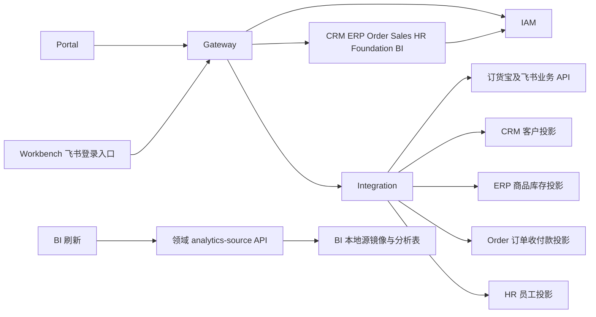

# 瑞盖项目功能与开发索引

最新六类成本实现、全系统模块审查和验收边界见 [2026-10-21 接手与验收记录](verification/PROJECT_COST_REVIEW_2026-10-21.md)。前期设计见 [2026-10-16 核对记录](PROJECT_CONTEXT_2026-10-16_COST_DASHBOARD.md)。以下日期、提交和迁移版本保留为当时快照，不代表当前部署状态。

核对日期：2026 年 10 月 14 日。本索引面向后续开发接手，说明功能用途、源码入口、服务调用和数据库操作。实现状态以本次检出的源码为依据；数据库部署、真实数据与浏览器验收需要分别核验。

## 仓库与当前基线

| 仓库 | 定位 | 本次检出 |
|---|---|---|
| `rigour-supply-chain-platform` | Java 21、Spring Boot 4.0.7、Spring Cloud 2025.1.2 后端 | `feature/cost-management`，`b7d0f96d2e6cc06af2bcb74c4b26e30b5a70d47b` |
| `rigour-supply-chain-portal` | Vue 3、TypeScript、Vite、Element Plus PC 运营后台；package 名为 `rigour-supply-chain-digital-web` | `feature/cost-management`，`e4cfacccd2afc7863cf9f98b9bef683b56fe2035` |
| `rigour-sales-workbench` | Vue 3、Vant 飞书 H5；当前以页面骨架和飞书能力适配为主 | `main`，`819b726eb647f9d3f5bcd58e8cd082d7e2dd5ff3`；相对本地缓存的 `origin/main` 落后 1 个提交 |
| `cost-management-prototype` | 独立 HTML 成本薪酬原型；内存样例，刷新恢复，不连业务接口 | 独立仓库，尚无提交 |
| `online-exam-system` | 独立考试 MVP，题库、Excel 导入、考试判分和排名 | 独立仓库，尚无提交；不依赖供应链 IAM/Gateway/Nacos |

工作目录的父 Git 根实际为用户目录，不能在瑞盖根目录执行全量 `git add`、提交、清理或回退。业务仓库分别检查。Platform 本轮开始前有 17 个未跟踪文件，包含指标完成、BI 回款状态相关源码、迁移、测试和说明；本索引不将其视为已接通的功能，不更改其暂存状态。没有重新 fetch 远程，以上是本地快照。

根 POM 递归纳入 **47 个 Maven 工程**，含聚合工程；可启动应用为 **Gateway 加 10 个领域服务**。协同、城市运营、渠道代理服务已退出代码与构建，不能继续按历史 12/13 个领域服务或 51 模块操作。工程目录与运行服务名不同，详见 [工程命名](PROJECT_NAMING.md)。

## 服务地图

| 工程 | 注册名 | 端口 | Schema | 已有实现及职责 |
|---|---|---:|---|---|
| `rg-scdp-gateway` | `rigour-api-gateway` | 26880 | 无 | 路由、JWT 校验、IAM 当前会话核验、下游身份签名 |
| `rg-scdp-iam` | `rigour-tenant-iam-service` | 26881 | `rigour_iam` | OIDC/飞书身份、用户角色、菜单、权限、数据范围、会话；员工业务档案在 HR |
| `rg-scdp-integration` | `rigour-integration-migration-service` | 26882 | `rigour_integration` | 订货宝/飞书业务采集、Raw、映射、连接器、同步编排、定时配置、导入与核对 |
| `rg-scdp-crm` | `rigour-merchant-crm-service` | 26883 | `rigour_crm` | 客户、联系人地址、地区类型、人员/成员责任归属、订单归属引用、外部客户投影 |
| `rg-scdp-erp` | `rigour-erp-core-service` | 26884 | `rigour_erp` | 商品规格价格、供应商、采购、仓库、出入库调拨、库存、营销与仓租费用 |
| `rg-scdp-order` | `rigour-order-center-service` | 26885 | `rigour_order` | 订单明细、回款退款、发货履约、资金单、发票、凭证核对、物流成本 |
| `rg-scdp-sales` | `rigour-sales-work-service` | 26886 | `rigour_sales_work` | 签到签退、定位、拜访计划及证据复核；另有服务内置临时拜访 H5 和后台 |
| `rg-scdp-ai` | `rigour-ai-agent-service` | 26887 | `rigour_ai` 为职责预留 | 当前只有启动类、配置和 package 骨架，无业务 Controller 或数据库迁移 |
| `rg-scdp-bi` | `rigour-analytics-bi-service` | 26888 | `rigour_bi` | 领域 API 源快照、分析事实、经营/销售/商品库存/人事拜访看板及对账 |
| `rg-scdp-hr` | `rigour-hr-payroll-service` | 26889 | `rigour_hr` | 员工、部门、岗位、经营目标、考勤确认、薪酬提成、报销 |
| `rg-scdp-foundation` | `rigour-business-settings-service` | 26892 | `rigour_settings` | 公共业务字典、租户覆盖、字典合并与操作审计；集中通知/文件服务仍属规划 |

每个服务是所属 Schema 的唯一业务写者。数据库共用一个实例不意味着允许业务代码跨库查询。Gateway 路由与实际服务映射见 [application.yml](../services/rg-scdp-gateway/gateway-server/src/main/resources/application.yml)。

## 功能与实现入口

以下“已有”表示存在对应源码，不表示目标环境已验收。服务内路径统一为 `services/rg-scdp-<域>/<域>-server/src/main/java/`；接口契约位于同工程的 `<域>-api`。具体类的路径索引见文末。

| 功能 | 业务用途与实现范围 | 主入口 |
|---|---|---|
| 登录与会话 | PC 使用 OIDC Authorization Code + PKCE；飞书使用一次性 code 交换平台身份；Gateway 在线核验会话和安全版本 | Portal `src/auth/oidc.ts`；IAM `AuthController`、`FeishuAuthController`；Gateway `CurrentTokenValidationFilter` |
| 用户角色与菜单 | 维护供应链成员、角色、按钮/API 权限及数据范围；导航来自 IAM，页面路由是承载入口 | IAM `IamAppMemberController`、`IamAppRoleController`、`ScdpNavigationController`；Portal `navigation.ts`、`supply-authorization.ts` |
| 客户及地址 | 维护客户基础资料、联系人、客户类型、地区和收货地址，支持来源绑定、同步和内部客户资料 | `CrmInternalCustomerService`、`CrmCustomerQueryService`；`/api/v1/crm/internal-customers` |
| 客户责任与交易归属 | 维护销售员工/应用成员责任和变更记录，为订单提供归属引用；人员查询依赖 HR，成员资格依赖 IAM | `CustomerResponsibilityService`、`CustomerMemberResponsibilityService`、`CustomerOrderAttributionService` |
| 商品主数据 | 商品、SKU、规格值、品牌、分类、标签、图片、单位及统计单位；名称与稳定编码分开 | `ErpProductManagementService` 及 product 目录；`/api/v1/erp/product-management/products` |
| 商品价格 | 按客户类型维护商品规格价格；采购参考价不能当作实际历史出库成本 | `ErpCustomerTypePriceService`；`/api/v1/erp/customer-type-prices` |
| 供应商及采购 | 供应商资料、采购订单和明细、来源同步；采购单与入库业务分开 | `ErpSupplierProfileService`、`ErpProcurementOrderService` |
| 库存业务 | 仓库、库存余额与流水、入库/出库、调拨及其状态；库存变动由 ERP 本地事务落库 | `ErpStockInOrderService`、`ErpStockOutOrderService`、`ErpTransferOrderService`、`ErpStockBalanceService` |
| 订单与明细 | 本地销售订单创建/编辑/提交/取消、来源状态与数据质量、商品修复、销售归属核对；人工状态和外部来源事实分开 | `OrderSalesOrderService`、`OrderProductRepairService`；写契约 `/api/v1/orders/sales` |
| 订单列表与统计 | 运营台账聚合订单、明细、回款、应收、单号映射及期间统计；不是每次打开页面实时查询订货宝 | `OrderRegisterService`；`/api/v1/orders/register`；Portal `OrderListView.vue` |
| 出库与履约 | 订单选仓，记录执行意图，ERP 核验并扣库，再回写执行回执；未知执行结果可重试核对 | `OrderFulfillmentService`、`ErpOrderExecutionService` |
| 发货与收退款 | 发货单、逐笔回款、销售退款和客户资金单；保留来源单号、状态、经办人员及附件 | `OrderSalesShipmentService`、`OrderSalesPaymentRecordService`、`OrderSalesRefundRecordService`、`OrderFundDocumentService` |
| 发票与凭证核对 | 申请发票、上传附件、完成/撤回；付款凭证检查、审计与排除管理 | `OrderInvoiceService`、`PaymentVoucherService`、`PaymentVoucherAuditService` |
| 物流成本 | 手工关联采购/调拨/订单配送来源，维护运费、承运方、承担方、确认和作废；金额空值和零不同 | **Order** `OrderLogisticsCostService`；`/api/v1/orders/logistics-costs`；表 `order_logistics_cost` |
| 营销成本 | 按事项、类型、城市、经办员工、日期、金额和付款状态登记，确认/作废和审计 | **ERP** `ErpCostService`；`/api/v1/erp/costs/marketing`；表 `erp_cost_entry` |
| 仓库租赁成本 | 关联仓库，登记面积、合同号、租期、押金与本次费用；不等同于完整租赁会计引擎 | **ERP** `ErpCostService`；`/api/v1/erp/costs/warehouse-rentals` |
| 员工报销 | 员工费用登记、报销类型、归属和确认/作废；营销与报销采用不同字典 | **HR** `HrExpenseService`；`/api/v1/hr/expenses`；表 `hr_expense` |
| 人事主档 | 员工、任职档案、部门树、岗位、薪酬资料和外部员工绑定；IAM 登录用户不是员工主档 | `HrEmployeeService`、`HrOrganizationService`、`HrPositionService`、`HrDhbBindingReviewService` |
| 经营目标 | 按月、城市/销售维护交易额、到账额、接触门店、下单门店和杨掌柜销售额目标；修订原因、版本及历史 | `TargetSettingsService`；`/api/v1/hr/target-settings`；当前仍有默认目标逻辑 |
| 考勤规则 | 按月设置公司默认或部门应出勤；不继承上级部门或其他月份；确认员工后锁定相关规则 | `HrAttendanceService`；`hr_attendance_rule`、`hr_attendance_month_lock` |
| 员工考勤 | 员工、规则、Sales 打卡日期实时组合；人工调整 0.5 天粒度，确认冻结依据；缺失保留未知 | `/api/v1/hr/attendance`；`hr_attendance_note`、`hr_attendance_audit`；当前没有撤销确认或自动扣薪 |
| 薪酬规则 | 商品按 SKU、角色、部门、生效期维护固定数量提成或回款金额比例；城市总支持团队比例、独立标准及本人销售配置 | `HrPayrollService`；`hr_payroll_rule`；Portal `PayrollRuleView.vue` |
| 月度薪酬 | 准备、预览、核算、确认、发放登记、撤回/补差；全额回款后一次计提，缺资料待核对；确认前校验来源指纹 | `HrPayrollService`、`HrPayrollWorkflowService`；`hr_payroll`、`hr_payroll_payment`、`hr_payroll_correction` |
| 销售外勤 | 平台签入/签出、工作日、轨迹、拜访计划、录音照片、有效性判定和主管复核；不直接写 HR 正式考勤 | `SalesWorkAttendanceService`、`SalesWorkVisitService`、`SalesWorkVisitAssessmentService` 等 |
| 临时拜访 H5 | Sales 内置 `/sales-checkin`，含身份验证、搜索定位、照片/录音、提交记录、后台复核与导出；开关控制启用 | `sales-server` 的 `temporarycheckin` 包和 `static/sales-checkin`，不是独立 Workbench 仓库 |
| 订货宝同步 | 连接器、页级/业务链同步、后台任务、租约、Raw、游标、映射、错误重试和核对 | `DhbSyncOrchestrationService`、`DhbOrderSyncService`、`DhbPageSyncJobService`、`DhbScheduleService` |
| 飞书导入与核对 | xlsx 批次预检、原始行、模板依赖、异步投影、问题明细、附件 COS；另有来源抓取与对账证据 | `FeishuImportBundleService`、`FeishuImportAsyncRunService`、`FeishuReconciliationService` |
| BI 分析 | 总览、城市经营、销售/到账、客户、商品库存、员工、拜访、城市商品报表与供应明细；带数据范围、刷新批次和核对 | `SupplyDashboardQueryService`、`OperatingWorkspaceService`、`CityProductReportService`、各 Analytics 服务 |
| 业务字典 | 字典及层级条目、有效选项/历史展示解析、租户覆盖、来源值补齐、合并及审计 | `BusinessDictionaryService`、`JdbcTenantDictionaryRepository`；`data_dictionary`、`data_dictionary_item` |

成本共用 Portal `CostManagementView.vue`，但 [cost.ts](../../rigour-supply-chain-portal/src/api/core/cost.ts) 按类别分流到 Order、ERP、HR。菜单归属不能用来判断数据库归属。

### 页面存在但功能尚未接通的范围

Portal [routes.ts](../../rigour-supply-chain-portal/src/router/routes.ts) 中未命中专用页面的业务目录落到 `CapabilityView.vue`。当前包括供应商商品/价格、采购申请/退货、库存盘点/部分库存分析、采购结算成本、独立门店/归属/信用政策页面、任职调动和部分业务规则菜单。采购付款明确使用 `PurchasePaymentPlaceholderView.vue`。相关表或内部接口存在，不等于对应操作页面已完成。

Sales PC 入口 `IndexView.vue` 实际接入管控台、拜访计划、主管复核和定位轨迹对比；其他 pageKey 显示“功能暂未开放”。独立 Workbench 的配送页是空列表结构，拜访页主要演示录音适配，没有完整拜访提交闭环；不要把 Sales 服务内置临时 H5 的能力归到 Workbench。

2026-10-21 补充：新成本看板使用独立 `CostSourceDatasets`，接入 ERP 成本、Order 物流、HR 报销及已确认薪酬源，经 BI 本地快照汇总；`bi_city_cost_record` 旧城市成本与演示值不混入新口径。代码与隔离测试状态见最新验收记录，不能据此认定目标环境已上线。商品估算成本、费用单据和完整经营利润仍不能等同。

## 服务如何调用



1. **身份与入口**：Portal OIDC 登录后请求 Gateway；网关校验 JWT，再向 IAM 核验当前会话，清理浏览器自填 `X-Rigour-*` 并生成 HMAC 签名上下文。领域服务验签、取租户、校验动作权限，再叠加数据范围。前端隐藏按钮不能替代服务端授权。内部服务调用可以直接经服务发现到对端，携带签名 SERVICE 或转发的合法调用人上下文，不需要绕回网关。
2. **寻址**：Gateway 使用 `lb://rigour-...`；领域 HTTP 客户端注入 `RestClient.Builder`，由公共 `ServiceAddressResolver` 解析 Nacos 服务实例。显式 IP/localhost/外部域名按原地址请求，不能假设 local profile 自动把内部服务都改为本机。服务名不存在时应查 namespace、实例健康及日志。
3. **订货宝**：Portal → Integration 同步中心 → 连接器/租约/任务编排；CRM/ERP 内部同步用例通过 Integration 查询契约取得外部数据并写本域。订单映射与采集在 Integration 的 `DhbOrderSyncService`，由 Order 投影 API 写订单；不用旧文档中的 Order 自带定时拉取流程。第三方来源状态与内部人工单据状态分开，幂等键、Raw 和核对记录用于重放。
4. **飞书**：预检保存批次和原始行 → 按模板依赖准备字典、人员、商品、客户 → 调 HR/ERP/CRM/Order 投影 → 外部附件下载上传 COS，领域保存 fileKey，读取时签名。预检成功不表示正式投影或附件处理成功。
5. **订单出库**：Order `prepare` 保存执行意图及版本 → 先读 ERP 回执，存在则复用 → 否则 ERP 回调 Order `claim` 验证当前意图/权限 → ERP 本地执行出库与库存事务 → Order 校验 executionId/orderId 并 `complete`。失败标记“结果尚未确认”，通过回执重查恢复；不宣称是一个跨库事务。
6. **人员与权限引用**：IAM → HR 员工、CRM/ERP/HR 授权引用；CRM → HR 人员及 IAM 成员资格；Order → CRM 城市/订单归属、HR 人员展示、ERP 履约。这些均通过 API，不能跨库 JOIN。
7. **薪酬与考勤**：HR → ERP 商品分类/SKU → Order 订单提成与回款事实 → Sales 薪酬证据；考勤另走 Sales `/api/v1/sales/attendance-evidence`。打卡日期和有效拜访是不同口径。Foundation 提供请假类型、费用类型等字典。
8. **成本**：Order 物流通过 ERP 取采购/调拨引用并结合本域配送数据；ERP 营销读取 HR 员工、仓租读取 ERP 仓库；HR 报销读本域员工和 Foundation 字典。各域持有自己的状态、版本和审计。
9. **BI**：通过 CRM/ERP/Order/HR/Sales/Integration 的 `analytics-source` 契约取版本和分页数据，校验列集合、tenant、游标及前后版本，事务发布到 `bi_source_*`；再刷新分析事实与维度。展示主要查 BI 本库，部分目标、权限、商品图片和修复证据经专用 API 读取。目标仍由 HR 持有，BI 不写回业务事实。

第三方集中到 Integration 是业务采集的规则，但当前代码有需要认清的例外：IAM 的飞书登录身份提供方直接访问飞书；Sales 含高德定位与腾讯 AI/媒体相关适配，且临时 H5 有独立入口。不能声称所有外部请求都已集中到 Integration，也不能声称已有完整独立 AI 服务。

## 代码实现规范

- 服务内遵循入站 `api/interfaces → application → domain/port`，`infrastructure` 实现端口；当前包名同时存在 `api` 和 `interfaces`，不要机械改目录。领域模型不依赖 Spring、数据库或其他服务实现。
- 跨服务只能依赖 `*-api` 或不含领域实现的 `*-client`，禁止依赖其他 `*-server`。`shared` 只承载最小公共契约；audit/outbox/cache/file/idempotency 按需引入，依赖了库不代表已经完成持久化或投递。
- 持久层实际混用 MyBatis-Plus 与 JDBC。新增薪酬、考勤、费用等已有 Entity/Mapper/Store 模式应沿用；复杂 SQL 放 Mapper/Provider 或本域既有仓储，不能在 Controller 拼库查询。不要把“全项目已统一 MyBatis-Plus”当作事实。
- 业务规则在后端校验；写入显式限制 tenant、数据范围与版本，幂等使用请求号/来源业务键，审计与业务写入保持本域事务一致。失败重试需要可核对回执，不凭注解推断已实现。
- HTTP 统一 `/api/v1`、`ApiResponse`、稳定错误码与 requestId。内部接口也要验签和权限；内部路径不等于免鉴权。错误按当前 `HTTP_ERROR_CONTRACT_2026-09-24.md` 接入。
- 金额和数量使用既有 DECIMAL/BigDecimal 精度，不能用浮点做核算。缺资料、零、估算分开；业务月份使用 Asia/Shanghai，事实时间按 UTC 存取，日期字段遵守所属领域契约。
- 数据模型存在 BIGINT、自增键、BINARY UUID、字符串 UUID、`revision` 与 `version` 等历史差异。先看真实迁移及 Mapper，不能机械套用旧数据库规范统一改表。外部名称不能替代人员、SKU、单位等稳定编码。
- 字典使用已有字典编码与值，不在 UI 重复硬编码；自研业务编码和外部映射分开。字典编码修改、合并与历史展示使用所属服务规则。
- Portal 手写 API 在 `src/api/core`，生成契约在 `src/api/generated`，契约变更优先修源并重新生成。复用公共样式和权限 store，前端只做展示、交互与输入校验。
- Portal Access/ID Token 按当前规范只存内存。Workbench 当前仍有 localStorage Token 实现，这是现状差异，不能宣称两个前端均已统一安全实现；后续修改 Workbench 应单独核对。
- 飞书 JSAPI 只走 Workbench adapter。实际路由为 Hash Router，旧 AGENTS 写的 `createWebHistory` 已与源码不同。
- 不提交业务导出、密钥或构建产物；新建项目文件按用户要求精确 `git add`。不 reset、clean、覆盖已有改动或把其他任务的文件一起暂存/提交。

## 数据库怎么操作

### 配置与环境

本次源码默认 DEV 数据源为 `192.168.12.7:13306`，各域使用自己的 `rigour_*` 库和 DEV `root` 数据源；密码按现行 AGENTS 存于服务 `application-dev.yml`，本索引和记忆不复制密码。Nacos 为 `192.168.12.7:18848`，默认 namespace ID 为 `3aa03547-8948-4254-bd94-47c630db128b`，可由 `NACOS_NAMESPACE` 覆盖。

当前 DEV YAML **启用 Nacos 配置导入和服务注册**，导入 `rigour-common.yml` 与 `${spring.application.name}.yml`；`local` 导入 DEV 后再覆盖。旧运行手册的“关闭 Nacos 配置、不注册、本机 IP 直连”已经过期。实际连接还会受 Nacos、启动参数、环境变量覆盖，执行前看最终生效配置，不能仅凭文件默认值判断目标。

DEV/local 启动 9 个有迁移的服务会自动执行 Flyway，因此“只启动看一下”也可能改共享数据库。BI local 还把刷新开关默认打开；后台同步、刷新与媒体任务应逐项检查，不能照旧文档认为全关。Gateway/AI 没有业务迁移；生产 Flyway 保持关闭，升级由独立流程执行。

### 只读核对

有 MySQL 客户端时，在可信终端交互输入凭据，明确选定库；以下是模板，不代表已执行：

```bash
mysql --host=192.168.12.7 --port=13306 --user=root --password rigour_order
```

```sql
SELECT @@hostname, @@port, DATABASE(), CURRENT_USER(), VERSION();
SELECT @@session.sql_mode, @@session.time_zone, @@global.time_zone;
SELECT @@character_set_database, @@collation_database;
START TRANSACTION READ ONLY;
SELECT installed_rank, version, description, type, script, checksum, success
FROM flyway_schema_history ORDER BY installed_rank;
SELECT table_name, table_collation
FROM information_schema.tables WHERE table_schema = DATABASE();
COMMIT;
```

查业务数据前先 `SHOW CREATE TABLE`，确认租户与主键类型，再按 tenant、业务单号和有限行数查询。BINARY UUID 应按该表既有转换方式处理。开发管理员账号权限大，不代表可以绕过领域接口修改业务状态。

### 迁移与维护

1. 检查目标服务、最终数据库地址、Git 状态、Flyway history、待执行迁移及相关写入影响。
2. 已执行 `V` 迁移不改、不删；新增迁移推进。新库使用冻结 `db/bootstrap/B*__general_ci_bootstrap.sql`，已有库继续校验 V 历史。B 基线不是 `baseline-on-migrate`。
3. 保持 `validate-on-migrate=true`、`baseline-on-migrate=false`、`clean-disabled=true`、`out-of-order=false`。失败停启动；不删除历史表、不关闭校验、不用 repair 掩盖冲突。
4. 新数据库、表及字符列统一 `utf8mb4` / `utf8mb4_general_ci`。冻结历史和清单中的旧迁移例外不能改写；存量排序规则转换须使用独立维护流程，不是改数据库默认值就结束。
5. 在 Platform 根执行 `python3 scripts/database/prepare-general-ci-baselines.py --check`。本轮通过：9 个冻结 B 基线、340 个历史 V 文件保持不变，后续迁移排序规则符合要求。
6. `scripts/run-service-flyway-migrations.sh` 默认是 **migrate**，且默认地址仍是旧的 `82.157.4.176`；不能裸跑。只读查看应显式指定 `ACTION=info`、`SERVICES`、`DB_HOST`、`DB_PORT`。脚本虽支持 repair，不改变当前禁止以 repair 绕过问题的规范。
7. 维护脚本、重建/清空脚本只是工具，不代表本任务授权执行。库表变更、数据修复要有具体目标、范围、备份恢复与验证方式；业务事实优先通过所属领域接口更新。

当前源码迁移上限：IAM V132（含小版本文件）、Integration V27、CRM V27、ERP V37、Order V54、Sales V27、HR 已提交 V18 加未跟踪 V19、BI 已提交 V25 加未跟踪 V26、Foundation V38。**这些不是数据库已执行版本。**本轮没有连接数据库、启动服务、执行迁移或修改业务数据；本机默认 PATH 未找到 mysql，默认 Python 也未发现 MySQL 客户端库。

## 当前文档与源码差异

| 材料或旧说法 | 本次确认 |
|---|---|
| 根 handoff、Platform handoff 中的分支、旧模块路径、旧迁移版本与验收结果 | 历史记录，不作为当前环境状态 |
| README 仍称多数领域为骨架 | CRM/ERP/Order/HR/BI 已有大量业务代码；AI 才是明确的空业务骨架 |
| 旧运行手册要求独立 DEV app/migrator、关闭 Nacos | 当前 DEV 统一数据源运行 Flyway，Nacos 配置和注册开启 |
| Integration README 建议启动参数执行 repair | 与当前 AGENTS 冲突，不照抄执行 |
| 旧成本方案把物流和报销都规划到 ERP | 当前物流在 Order，报销在 HR，营销仓租在 ERP |
| `TARGET_PERFORMANCE.md` 称当前在指标分支、已具备完成值和整单绩效 | 当前实际为 cost-management；`HrTargetSettingsApi` 无 completions 接口，`TargetSettingsService` 无 PERFORMANCE_AMOUNT，BI 已接入数据集无 ORDER_PAYMENT_STATUS；存在未跟踪文件，不代表完整功能 |
| Portal/Workbench 有菜单就视作可用功能 | 多个页面仍是占位或能力演示，应核对路由组件和 API |
| 旧数据库规范全部 UUIDv7、统一字段 | 真实表已有不同主键/版本/审计字段，修改以对应迁移与仓储为准 |
| Foundation 是通用调度、通知、文件服务 | 当前主体是字典；同步调度实际在 Integration，业务文件适配仍分属领域 |

## 验证与后续开发入口

文档和索引变更无需启动服务或运行全量业务测试。后续修改按影响验证：

```bash
# Platform 根；跨模块定向测试带 -am，防止使用本地旧 API 包
./mvnw -pl services/rg-scdp-hr/hr-server -am \
  -Dtest=HrAttendanceServiceTest -Dsurefire.failIfNoSpecifiedTests=false test
./mvnw verify

# Portal 根
pnpm typecheck
pnpm test:run
pnpm build

# Workbench 根
pnpm lint
pnpm typecheck
pnpm test
pnpm build
```

Docker/Testcontainers 跳过不能算数据库测试通过；源码检查、编译测试、服务启动、数据库迁移、登录页面与业务对账分别记录。本次只执行源码/配置核对、数据库基线静态校验及文档检查。

开发前依次定位：Portal routeKey 和组件 → `src/api/core` 路径 → Gateway route → 提供方 API/Controller → application 用例 → port/仓储/Mapper → 本域迁移与权限。跨域修改再检查相关调用方、错误码、租户/数据范围、幂等和回执。

规范入口：[AGENTS](../AGENTS.md)、[团队协作](TEAM_DEVELOPMENT_GUIDE.md)、[服务边界](SERVICE_BOUNDARIES.md)、[工程命名](PROJECT_NAMING.md)、[数据库排序规则](DATABASE_COLLATION_POLICY.md)、[领域授权](DOMAIN_AUTHORIZATION_GUIDE.md)。文档与源码冲突时记录差异并遵守当前明确规范，不把实现偏差静默当成新规范。

## 关键源码路径

下面的索引用于从本说明跳到具体实现；完整 API 面由各服务 API 模块和 Controller 共同组成。

| 范围 | 入口 |
|---|---|
| 网关和寻址 | [CurrentTokenValidationFilter](../services/rg-scdp-gateway/gateway-server/src/main/java/com/rigour/gateway/security/CurrentTokenValidationFilter.java)、[TrustedContextFilter](../services/rg-scdp-gateway/gateway-server/src/main/java/com/rigour/gateway/security/TrustedContextFilter.java)、[ServiceAddressResolver](../platform/rigour-platform-starter/src/main/java/com/rigour/platform/http/ServiceAddressResolver.java)、[OutboundContextHeaders](../shared/shared-context/src/main/java/com/rigour/shared/context/OutboundContextHeaders.java) |
| IAM | [IamAppMemberController](../services/rg-scdp-iam/iam-server/src/main/java/com/rigour/tenant/iam/api/controller/management/IamAppMemberController.java)、[IamAppRoleController](../services/rg-scdp-iam/iam-server/src/main/java/com/rigour/tenant/iam/api/controller/management/IamAppRoleController.java)、[ScdpNavigationController](../services/rg-scdp-iam/iam-server/src/main/java/com/rigour/tenant/iam/api/controller/management/ScdpNavigationController.java)、[HttpAppEmployeeClient](../services/rg-scdp-iam/iam-server/src/main/java/com/rigour/tenant/iam/infrastructure/persistence/settings/HttpAppEmployeeClient.java) |
| 集成 | [DhbSyncOrchestrationService](../services/rg-scdp-integration/integration-server/src/main/java/com/rigour/integration/application/service/dhb/DhbSyncOrchestrationService.java)、[DhbOrderSyncService](../services/rg-scdp-integration/integration-server/src/main/java/com/rigour/integration/application/service/dhb/DhbOrderSyncService.java)、[DhbPageSyncJobService](../services/rg-scdp-integration/integration-server/src/main/java/com/rigour/integration/application/service/dhb/DhbPageSyncJobService.java)、[DhbScheduleService](../services/rg-scdp-integration/integration-server/src/main/java/com/rigour/integration/application/service/dhb/DhbScheduleService.java)、[FeishuImportBundleService](../services/rg-scdp-integration/integration-server/src/main/java/com/rigour/integration/application/service/feishu/FeishuImportBundleService.java)、[FeishuImportAsyncRunService](../services/rg-scdp-integration/integration-server/src/main/java/com/rigour/integration/application/service/feishu/FeishuImportAsyncRunService.java)、[FeishuAttachmentImportService](../services/rg-scdp-integration/integration-server/src/main/java/com/rigour/integration/application/service/feishu/FeishuAttachmentImportService.java) |
| 客户 | [CrmInternalCustomerService](../services/rg-scdp-crm/crm-server/src/main/java/com/rigour/merchant/application/service/CrmInternalCustomerService.java)、[CustomerResponsibilityService](../services/rg-scdp-crm/crm-server/src/main/java/com/rigour/merchant/application/service/CustomerResponsibilityService.java)、[CustomerMemberResponsibilityService](../services/rg-scdp-crm/crm-server/src/main/java/com/rigour/merchant/application/service/CustomerMemberResponsibilityService.java)、[CustomerOrderAttributionService](../services/rg-scdp-crm/crm-server/src/main/java/com/rigour/merchant/application/service/CustomerOrderAttributionService.java) |
| 商品库存 | [ErpProductManagementService](../services/rg-scdp-erp/erp-server/src/main/java/com/rigour/erp/application/service/product/ErpProductManagementService.java)、[ErpProcurementOrderService](../services/rg-scdp-erp/erp-server/src/main/java/com/rigour/erp/application/service/supply/ErpProcurementOrderService.java)、[ErpStockInOrderService](../services/rg-scdp-erp/erp-server/src/main/java/com/rigour/erp/application/service/inventory/ErpStockInOrderService.java)、[ErpStockOutOrderService](../services/rg-scdp-erp/erp-server/src/main/java/com/rigour/erp/application/service/inventory/ErpStockOutOrderService.java)、[ErpOrderExecutionService](../services/rg-scdp-erp/erp-server/src/main/java/com/rigour/erp/application/service/inventory/ErpOrderExecutionService.java) |
| 订单 | [OrderSalesOrderService](../services/rg-scdp-order/order-server/src/main/java/com/rigour/order/application/service/sales/OrderSalesOrderService.java)、[OrderRegisterService](../services/rg-scdp-order/order-server/src/main/java/com/rigour/order/application/service/sales/OrderRegisterService.java)、[OrderFulfillmentService](../services/rg-scdp-order/order-server/src/main/java/com/rigour/order/application/service/sales/OrderFulfillmentService.java)、[OrderSalesPaymentRecordService](../services/rg-scdp-order/order-server/src/main/java/com/rigour/order/application/service/sales/OrderSalesPaymentRecordService.java)、[OrderInvoiceService](../services/rg-scdp-order/order-server/src/main/java/com/rigour/order/application/service/sales/OrderInvoiceService.java) |
| 成本 | [OrderLogisticsCostService](../services/rg-scdp-order/order-server/src/main/java/com/rigour/order/application/service/cost/OrderLogisticsCostService.java)、[ErpCostService](../services/rg-scdp-erp/erp-server/src/main/java/com/rigour/erp/application/service/cost/ErpCostService.java)、[HrExpenseService](../services/rg-scdp-hr/hr-server/src/main/java/com/rigour/hr/application/service/HrExpenseService.java) |
| 人事 | [HrEmployeeService](../services/rg-scdp-hr/hr-server/src/main/java/com/rigour/hr/application/service/HrEmployeeService.java)、[HrAttendanceService](../services/rg-scdp-hr/hr-server/src/main/java/com/rigour/hr/application/service/HrAttendanceService.java)、[HrPayrollService](../services/rg-scdp-hr/hr-server/src/main/java/com/rigour/hr/application/service/HrPayrollService.java)、[HrPayrollWorkflowService](../services/rg-scdp-hr/hr-server/src/main/java/com/rigour/hr/application/service/HrPayrollWorkflowService.java)、[TargetSettingsService](../services/rg-scdp-hr/hr-server/src/main/java/com/rigour/hr/application/service/TargetSettingsService.java) |
| 销售 | [SalesWorkVisitAssessmentService](../services/rg-scdp-sales/sales-server/src/main/java/com/rigour/sales/application/service/SalesWorkVisitAssessmentService.java)、[SalesAttendanceSourceService](../services/rg-scdp-sales/sales-server/src/main/java/com/rigour/sales/application/service/SalesAttendanceSourceService.java)、[TemporaryCheckinController](../services/rg-scdp-sales/sales-server/src/main/java/com/rigour/sales/temporarycheckin/TemporaryCheckinController.java) |
| 分析 | [SupplyDashboardRefreshService](../services/rg-scdp-bi/bi-server/src/main/java/com/rigour/analytics/application/service/SupplyDashboardRefreshService.java)、[HttpBiSourceSnapshotClient](../services/rg-scdp-bi/bi-server/src/main/java/com/rigour/analytics/infrastructure/integration/HttpBiSourceSnapshotClient.java)、[BiSourceDatasets](../services/rg-scdp-bi/bi-server/src/main/java/com/rigour/analytics/infrastructure/persistence/scope/BiSourceDatasets.java)、[BiSourceSnapshotProjector](../services/rg-scdp-bi/bi-server/src/main/java/com/rigour/analytics/infrastructure/persistence/scope/BiSourceSnapshotProjector.java)、[SupplyDashboardQueryService](../services/rg-scdp-bi/bi-server/src/main/java/com/rigour/analytics/application/service/SupplyDashboardQueryService.java)、[HttpHrTargetClient](../services/rg-scdp-bi/bi-server/src/main/java/com/rigour/analytics/infrastructure/integration/HttpHrTargetClient.java) |
| 字典 | [BusinessDictionaryService](../services/rg-scdp-foundation/foundation-server/src/main/java/com/rigour/settings/application/service/BusinessDictionaryService.java)、[JdbcTenantDictionaryRepository](../services/rg-scdp-foundation/foundation-server/src/main/java/com/rigour/settings/infrastructure/persistence/repository/JdbcTenantDictionaryRepository.java) |

## 法定工作日历（2026-10-20 实现与开发环境验收）

- Foundation 从中国政府网公开政策检索页面的数据请求发现年度通知，再读取政府站点公告正文；这是网页采集，不是政府承诺对外开放的节假日专用 API。运行时不依赖第三方节假日镜像，也不内置年度放假日期。检索地址配置为 `rigour.settings.calendar.government-search-url`，默认 `https://sousuo.www.gov.cn/search-gov/data`，仅允许政府 HTTPS 站点。
- `StatutoryNoticeParser` 校验标题、国务院办公厅文号、完整节日覆盖、日期跨度、公布天数和日期冲突；结构变化、无法识别或取数失败不得替换旧日历。年度公告原文、来源链接、解析日期和内容版本通过 MyBatis-Plus 保存到 `settings_statutory_calendar_year`，内容变更另存不可变历史；这是 `GLOBAL` 公共配置，不是租户业务事实。首次发布须执行 Foundation 新增迁移 `V43__statutory_calendar_snapshots.sql`。
- Foundation 启动 30 秒后及每 6 小时刷新已使用年份、上年、当年和下一年；首次读取缺失年份按需同步。`rigour.settings.calendar.initial-delay-ms`、`refresh-delay-ms` 可配置调度；数据库每年刷新尝试间隔固定为 6 小时，多实例使用租约避免重复写入。未检索到公告返回 `NOT_PUBLISHED`，不猜测未来安排；失败保留最近成功数据并返回过期提示。下一年度公告涉及上一年 12 月的日期会合并进上一年度日历。
- Portal 与 HR 经 `/api/v1/business-settings/statutory-calendars/{year}` 读取同一份全年日历，沿用 `business-settings:dict:read`；HR 使用可信服务签名。新规则默认 `STATUTORY` 自动跟随，保存的 `workDays/restDays` 仅为人事人工覆盖，优先于法定安排；历史 `source=null/MANUAL` 规则保留原安排，不静默重写。大小周仍由人事在月历手动设置。
- HR 应出勤与薪酬计算都解析该年度基准；缺失基准时阻止自动计算，不能回退为旧默认天数。薪酬计算快照保存 `STATUTORY_SNAPSHOT` 与年度版本，后续公告变化影响未确认计算指纹，已确认历史仍保留快照。
- 验证应区分：离线公告/跨年/错误输入测试、隔离 H2 的 MyBatis-Plus 与历史保存测试、显式启用 `-Drigour.calendar.live-test=true` 的政府站点只读联网测试，以及真实 MySQL 迁移/服务启动/登录页面验收。后面三项部署验收未由本地单元测试替代。
- 2026-10-20 实际修复：Portal 请求此前仍命中 09:58 启动的 Foundation 旧进程，新日历接口返回 404；开发库 `192.168.12.7:13306/rigour_settings` 仅到 V42。先核对有效 `dev,local` 配置、Nacos `ethan-local` 唯一服务实例及历史迁移校验，再编译并仅重启 Foundation。15:49 启动的新进程由 Flyway 将数据库迁移至 V43，事后校验无待执行迁移。
- 真实数据验收：启动后的定时任务自动获取政府公告，2025、2026 年状态为 `AVAILABLE`，分别保存 33、39 条公告日期例外、公告正文、政府来源链接和各 1 条历史版本；2027 年为 `NOT_PUBLISHED`，无虚构日期。MySQL 只读查询确认已经落库，不能把这些例外条数当作全年工作日或休息日总数。
- 登录页面验收：经当前 Portal/Gateway 实际打开新增考勤规则，2026 年 10 月显示工作日 18 天、休息日 13 天，1—7 日放假、10 日补班；将 10 日手动改休息后为 17/14，恢复本月法定安排后为 18/13。切换到 2025 年可见 10 月 8 日仍放假、11 日补班；切换到 2027 年显示尚未公布并禁止编辑未知安排。未保存测试规则、未修改既有考勤或工资。截图位于 Portal `docs/qa/attendance-calendar/statutory-live-2026-10-20.png`；本次未执行薪酬确认、重算或生产环境部署。

## 城市总绩效关联补齐（2026-10-20）

- 城市总 `ACTUAL_COMPLETION` 的五个标准指标通过 `cityMetric` 关联城市月度经营目标；按员工管辖城市、实际任期、入离职和保护期归集。同一城市重复任职、缺少目标或目标不唯一时标记待核对，不用个人目标、其他城市或上月目标补零。CRM 城市编码与 HR 部门编码不同时，仅接受唯一的规范化城市名称匹配；计算证据保留各城市目标修订和折算过程，参与确认指纹。
- 城市“回款额”实际值来自 Order 新增可信服务接口 `/api/v1/orders/cost-sources/city-collections`，按到账日期和冻结城市归属汇总该期全部有效回款记录，包含未整单付清订单已到账款项；退款单列，不自动冲减回款额。销售人员业绩、等级与提成的整单付清口径不变。城市销售总额可读取订单来源；建联门店数、有效门店数、品牌销售额没有在本轮新增可靠的自动来源，仍由 HR 核定实际值并填写依据，不能拿城市销售额或回款额替代门店数。
- 城市目标已按任期和保护期折算后，绩效计算器不再重复折算目标。现行口径支持按指标选择实际完成率或 HR 配置的阶梯计分，再按权重求和；综合层不二次映射阶梯，保护期内按既有规则 100% 计入。薪资金额依员工档案配置：见习底薪 8000、绩效基数 4000；正式底薪 8000、绩效基数 8000。试用结束日期和 80% 比例须维护；试用期仅底薪折为 6400，绩效基数不打八折。这些金额没有按身份硬编码，也未批量改写现有员工档案。
- 验证：HR/Order 共 8 类定向测试 63 项通过、无跳过；Portal 相关测试 22 项、类型检查、相关 lint、生产构建通过。H2 覆盖到账期间、原冻结城市、退款单列及租户隔离。真实 DEV 只读签名调用核对 9 月某城 90 条有效回款，与本域数据库金额、记录数一致；随机其他租户为空，未签名请求返回 403。未确认、撤销确认、发放或重算真实工资。
- 运行：校验 HR/Order 实际数据库 Flyway 历史、无待执行迁移后，更新本地 `dev,local` 服务，保留 `ethan-local` 注册空间，订单 26885、HR 26889 健康检查和 Nacos 注册正常。本轮没有数据库迁移。Nacos 前期诊断误用了未被当前 YAML 引用的 `NACOS_PASSWORD`；改用实际生效凭据后认证、配置读取和实例查询成功，未修改 Nacos 或切换环境。页面新增指标关联与实际回款来源已验证，截图在 Portal `docs/qa/city-manager-performance/city-target-link-2026-10-20.png`，未保存测试规则；完整真实薪酬业务验收及生产部署仍未执行。

## HR 可配置单项计分与统一个人薪酬核定（2026-10-20）

- `PayrollMetricDefinition.scoringMode` 可为 `ACTUAL` 或 `TIERED`，为空保留历史实际完成率算法，不激活过去未使用的单项区间。HR 在每项城市总指标内维护完成率区间、线性/固定取值方式和系数；前端提供 0—100%、100—150%、150—200%、200% 以上的可编辑示例，系数只在保存的规则 JSON 中取值，计算器没有硬编码 1、1.2、1.5。区间必须从 0 连续覆盖至无上限，端点不能重复；缺失、重叠或无有效匹配时阻止确定绩效金额。
- 计算顺序为：实际值 ÷ 当期目标 → 按该单项规则计分 → 计分系数 × 权重 → 汇总发放比例 → 绩效基数及保护期折算。原始加权完成率与计分后发放比例分开保存，单项完成率、系数、加权贡献在页面及 Excel 中展示；历史全局 `TIERED` 算法保留。已保存规则不自动切换，新建指标默认提供可编辑阶梯，实际采用何种方式由 HR 保存规则决定。
- 总部固定绩效继续按 `tenant_id + employee_code + payroll_month` 独立核定完成率，再按个人绩效基数及折算政策计算；不使用部门共用完成率。月度薪酬列表直接展示“核定薪酬”，详情和绩效页入口均打开同一面板。面板集中展示本人的月度完成率、人工指标、提成调整、底薪、最终绩效、补贴、扣款和统一核定说明；金额留空按规则，明确填写时覆盖本人的当月金额。
- 新增 `PUT /api/v1/hr/payroll/determinations/{month}/{employeeCode}`，输入为独立文件模型 `PayrollDeterminationCommand`，返回 `PayrollDeterminationView`。应用事务同时调用现有金额核定与月度事实保存，沿用权限、租户、员工范围、版本校验及审计；任何一步冲突整体回滚，统一采用金额核定说明。成功后单独调用既有重算流程；来源失败保留已核定内容、提示重算失败，不能显示已确认。HR 核对最终结果后仍须明确确认薪酬，已确认/发放结果沿用撤回或补差流程。
- 验证：9 类后端定向测试共 85 项通过，无跳过，覆盖分档边界、自定义系数、历史兼容、保护期加权、规则校验、JSON 保存回读、同部门员工不同完成率、按人/月/租户隔离，以及统一核定事务回滚。Portal 4 类相关测试 27 项、类型检查、相关 lint 和生产构建通过；修复金额控件在异步加载后残留 `aria-disabled` 的问题，以加载占位后再创建表单。
- 运行与验收边界：复核有效 Nacos 配置及 HR 数据库 Flyway 历史、待迁移数为 0 后，仅更新本地 HR 26889；健康检查 UP、`ethan-local` 注册实例唯一且健康。本轮没有新增/执行迁移、没有修改真实规则或保存/重算/确认真实员工工资。浏览器实际验证 HR 可编辑单项系数；统一核定面板使用单独标签页的隔离演示响应，验证完成率、提成、底薪、绩效、补贴、扣款均可编辑，未发送保存请求。演示拦截在验收后移除。截图在 Portal `docs/qa/payroll-determination/`；真实业务工资验收、生产部署未执行。


### 2026-10-23 成本／人事 feature 验收收尾

本次用户范围为人事与绩效、六成本台账、本次成本看板的城市／总部分析。最终业务边界、真实 DEV 对账、MySQL 迁移并发、权限、工资凭证七天 COS 链接、WPS 实际打开及性能证据，统一以 `docs/verification/FEATURE_COST_MANAGEMENT_ACCEPTANCE_2026-10-23.md` 为准，早期未执行项已有替代结果时不继续当作当前状态。未进行生产部署／真实收支核验，不将服务层 12 万事实测试当作生产全链路 SLA。
