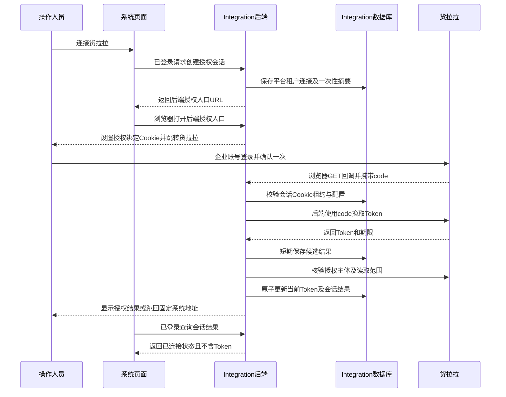

# 三方接入与货拉拉后端授权完整方案

日期：2026 年 11 月 11 日。状态：实施评审稿。

本方案将三方接入组织为 Integration 服务中的独立功能目录，以货拉拉作为首个使用公共 OAuth 能力的平台。后端接收授权回调、换取和保存 Token、刷新 Token、调用企业订单及员工接口；前端只负责发起连接、展示结果和业务操作。当前联调采用本机服务连接货拉拉正式环境，数据进入 DEV 数据库，不等待沙箱审核。

本文件是设计交付，不代表后端回调、数据库 Token 存储及目录迁移已经实施。当前已有的订单、账单、回单和 COS 处理继续作为实施基础。本次不执行建表、不修改正式代码，也不调整已确认成本口径。

## 一 已确认要求和设计边界

| 项目 | 本次约定 |
| --- | --- |
| 所属服务 | Integration，现有工程内实施，不新建微服务 |
| Java 功能目录 | 在现有各层中增加 `thirdparty`，其中服务层为 `application.service.thirdparty` |
| 公共能力 | 平台识别、授权会话、Token 存取、有效期检查、刷新调度、并发控制、脱敏及授权状态 |
| 平台实现 | 货拉拉的签名、HTTP 请求、OAuth 响应解释、订单和员工解析、同步及凭证处理 |
| 平台编码 | 新增通用表统一使用 `platform_code`，货拉拉为 `HUOLALA` |
| 环境 | 新表不增加 DEV、生产或沙箱环境字段；部署环境通过数据库隔离，平台环境由服务端配置确定 |
| Token 内容 | `access_token`、`refresh_token` 按平台返回的字符串原值保存，不加密、不截断、不 trim、不拼接前缀 |
| 数据库 | DEV 使用 DEV Integration 数据库 `rigour_integration`；生产使用生产 Integration 数据源对应的独立数据库 |
| 应用密钥 | APP_SECRET 只在 Integration 部署环境变量中维护，不存 Token 表、不放前端、不提交 Git |
| 首次授权 | 企业账号必须在货拉拉页面确认一次；APP_KEY、APP_SECRET 不能替代用户授权 |
| 后端回调 | Integration 的 GET 接口接收授权码，不再使用前端 HTML 接收或中转授权码 |
| 业务主列表 | 沿用物流运输记录，同时展示平台同步与手动录入 |
| 成本边界 | 平台资料只读；同步不自动确认费用、不重复计费、不覆盖已确认成本 |

原值落库属于明文凭据存储。数据库访问权限、备份权限和运维查询必须限制到凭据使用范围；页面、公共接口、日志、异常、SQL 参数日志及导出均不得返回 Token。平台响应解析仅做 JSON 解码，取得的 Token 字符串保持一致；这不要求保留 JSON 转义文本的字节形式。

既有接入说明和历史迁移注释采用“只存凭据引用”的规则。本次 Token 原值入库是用户明确调整后的设计，仅作用于新的公共 OAuth 凭据存储；实施时更新当前说明，不改写已执行迁移，也不据此把 APP_SECRET 或其他平台已有密钥一并改成明文入库。

DEV 和生产的数据库隔离，不能替代货拉拉正式／沙箱的调用配置。DEV 本次明确使用正式应用及正式接口。后续如果同一连接更换应用或平台环境，先暂停任务、结束在途授权、使旧令牌失效，再重新授权，不能继续复用旧 Token。

## 二 现有实现与本次调整

| 已核对的现有实现 | 本次调整 |
| --- | --- |
| `HuolalaController` 有发起授权和前端提交授权码的 POST 接口，没有 GET OAuth 回调 | 新增后端授权入口和回调；退出前端提交授权码链路 |
| 回调校验限定 `/huolala-authorized.html` | 改为指定后端回调地址校验，不绑定前端同源 |
| `HttpHuolalaGateway` 将 Token 加密保存在私有文件目录 | 改为调用公共 Token 仓储，按本次要求保存平台原值 |
| `integration_huolala_connector` 保存授权状态、文件引用、有效期及单个授权摘要 | 配置和同步设置继续保留；Token、授权会话迁到通用表，避免双份状态长期并存 |
| 服务、HTTP、配置、凭证 Worker 分散在现有目录 | 在各自层内整理到 `thirdparty`，保持原有分层依赖 |
| 已有原始回执、员工映射、平台物流记录、COS 任务 | 复用并保持业务行为；不为接入再次复制一套业务表 |

这些结论来自当前源码，不是 DEV 或生产数据库结构验收结论。发布前需分别核对实际库结构、已执行迁移和目标实例。

## 三 目录组织和复用方式

按截图中的 `service/cost`、`service/inventory` 等命名方式，服务层使用 `service/thirdparty`。其余层使用相应的 `thirdparty` 目录，不能把 Controller、持久化和业务逻辑都塞进 service。

```text
com.rigour.integration
├── api.controller.thirdparty
│   ├── ThirdPartyAuthorizationController
│   ├── HuolalaAuthorizationCallbackController
│   └── HuolalaController
├── application
│   ├── service.thirdparty
│   │   ├── oauth
│   │   │   ├── ThirdPartyAuthorizationService
│   │   │   ├── ThirdPartyTokenService
│   │   │   └── ThirdPartyTokenRefreshScheduler
│   │   └── huolala
│   │       ├── HuolalaService
│   │       ├── HuolalaOrderNormalizer
│   │       └── HuolalaEvidence
│   └── port.out.thirdparty
│       ├── oauth
│       │   ├── ThirdPartyOAuthProvider
│       │   ├── ThirdPartyTokenStore
│       │   └── ThirdPartyAuthorizationSessionStore
│       └── huolala
│           ├── HuolalaGateway
│           ├── HuolalaStore
│           └── HuolalaDomainClient
├── domain.thirdparty.oauth
│   ├── PlatformCode
│   ├── OAuthToken
│   └── AuthorizationSession
└── infrastructure.thirdparty
    ├── oauth
    │   ├── JdbcThirdPartyTokenStore
    │   └── JdbcThirdPartyAuthorizationSessionStore
    └── huolala
        ├── config.HuolalaConfiguration
        ├── http.HttpHuolalaGateway
        ├── oauth.HuolalaOAuthProvider
        ├── persistence.JdbcHuolalaStore
        ├── media.HuolalaVoucherWorker
        └── domain.HttpHuolalaDomainClient
```

上面是目标组织方式，类可以按职责拆分，不以增加类数量为目标。对外 DTO 继续留在 `integration-api` 中，不能让其他服务依赖 `integration-server`。包移动不应顺带改变已有订单、员工、同步等 HTTP 契约。

货拉拉代码中的所有外部接入实现纳入对应的 `thirdparty.huolala` 目录。Order 中物流单确认、撤销、分摊和附件可见范围等领域规则仍属于 Order，不搬到 Integration。现有 COS 公共存储实现可继续复用，不为货拉拉复制一套上传客户端。

公共 OAuth 服务通过 `ThirdPartyOAuthProvider` 按平台注册适配器。适配器声明平台编码，提供授权 URL、授权码交换、刷新请求、Token 响应解释、授权主体核验和错误分类。请求参数、签名和返回字段差异由适配器处理，公共服务不写货拉拉专属判断。

后续接入其他 OAuth 平台时增加对应 Provider、部署配置和业务同步适配器，即可复用授权会话与 Token 表。仅使用固定 API Key 或其他鉴权方式的平台，不强制套用授权码流程。本方案不立即重构订货宝、飞书的既有鉴权，避免未经验证的扩大改动。

## 四 平台编码和数据库归属

新建表固定包含 `tenant_id`、`platform_code`、`connector_id`，平台编码由后端已注册适配器确定，不信任浏览器随意传入的未注册值。`HUOLALA`、未来的 `SFEXPRESS` 等只是稳定平台编码示例，不代表相关平台已经接通。

平台名称按编码解析，不在 Token 每条记录中重复保存“货拉拉”等名称，也不新增平台名称表。对于既有通用表：`source_system` 已承担平台识别职责，不能误认为没有名为 `platform_code` 的列就没有来源信息。

现有货拉拉源数据和人员映射使用 `source_system='HLL'`。本期将 `HUOLALA` 作为通用 OAuth 平台编码，在适配器中明确映射 `HUOLALA → HLL`；保留旧来源键，不能因改编码再生成一套订单、映射或附件。

| 库或服务 | 保存内容 |
| --- | --- |
| Integration 的 `rigour_integration` | 应用连接引用、通用 Token、授权会话、货拉拉原始数据、同步运行记录、员工映射和文件任务 |
| Order 的领域库 | 平台来源物流事实、运输业务记录、业务订单关联、分摊、确认成本与操作记录 |
| HR | 本系统员工和部门档案；Integration 通过 API 读取，不直连 HR 库 |
| COS | 平台实际返回且成功获取的凭证、回单及装卸货照片 |
| BI | 消费领域分析投影，不直接查询 Token 表或货拉拉接口 |

## 五 新表设计

本期新增两张公共表。`integration_oauth_token` 保存当前令牌及刷新控制信息；`integration_oauth_authorization_session` 保存一次授权所需的短期校验信息。订单、账单、平台员工、附件和同步日志继续复用现有结构，不再新建一套。

单独保存授权会话是为了让后端回调校验租户、应用绑定和一次性授权，不能仅凭回调 URL 中的企业编号或 `code` 决定把 Token 存到哪个租户。它不是另一张长期 Token 历史表。

以下 SQL 是新库表的设计稿，不含 DROP，也不是可直接替代现有 Flyway 文件的脚本。执行版本须在实施时结合最新迁移历史分配。时间统一按 UTC 写入、按系统既有方式展示北京时间；会话初始化及数据库连接需保持 UTC。

### 通用 Token 表

```sql
CREATE TABLE integration_oauth_token (
    id BINARY(16) NOT NULL COMMENT '主键ID，由后端生成UUID',
    tenant_id BINARY(16) NOT NULL COMMENT '本系统租户ID',
    platform_code VARCHAR(32) NOT NULL COMMENT '第三方平台编码，货拉拉为HUOLALA',
    connector_id BINARY(16) NOT NULL COMMENT '平台连接ID，货拉拉关联既有连接表',
    app_key VARCHAR(128) NOT NULL COMMENT '令牌所属应用标识APP_KEY，不保存APP_SECRET',

    access_token TEXT NULL COMMENT '平台返回的访问令牌原值，仅后端读取',
    refresh_token TEXT NULL COMMENT '平台返回的刷新令牌原值，未提供时为空',
    token_type VARCHAR(50) NULL COMMENT '平台返回的令牌类型原值，未提供时为空',
    token_metadata_json JSON NULL COMMENT '平台返回的有效期及授权范围等元数据，保留原字段名，不重复保存令牌和密钥',
    token_received_at DATETIME(6) NULL COMMENT '后端收到当前令牌响应的时间UTC',
    access_token_expires_at DATETIME(6) NULL COMMENT '访问令牌到期时间UTC，根据平台明确的期限语义计算',
    refresh_token_expires_at DATETIME(6) NULL COMMENT '刷新令牌到期时间UTC，平台未提供时为空',
    next_refresh_at DATETIME(6) NULL COMMENT '下次计划刷新或失败重试时间UTC',

    auth_status VARCHAR(32) NOT NULL DEFAULT 'UNAUTHORIZED'
        COMMENT '授权状态UNAUTHORIZED未授权AUTHORIZED已授权REAUTHORIZE_REQUIRED需重新授权DISABLED已停用',
    last_authorized_at DATETIME(6) NULL COMMENT '最近一次授权成功时间UTC',
    last_refreshed_at DATETIME(6) NULL COMMENT '最近一次令牌刷新成功时间UTC',
    refresh_failure_count INT NOT NULL DEFAULT 0 COMMENT '连续刷新失败次数',
    last_error_code VARCHAR(100) NULL COMMENT '最近失败的错误编码，不含敏感内容',
    last_error_message VARCHAR(500) NULL COMMENT '最近失败的脱敏说明，不含令牌授权码及密钥',

    refresh_lease_id VARCHAR(36) NULL COMMENT '刷新任务租约标识，防止多实例并发刷新',
    refresh_lease_expires_at DATETIME(6) NULL COMMENT '刷新任务租约到期时间UTC',
    revision BIGINT NOT NULL DEFAULT 1 COMMENT '乐观锁版本',
    created_by BINARY(16) NULL COMMENT '创建人员ID，系统任务为空',
    created_at DATETIME(6) NOT NULL DEFAULT CURRENT_TIMESTAMP(6) COMMENT '创建时间UTC',
    updated_by BINARY(16) NULL COMMENT '最近操作人员ID，系统任务为空',
    updated_at DATETIME(6) NOT NULL DEFAULT CURRENT_TIMESTAMP(6)
        ON UPDATE CURRENT_TIMESTAMP(6) COMMENT '更新时间UTC',

    PRIMARY KEY (id),
    UNIQUE KEY uk_oauth_token_connection (tenant_id, platform_code, connector_id),
    KEY ix_oauth_token_refresh (auth_status, next_refresh_at)
) ENGINE=InnoDB
  DEFAULT CHARSET=utf8mb4
  COLLATE=utf8mb4_general_ci
  COMMENT='第三方平台OAuth当前令牌与刷新控制';
```

一条记录对应一个租户、一个平台、一个连接的当前有效凭据。一个连接固定绑定一个应用和授权主体；多个账号使用不同连接。货拉拉当前连接表仍限制每租户一条，本次不宣称已经具备同租户多个货拉拉企业连接能力。

`token_metadata_json` 只保存适配器识别的有效期、授权范围等非凭据元数据。平台实际使用 `expires_in` 或其他字段名时保留真实名称和值；不预先保证平台存在某个字段。相对有效期根据响应接收时间计算，绝对时间按平台规定单位和时区转换，原值与计算结果分开保存。平台未给刷新令牌有效期时保持 NULL，不自行设为三个月。

通用表允许没有 refresh_token 的其他 OAuth 平台使用；这种 Provider 必须声明重新获取策略，不能由公共服务捏造刷新令牌。Token 状态指授权关系，不把一次网络失败或访问令牌暂时过期直接等同用户撤销授权。

### 通用授权会话表

```sql
CREATE TABLE integration_oauth_authorization_session (
    id BINARY(16) NOT NULL COMMENT '授权会话ID，由后端生成UUID',
    tenant_id BINARY(16) NOT NULL COMMENT '本系统租户ID，取发起授权时的可信上下文',
    platform_code VARCHAR(32) NOT NULL COMMENT '第三方平台编码，货拉拉为HUOLALA',
    connector_id BINARY(16) NOT NULL COMMENT '本次授权的平台连接ID',
    token_id BINARY(16) NOT NULL COMMENT '目标通用Token记录ID',
    actor_id BINARY(16) NOT NULL COMMENT '发起授权的系统人员ID',

    app_key VARCHAR(128) NOT NULL COMMENT '发起授权时的应用标识快照',
    configuration_fingerprint CHAR(64) NOT NULL COMMENT '应用平台环境回调及企业绑定配置的指纹，不保存环境明文字段和密钥',
    session_hash CHAR(64) NOT NULL COMMENT '一次性授权票据的SHA256摘要，不保存原始票据',
    browser_binding_hash CHAR(64) NULL COMMENT '后端授权浏览器Cookie绑定值的摘要',
    authorization_code_hash CHAR(64) NULL COMMENT '收到授权码的摘要用于去重，不保存原始授权码',
    status VARCHAR(32) NOT NULL DEFAULT 'CREATED'
        COMMENT '会话状态CREATED待打开REDIRECTED授权中EXCHANGING换取中PENDING_VERIFICATION待核验SUCCEEDED成功FAILED失败UNCERTAIN结果不明SUPERSEDED已替代EXPIRED已过期',
    expires_at DATETIME(6) NOT NULL COMMENT '授权会话到期时间UTC',

    processing_lease_id VARCHAR(36) NULL COMMENT '回调处理租约标识',
    processing_lease_expires_at DATETIME(6) NULL COMMENT '回调处理租约到期时间UTC',
    exchange_attempted_at DATETIME(6) NULL COMMENT '最近一次提交授权码交换的时间UTC',
    candidate_token_json JSON NULL COMMENT '授权主体核验前短期保留的原值Token及期限，完成或过期后清理，仅后端读取',
    finished_at DATETIME(6) NULL COMMENT '会话结束时间UTC',
    error_code VARCHAR(100) NULL COMMENT '会话失败或待处理编码',
    error_message VARCHAR(500) NULL COMMENT '脱敏后的失败或待处理说明',
    revision BIGINT NOT NULL DEFAULT 1 COMMENT '乐观锁版本',
    created_at DATETIME(6) NOT NULL DEFAULT CURRENT_TIMESTAMP(6) COMMENT '创建时间UTC',
    updated_at DATETIME(6) NOT NULL DEFAULT CURRENT_TIMESTAMP(6)
        ON UPDATE CURRENT_TIMESTAMP(6) COMMENT '更新时间UTC',

    PRIMARY KEY (id),
    UNIQUE KEY uk_oauth_session_hash (session_hash),
    KEY ix_oauth_session_connection (tenant_id, platform_code, connector_id, created_at),
    KEY ix_oauth_session_expiry (status, expires_at)
) ENGINE=InnoDB
  DEFAULT CHARSET=utf8mb4
  COLLATE=utf8mb4_general_ci
  COMMENT='第三方平台OAuth后端授权会话及一次性回调校验';
```

所有字段均由系统维护，页面不提供 Token 或会话字段的录入、查看和导出。初始会话有效期建议十分钟，这是本系统策略，不是货拉拉授权码有效期承诺；实际处理还要遵守平台 code 的有效期。

每个连接同时只保留一个可完成的新授权会话。新会话建立时替代此前未完成会话，但不立即清空原有效 Token；旧回调不能覆盖新授权。回调与刷新更新当前 Token 时都必须校验租约、revision 和配置绑定。

`candidate_token_json` 只用于令牌已取到、主体核验尚未完成或本地提交需恢复的短期状态。成功后在同一事务写入 Token 表并清空候选信息；失败或过期后清理，不把它变成永久令牌历史。授权会话仅保留必要的无凭据结果元数据用于排查，清理周期由运维配置确定。

### 现有货拉拉表的配套调整

现有专属连接表和凭证表也补充明确的平台编码。以下 ALTER 为设计示意，实施时检查实际结构再通过新迁移执行，不重复执行。

```sql
ALTER TABLE integration_huolala_connector
    ADD COLUMN platform_code VARCHAR(32) NOT NULL DEFAULT 'HUOLALA'
        COMMENT '第三方平台编码，货拉拉固定HUOLALA' AFTER tenant_id;

ALTER TABLE integration_huolala_voucher
    ADD COLUMN platform_code VARCHAR(32) NOT NULL DEFAULT 'HUOLALA'
        COMMENT '第三方平台编码，货拉拉固定HUOLALA' AFTER tenant_id;
```

连接表保留企业绑定、同步配置及同步租约；`token_secret_ref`、`token_expires_at`、旧授权摘要等字段在切换后停止作为数据来源。页面授权状态统一从通用 Token 与会话计算；旧连接 `auth_status` 不再成为第二个独立判断源。旧字段在独立前向迁移及兼容窗口结束后再清理，不修改已执行的 V28。

已有通用 Raw、映射和死信表的 `source_system` 继续使用，不再增加等义列。任务通过所属连接确定平台；新查询必须同时核验租户、平台、连接。既有货拉拉凭证表的租户与连接字段是 VARCHAR(36)，本次不强行改成 BINARY(16)，适配层完成 UUID 表示转换，避免无关结构变化。

## 六 后端授权和回调流程



这是授权完成后的浏览器导航，不是平台业务消息 Webhook，也不是后台凭空触发用户同意。浏览器必然承载 code 的回调 URL，但前端业务 JavaScript 不再接收、复制或中转 code。

### 回调身份校验

官方当前授权参数表未列出 `state`，重定向示例只明确 `code`。因此本期不能依赖“平台一定透传 state”的假设。后端采用自己的短期授权会话，并在浏览器先访问后端授权入口时设置 HttpOnly Cookie，完成回调绑定。

具体约束如下：

1. 创建会话的 POST 请求仍要求现有登录、租户及接入操作权限；租户和操作人取可信上下文，不取请求体。
2. 后端生成高熵一次性票据，数据库仅存摘要。打开后端授权入口时，核验票据并建立浏览器绑定；正式 HTTPS 使用 Secure、HttpOnly、SameSite=Lax Cookie，不依赖弹窗 opener 或前端同源消息。
3. 回调根据 Cookie 和数据库会话恢复归属，不允许使用未经校验的 `tenantId`、`connectorId` 或任意回跳地址决定目标。
4. 仅对指定 GET 授权入口和 GET 回调设置精确接收规则。它们不要求本系统 Bearer Token，但不等于允许匿名写任意连接。网关清理伪造可信头；其他业务 API 继续鉴权。
5. 回调以数据库条件更新领取短租约，只允许一次 code 交换。重复成功回调返回同一结果；并发回调不再换取 Token。
6. 授权码交换结果不明时，不能把 code 当作可无限重试参数。标记结果不明并引导重新连接；已持久化候选 Token 的后续核验或提交可恢复，不再交换 code。
7. 所有回调响应设置 no-store 和严格 Referrer 策略；网关、Nginx、应用日志不记录 code、票据、Cookie 或 Token。审计只记会话ID、平台、结果及脱敏错误。
8. 回跳只允许服务端预配置的系统地址；后端清理 Cookie，不把 code 或 Token 带到最终页面。

本地 HTTP 仅在平台允许登记本地地址、且同一开发机浏览器完成授权时使用；Cookie Secure 属性按实际 HTTPS/本机 HTTP 配置处理。不能依赖跨域 AJAX 设置第三方 Cookie，打开后端授权入口必须是浏览器导航。

### 企业归属核验

连接预先绑定目标企业。核验依据必须来自平台明确返回的企业或账号标识，不能根据姓名、手机号或公司名称相似判断。企业订单返回的 `ep_id` 可作为具有订单时的核验依据，但抽样订单为空不能证明企业一致，也不能只抽样一张就承诺所有员工订单可见。

若已开通接口或 Token 响应无法提供可核实的企业归属，保留待核验会话，不启用自动同步、不替换原有效 Token；提示核对授权企业。需要结合平台支持的主体字段或明确的企业应用绑定完成核验，再激活连接。不能为了让流程通过新增未经开通的接口调用。

从货拉拉控制台直接点击“新增用户授权”并不保证带有本系统会话。缺少可靠绑定的直接回调必须拒绝，不能自行猜测租户。本期推荐从系统“连接货拉拉”进入同一个官方授权流程，人员只确认一次；控制台可核对授权记录。若要求控制台作为唯一入口，须先由平台确认可验证的会话或主体回传机制，再实施，不能假装当前 code 参数已包含租户信息。

## 七 回调地址和接口清单

建议货拉拉应用登记以下稳定后端接口。它是待实现路径，当前不能只修改平台配置就直接使用。

```text
https://实际API域名/api/v1/integration/huolala/oauth/callback
```

| 接口 | 访问方式 | 用途及返回边界 |
| --- | --- | --- |
| `POST /api/v1/integration/thirdparty/{platformCode}/oauth/authorizations` | 已登录及原有接入操作权限 | 按指定连接创建授权会话；返回会话ID、后端打开URL及到期时间，不返回凭据 |
| `GET /api/v1/integration/huolala/oauth/start` | 有效一次性票据 | 建立后端浏览器绑定并跳转官方授权页，不信任任意目标URL |
| `GET /api/v1/integration/huolala/oauth/callback` | 有效授权会话与浏览器绑定 | 接收 code，后端交换、核验、保存并展示简洁结果 |
| `GET /api/v1/integration/thirdparty/{platformCode}/oauth/authorizations/{id}` | 已登录且有当前会话查询权限 | 返回授权进度、结果和业务错误，不返回 code 或 Token |
| `GET /api/v1/integration/huolala/connection` | 原有权限 | 返回企业、连接状态、到期时间和同步设置 |
| 现有员工、映射、同步、运行记录接口 | 原有权限 | 保持业务用途，复用公共 Token 获取有效凭据 |

`start` 的一次性票据参数需要在所有请求日志中显式脱敏，不应因为参数叫 ticket 就漏过现有敏感参数规则。Token 刷新由服务端调度与内部用例调用，不暴露匿名刷新 API，也不提供业务前端查询原值 Token 的接口。

包名调整不要求变更已有业务 URL。现有 POST 发起授权可在兼容窗口代理到新服务；前端提交 code 的 `/authorization/complete` 在配套版本切换后退出。必须完整清理 `huolala-authorized.html`、相关脚本、postMessage 监听和手工粘贴授权码入口，不能并存两套长期链路。

## 八 本机接正式接口的配置

| 配置项 | 当前联调取值或原则 |
| --- | --- |
| Integration 运行位置 | 用户现有本机 IDEA 运行项 |
| 应用 | 已审核通过的货拉拉正式应用 |
| 业务接口地址 | `https://openapi.huolala.cn/v1` |
| 授权和 Token 请求 | 使用正式应用 APP_KEY 及 `isSandbox=false` |
| 平台环境属性 | `rigour.huolala.sandbox=false`，保留在部署配置，不入新表 |
| Token 及源数据 | DEV 的 Integration 数据库 |
| 平台物流业务记录 | 通过 Order 服务写入 DEV Order 数据库 |
| 回调 | 后端地址，与开放平台登记值一致 |
| 成本确认 | 必须由本系统业务操作完成，不能由授权或同步触发 |

仅调用平台只读订单、详情和已获批员工接口，不调叫车、支付、取消或开票接口。正式联调读取的是真实授权范围数据，不能用沙箱参数假装验证正式订单。

如果平台接受本机地址，可登记 `http://localhost:26882/api/v1/integration/huolala/oauth/callback`，由开发机浏览器直接回到本机后端。官方文档未明确 localhost 的登记限制，必须以控制台保存结果或平台确认为准；未确认前不承诺可用。

如果平台拒绝本机地址，使用稳定 HTTPS 入口反向代理到本机后端。入口必须确定转发到本次授权的本机实例，不能随机落到共享 Nacos 中另一台未配置相同凭据的实例。授权入口和回调保持同一后端外部域名，以便 Cookie 绑定有效。

目前按单个应用一个回调地址处理。本次使用正式应用联调，就在联调期间登记对应后端入口；上线前切换到生产固定回调并在生产重新授权。没有明确的跨环境授权分发方案时，不同时让一个固定回调承接本机和生产实例，不复制 DEV Token 到生产。

货拉拉正式和沙箱应使用各自应用凭据及调用参数。平台支持两个环境，不自动等于同一应用可以配置两个回调；本方案不依赖这个未经核实的能力。

按用户2026-11-11补充决定，货拉拉应用凭据及企业配置统一放入 Integration 的 Nacos 服务配置，使用 `rigour.thirdparty.huolala.app-key`、`app-secret`、`enterprise-id`、`enterprise-name`、`redirect-uri`、`sandbox`，真实密钥不提交Git、不向页面返回。旧环境变量只作兼容回退，同一部署应统一维护新配置，避免双处冲突。企业编号和名称属于企业用车账号，不是开放平台应用编号或应用名称。文件存储切换完成后，移除仅供 Token 文件使用的 `RIGOUR_HUOLALA_TOKEN_DIR`、`RIGOUR_HUOLALA_TOKEN_KEY` 依赖；COS 相关配置不受影响。企业编号是货拉拉企业标识，不是应用编号。

## 九 Token 自动刷新和异常恢复

有效期只按平台实际响应解释，不将文档中的“三个月”写死到数据库。公共服务统一返回可用凭据，平台 Provider 负责原始字段和单位的解释。

1. 后台定时扫描已授权且到达 `next_refresh_at` 的记录，业务请求前再检查剩余有效期，避免只在用户点同步时才续期。
2. 初始刷新策略建议提前五分钟；当平台期限很短时按有效时长比例缩短。该阈值是部署策略，不是业务页面字段。
3. 通过数据库条件更新领取租约，校验 revision；多个本机或服务实例也只能有一个成功领取。外部 HTTP 请求期间不长时间持有数据库事务锁。
4. 成功响应后在短事务中更新新的 access_token、实际返回的 refresh_token、有效期、下次刷新时间和版本。平台返回新的 refresh_token 时必须同时替换旧值。
5. 某平台允许刷新响应不含 refresh_token 时，只能按该平台明示规则保留旧值；不能让所有适配器统一把缺失字段当作清空或自动沿用。字段显式失效与字段未返回分开处理。
6. 网络错误、平台限流、服务暂不可用时退避重试。候选重试策略为三十秒起、逐步延长并设上限，最终数值依据配额调整；短暂失败不立即清空仍有效的 Token。
7. 只有平台明确报告授权撤销、refresh_token 无效等不可恢复结果时进入需重新授权。访问 Token 过期但刷新仍可用时先刷新，不直接要求人工授权。
8. 刷新超时可能发生平台已旋转令牌、本地未收到结果的情况，不能假定重发旧 refresh_token 一定安全。按平台刷新幂等或宽限规则恢复；没有保证时停止盲重试并提示重新连接。
9. 刷新租约过期、重新授权、配置切换等场景，写回时检查原版本和租约。旧任务不能覆盖较新的授权。重授权与刷新互斥；一旦交换已开始，后续新任务必须等其可恢复结果或明确结束，不能只靠超时同时发两次请求。

Token 状态和刷新失败次数在业务页面只翻译为连接状态与处理建议。任何异常不得泄漏平台完整响应中的凭据。

## 十 企业数据同步与附件留存

### 接口与数据落地

优先使用已确认的企业版接口：`e-order-list`、`e-order-detail`、`e-staff-construct`、`e-staff-detail`。员工详情、部门详情等依赖仅在实际获批后调用，不能因为代码存在方法就认为已授权。禁止静默改用 APP 版 `u-order-detail` 解释企业返回结构。

每页先保存列表，再逐单补详情。Integration 保存完整业务返回结构及版本，Order 通过版本化接口保存本域来源与业务数据；打开列表和详情读本地库，不逐行实时请求货拉拉。Token 端点原始凭据不进入普通 Raw、死信、导出或运行日志。

企业详情当前文档只支持近一年；企业列表的可查范围与详情不同，应按实际账号和接口条件拆分。司机信息在司机完成七十二小时后可能不再返回；已有资料不能因后续缺失字段被清空。详情查询失败、超出历史范围、权限不足与没有附件应分别记录，不能用一个“暂无数据”掩盖。

同步采用重叠窗口、未完成订单复查、详情失败补查和历史补同步。没有核实平台支持按更新时间过滤前，不把最近同步时间当作唯一增量游标。建议回看频率受实际配额控制，失败任务独立重试。

### 核心字段和展示口径

| 业务内容 | 保存和处理 |
| --- | --- |
| 平台订单号 | 字符串保存，业务显示第三方订单号；不经过 JavaScript 浮点数转换 |
| 物流公司 | 货拉拉自动同步固定为货拉拉；手动单从物流公司字典选择 |
| 平台订单状态 | 保存原编码和已核实名称，与本系统单据状态分开 |
| 全部发收货点 | 保留平台顺序、名称、联系人、电话及地址，多收货方逐项显示 |
| 账单汇总 | 平台返回的总额、已付、未付、退款分别保存，按分精确转换元 |
| 费用明细 | 保存每一项的类型、名称、正负金额、优惠和凭证，未知类型也保留 |
| 付款进度 | 来源按当前可用金额与支付字段展示；旧 pay_status 已停止维护，不能单独判定是否付清 |
| 平台下单员工 | 平台人员标识关联 HR 员工，部门通过 HR 员工档案取得 |
| 业务单据归属 | 关联销售单表中分别显示原单业务员及部门，不与平台下单员工混为一个字段 |
| 运输成本 | 来源账单与已确认成本分开；不把费用分项、已付款、退款再次叠加成另一笔成本 |

员工映射可以推荐，最终人工确认。手机号或姓名相同不能直接写成已关联，不创建重复 HR 员工，不用货拉拉部门覆盖 HR。员工调动后，历史已确认成本的归属快照保留；本次授权重构不静默改变既有成本看板按业务单归属的口径。

订单关联继续支持一条运输记录多张业务单、多笔运输费用对应同一业务单。没有本系统订单关联也先保留平台记录，不能丢弃来源。跨单分摊按分处理尾差，合计必须等于本次确认的运输成本。

### 回单和凭证

| 企业详情字段 | 保存与展示 |
| --- | --- |
| `order_detail_item.order_item.order_price_arr[].img_urls[]` | 各费用项凭证，随对应费用行展示 |
| `order_detail_item.receipt_url[]` | 拍照回单，全部保留 |
| `order_detail_item.receipt_info` | 回单类型、状态、寄回方式、寄回快递单号、备注及无法返单原因等实际返回信息 |
| `order_detail_item.order_item.addr_info_arr[].goods_imgs[]` | 按节点保存照片，首节点装货、末节点卸货，中间点保留所属节点 |

`receipt_info.express_no` 是纸质回单寄回的快递单号，不能覆盖运输运单号。装卸货照片需要平台商务申请资源权限；取得企业详情接口权限不等于一定有照片返回。

Integration 获取平台附件并转存自有私有 COS，路径继续按租户、来源服务、连接、订单和附件身份区分；业务页面只使用内部文件标识。Order 校验本系统租户、运输记录和附件归属后签发短期查看或下载地址，下载设置正确文件名和 attachment 响应头。

相同来源附件重复同步复用已有 COS 文件；临时签名 URL 更新不生成第二份资料。COS 已成功、Order 投递失败时只重试投递。单个附件失败不回滚订单。下载继续校验允许的 HTTPS 来源、地址、文件大小、真实类型和重定向规则；现有实现支持的图片及 PDF 范围、十 MB 上限需要在真实样本中核验，超限标明原因，不能宣称所有格式无限大小已支持。

## 十一 页面调整范围

### 货拉拉接入页

页面沿用现有蓝白风格。只保留以下内容，不展示包名、API Method、Token、APP_KEY、APP_SECRET、回调 URL、租约或数据库字段。

| 展示区域 | 字段或操作 |
| --- | --- |
| 连接信息 | 平台名称、已核验企业、连接状态、授权有效期、最近同步时间 |
| 连接操作 | 连接货拉拉、重新连接；确认操作发生在官方页面，只需一次 |
| 同步设置 | 历史同步起始日期、自动同步、同步频率、保存设置、立即同步 |
| 员工关联 | 货拉拉员工、本系统员工、HR 所属部门、关联状态及关联操作 |
| 同步记录 | 执行时间、新增、更新、无需更新、详情待补、失败及可操作原因 |

默认状态用“未连接、连接中、已连接、需重新连接、已停用”；需要核验主体时显示“需核对授权企业”。连接配置不完整时给出明确管理员处理提示，不让业务填写技术字段。页面只轮询当前授权结果，不再监听 code 的 postMessage，也不提供手工粘贴 code。

### 物流运输记录

主列表保留费用单号、物流公司、运输类型、运输日期、各收货方、第三方订单号、运单号、运输费用、单据状态、创建人及状态对应操作。平台订单状态、账单支付明细、回单、司机车辆和同步时间放详情；列表列设置不重新堆入所有技术或付款明细。

详情统一顺序：基本信息 → 关联业务订单 → 发货信息 → 收货信息 → 费用及账单 → 回单和凭证 → 备注与操作记录。平台字段只读，手工单支持自行选择付款状态，并按用户已确认方式录入账单总额或费用分项。新增、编辑、详情使用同一业务字段口径，来源决定编辑权限，而不是做成相互脱节的页面。

状态规则继续为：待确认可查看、编辑、确认、作废；已确认可查看、撤销；撤销回到待确认；只有已作废可删除。平台新账单可更新来源展示，但已确认成本保持快照并提示需要核对；撤销后重新确认替换当前有效成本，不能累加。

## 十二 实施与数据迁移顺序

1. 核对当前分支、独立仓库改动、目标库和迁移历史。已有暂存的凭证留存等工作不得丢弃，已发布 SQL 不改写；本方案不预占固定 Flyway 版本号。
2. 新增两张公共表及现有专属表平台编码字段，统一 `utf8mb4_general_ci`；不新增数据库，不重建已有业务表。
3. 先实现公共仓储、授权会话和租约测试，再提供货拉拉 Provider。普通日志不得记录 Token SQL 绑定参数或候选响应。
4. 实现后端 start/callback、网关精确接收规则、Cookie、会话状态查询以及企业核验，再修改前端连接入口。移除前端 code 链路与路径硬编码。
5. 将 Token 存取从文件切换至数据库。若存在旧有效文件，只在确认应用和连接匹配后由受控迁移程序导入，不能输出原值；确认数据库可读且自动刷新可用后停止旧文件读写。不得为回退而长期双写两套凭据。
6. 目录移动按层实施，更新 Spring 扫描、装配、测试与引用；保持对外业务接口兼容，避免 final 类代理或重复 Bean 等装配问题。删除已替代旧类，不能把同一实现留两份。
7. 在本机使用正式凭据完成真实首次授权、小时间范围同步、重复同步、附件留存和只读成本对账。先手动核对再开启自动同步。
8. 新文件逐路径加入 Git 暂存区，只暂存本次交付文件。应用需重启时按项目约定由用户在原 IDEA 运行项操作。
9. 生产执行经评审的前向迁移并核对正式回调、生产密钥和权限；生产自身完成授权，不搬运 DEV Token。生产启动关闭自动 Flyway 的现有发布约定保持不变。

回退时停止当前自动任务并保留库中数据；如旧版本只认识文件令牌，不能靠回滚代码保证可用。优先回滚到可读新表的兼容版本，或在受控条件下恢复授权。新版刷新可能使旧 refresh_token 失效，不能把旧文件当作永远有效的备份。

## 十三 验证清单和通过标准

以下为待执行的实施验证，不是本次已经通过的测试结果。

| 范围 | 必须验证 |
| --- | --- |
| 数据库 | 两个新表都有平台编码和租户；环境字段不存在；同连接不重复插入 Token；所有新字符列为 general_ci |
| Token 原值 | 含大小写、符号和边界长度的字符串保存后逐字符一致；不 trim、不截断；反序列化及异常字符串不泄漏 Token |
| 公共复用 | 用一个隔离的第二平台假适配器验证复用，测试不同期限字段、没有 refresh_token 及不同错误规则，不用真实创建另一平台业务接入 |
| 授权入口 | 无权限不能创建会话；票据失效、平台不匹配、跨租户、配置变更、旧会话和错误浏览器绑定均拒绝 |
| 后端回调 | 不带前端 Bearer 仍可处理合法会话；没有会话不能落 Token；前端不处理 code；成功和失败都无敏感信息回传 |
| 幂等与恢复 | 同 code 重复回调和并发回调不重复交换；租约崩溃可处理；交换超时不盲重用 code；候选结果可恢复并按期清理 |
| 企业核验 | 授权其他企业拒绝；空订单不默认成功；待核验结果不能启动同步或替换原有效 Token |
| 刷新 | 到期前刷新、两个 Token 更新、缺失刷新字段的 Provider 差异、网络重试、平台明确失效及多实例互斥 |
| 并发写回 | 旧刷新不能覆盖新授权；旧回调不能覆盖新会话；应用切换后旧租约失效，Token 更新按当前版本校验 |
| 安全边界 | 只开放指定方法和路径；其他业务接口仍鉴权；Cookie 属性、no-store、Referrer、反向代理日志和 SQL 日志均检查 |
| 源数据 | 同一真实单与官方页面比较单号、企业、员工、全路线、总额、分项、优惠、付款及退款；列表失败与详情失败分开计数 |
| 附件 | 费用凭证、回单、纸质回单信息、可返回的照片全部核对；真实 COS 上传、查看、下载；一项失败、签名更新及重复同步不新增成本 |
| 成本 | 平台资料只读；未关联先保留；确认后新账单不改成本；撤销重确替换有效金额；分摊尾差及自定义导出与详情一致 |
| 页面 | 新增编辑详情一致；手工快递与平台记录都能查看；单据状态在创建人之前；空值显示统一；不暴露技术配置 |

通过标准包含三层证据：隔离测试和构建通过；真实后端授权与数据库保存、刷新通过；同一真实订单的官方页面、API、本地详情、下载文件与成本保护一致。仅构建成功、健康检查 UP 或页面显示已连接都不能代替后两层。

## 十四 上线前必须核实的外部条件

| 条件 | 对实施的影响 |
| --- | --- |
| 唯一回调是否接受本机 HTTP | 决定本次可直接回本机，还是需要固定 HTTPS 转发入口 |
| 实际 DEV 与生产 API 域名 | 确定最终登记值、Cookie 域及反向代理，不用示例域名冒充已部署 |
| 实际 Token 响应和期限字段 | 确定 Provider 的原值保存、期限解释和刷新时机 |
| 企业主体可核验字段 | 决定何时可以安全激活授权；无法核验时保持待核对 |
| 实际获批接口和账号范围 | 决定员工资料、跨下单账号订单和历史数据是否可取 |
| 附件资源权限及大小格式 | 决定照片、回单是否存在以及当前下载限制是否需要调整 |
| 生产数据源实际库名及发布流程 | 本次未连接生产核验，生产配置与 DEV 不共享 Token |

这些是接口和部署核实项，不出现在普通物流录入页面，也不要求业务人员填写 Token、数据库或网络配置。

## 十五 官方依据和项目入口

官方页面核对日期为 2026 年 11 月 11 日。当前文档与企业账号实际回执有差异时，以已获批接口和核实后的响应为准；示例字段存在不等于每笔订单都返回。

- [货拉拉创建应用](https://open.huolala.cn/#/generic-doc/1?menu=1&id=17)：选择正式或沙箱环境创建应用。
- [授权码及刷新流程](https://open.huolala.cn/#/generic-doc/1?menu=1&id=33)：Server-side flow、code 回调、Token 交换及刷新后令牌更新。
- [调用方式](https://open.huolala.cn/#/generic-doc/1?menu=1&id=21) 与 [签名规则](https://open.huolala.cn/#/generic-doc/1?menu=1&id=22)：正式联调核对请求封装与签名，不自行假设不同接口契约可混用。
- [企业订单列表](https://open.huolala.cn/#/doc/api?menu=9&type=2&id=10)。
- [企业订单详情](https://open.huolala.cn/#/doc/api?menu=9&type=2&id=9)：详情近一年、回单资料、支付字段维护说明、照片商务权限及司机信息时效。
- [企业员工目录](https://open.huolala.cn/#/doc/api?menu=9&type=2&id=151) 与 [员工详情](https://open.huolala.cn/#/doc/api?menu=9&type=2&id=154)。
- 项目分层与迁移约定：[AGENTS.md](../../AGENTS.md)。
- 现有业务接入说明：[HUOLALA_INTEGRATION.md](HUOLALA_INTEGRATION.md)。其中前端回调与加密文件 Token 部分由本方案在后续实施时替代；其余业务规则继续核对沿用。
- 现有货拉拉连接迁移：[V28](../../services/rg-scdp-integration/integration-server/src/main/resources/db/migration/V28__huolala_connection.sql)。
- 现有凭证任务迁移：[V29](../../services/rg-scdp-integration/integration-server/src/main/resources/db/migration/V29__huolala_voucher_jobs.sql)。

本方案不创建额外业务角色、不新增独立平台部门档案，不把接入重构扩大成所有历史平台的一次性重写。后续实施交付按本文件逐项核对，并分别报告已通过、未执行及受外部条件限制的项目。

## 本轮配置和实施补充（2026-11-11）

- Nacos 当前导入的 Data ID 为 `rigour-integration-migration-service.yml`，Group 为 `DEFAULT_GROUP`，命名空间以 Integration 运行项的 `NACOS_NAMESPACE` 为准。增量合并示例见 [货拉拉后端配置](../nacos/huolala-backend-oauth.example.yml)，不能覆盖原文件已有的数据源等配置。多份 `rigour:` 必须合并为一个根节点。
- 本机当前地址为 `http://192.168.9.90:26882/api/v1/integration/huolala/oauth/callback`，IP变更后两端同时更新。用户已确认货拉拉支持本机IP登记，实际浏览器联调仍需验证；同机也可用 `http://localhost:26882/api/v1/integration/huolala/oauth/callback`。HTTP私网例外仅在dev/local且非prod/production配置下启用，不依赖货拉拉sandbox选项。
- DEV、生产分别使用自己的数据库与命名空间；生产回调为实际HTTPS网关域名加同一接口路径。网关只公开GET start/callback，业务接口保留登录权限；反向代理访问日志不得记录这两个入口的查询参数。
- 新迁移 V31 新建公共Token和授权会话表，旧版文件Token不自动导入，部署切换后通过后端流程重新完成一次企业授权。此迁移不修改物流订单及已确认成本。
- 配置修改后重启现有 Integration；网关精确公开回调路由需更新Gateway。不承诺运行时热切换APP_SECRET，避免一次授权中混用凭据。

## 本地检查记录（2026-11-11）

- Integration／Gateway 定向检查79项通过，覆盖原值Token落库、浏览器Cookie绑定、重复回调、企业未核验、刷新互斥和旧响应保护、中文回调结果、精确公开路由、凭证和照片现有链路。授权会话终态元数据默认保留30天，通过 `rigour.thirdparty.oauth.session-retention-days` 在1至365天内调整；候选凭据成功／失败／过期即清理。
- 架构、环境与排序规则检查12项通过；16份冻结基线与684份历史迁移保持不变。
- 前端授权查询、接入页、运输记录和凭证相关检查通过，类型检查、定向lint和生产构建通过。构建保留原有的大包体积提示。
- 已执行完整 `./mvnw verify`，因本机无可用Docker停在IAM的9项数据库测试，不能标记全量通过。
- 共享开发库只读核对当前V30；独立Flyway validate仅报告新增V31尚未执行，未执行repair、清库或忽略迁移校验。实际V31执行、Nacos有效配置与货拉拉授权／刷新／同步仍待现有服务重启后联调。

## 重启后的真实检查（2026-11-11）

- Integration与Gateway健康接口均200；V31已成功执行，两张公共表均为 `utf8mb4_general_ci`。通过网关和直连后端访问无会话回调均返回安全的400页面，不会写入Token。
- 实际运行项为 `dev,local`，Nacos配置命名空间为 `ethan-local`。本次用运行进程的只读管理接口只核对配置是否存在，没有输出APP_KEY或APP_SECRET。
- 当前浏览器填写的是共享DEV命名空间下的 `.yaml` 配置，运行项未读到新六项。需将同样的货拉拉配置合并发布到 `ethan-local / DEFAULT_GROUP / rigour-integration-migration-service.yml` 后只重启Integration，再从本系统发起一次新授权；不重放控制台此前生成的授权码。
- 真实授权、平台Token响应、企业订单同步、到期刷新及COS附件转存仍未完成联调，不以模拟测试替代。

### 本地配置方式补充

用户后续改用项目现有 `application-local.yml` 配置同一组 `rigour.thirdparty.huolala` 属性，运行中服务已核对六项全部存在、回调为本机私网IP后端接口、`sandbox=false`。该文件含真实凭据，保留在用户工作区，不加入本次暂存；DEV／生产仍使用各自Nacos。

真实页面最小保存请求曾因旧SaveConnection中的隐藏primitive字段缺失而返回400，已改为仅接收 `enabled / intervalMinutes / startDate / revision` 的SyncSettings对象，技术字段由服务端填充；HTTP回归同时覆盖有效业务请求及缺少必填业务字段。重启后已从真实页面保存成功，企业名称与编号回显正确，企业授权按钮可用；后端start入口已成功跳转货拉拉正式应用授权页。


### 首次正式授权联调发现与修正

- 首次真实回调已到达后端，但本轮Token交换结果未确认，公共Token记录仍为未授权，没有伪造同步成功或修改物流成本。
- 重新查看[官方授权指引](https://open.huolala.cn/#/generic-doc/1?menu=1&id=33)中的响应表和JSON示例：授权与刷新均返回 `auth_end_time`（示例格式 `2020-06-07 15:35:08`）。此前代码仅处理 `expires_in / expire_in / expire_time`，存在不兼容。现已补齐官方字段，按货拉拉中国业务时间转为UTC到期时间，原字符串保存在Token元数据中，access_token与refresh_token仍原值保存。
- 明确区分平台拒绝、缺少有效期、日期不合法、已过期及网络结果不明；只保存预定义错误编码及数值响应码，不记录平台原始错误正文、请求URL、授权码和Token。已确认的平台拒绝不重试授权码；旧有效Token不因新的失败授权被清空。
- 此前失败记录没有保留更细的分类，因此不能仅凭旧记录断言实际平台响应是哪一种；本次官方字段修正与安全诊断需Integration重启后再次完成一轮新授权确认。授权码不重放。
- 正常使用仅首次由企业账号完成授权，后端提前刷新Token；不是每次同步都需人工授权。平台撤销授权或刷新失效等情况才重新授权。

- 官方有效期修正后重新执行Integration／Gateway定向测试及打包：88项通过；前端接入／授权／来源13项通过，页面定向lint通过。无凭据的官方Token端点连通性由当前JDK实测HTTP200（只校验缺少App Key的公开错误响应），这不是实际Token交换成功证据。


### 正式接口本地联调结果（2026-11-11）

- 用户完成新的企业账号授权后，后端回调成功，授权会话为SUCCEEDED，短期候选Token已清理；`rigour_integration.integration_oauth_token` 中平台编码为HUOLALA，状态AUTHORIZED，access_token与refresh_token均已存在。检查未输出令牌值。
- 货拉拉原始 `auth_end_time=2027-02-09 17:00:01` 已保留在元数据中，对应数据库UTC到期时间为09:00:01，下次刷新计划为08:55:01。实际等待到期刷新尚未发生；互斥、轮换、失败保护由定向测试覆盖，不人为修改真实Token有效期来伪造联调。
- 按页面既有范围2026-11-01至2026-11-11同步订单和员工：123笔订单列表及123笔详情、23名员工全部成功。任务读取146项、处理146项、失败0项。统一运输主列表已展示同步记录，物流公司为货拉拉，均为待确认；人员、业务单据关联留待业务确认。
- 与123笔原始详情逐项汇总对照：接口返回38份拍照回单和11份费用票据、未返回装卸货照片。49个附件任务全部DONE，file_key均指向自有integration-huolala-vouchers路径。抽查一份费用票据在线预览，并实际下载费用票据与拍照回单，均为非空有效JPEG；平台源URL未作为最终业务下载地址。
- 对同一平台单执行重复同步：读取1、处理变更0、无需更新1、失败0；平台运输记录仍为123条、凭证仍为49份。员工再次同步仍为23人，没有自动绑定员工或创建HR档案。
- 同步前后原有2笔CONFIRMED运输记录全行摘要完全一致；本轮没有确认、撤销或改写真实业务成本。同步平台订单不等同于确认成本。
- 真实检查另发现员工目录和最近同步时间没有在任务结束后自动刷新，已修复前端结果刷新，并保留尚未保存的同步设置；新增回归后相关前端14项通过，类型检查、定向lint、生产构建通过，原有大包提示保留。新增文件及代码均已暂存；本机含真实凭据的application-local.yml仍未暂存。
- 自动同步开关当前仍为关闭，现阶段验证使用手动同步；定时自动同步需业务按需开启。生产部署、到期时的真实Token轮换、平台未返回的装卸货照片不列为已完成的真实联调项目。完整Maven verify仍受本机Docker不可用限制。
