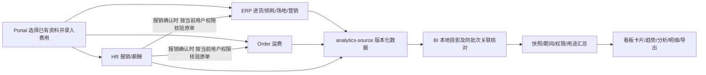

# 成本台账、报销与 BI 联动：本地实现及验收记录

日期：2026-10-21。范围：Platform 的 HR、BI 与 Portal 成本/报销页面。本轮代码与测试已完成；尚未部署、执行共享库迁移或完成真实账号端到端验收。两个仓库均保留原有未提交工作，没有提交或推送。

## 已落实的业务口径

- 成本管理菜单保持进货、损耗、运费、仓储、办公室、营销六个入口；工资和报销仍在人事，成本看板仍在数据看板。
- 差旅、住宿、打车在人事报销登记，并进入看板“员工报销”；人力只取已确认/已发放薪酬的应发金额，激励包含在提成中。
- 独立办公用品、货运等报销按明确的用途类别归集，保留 HR 原始单据。旧记录没有新用途时仍保留原报销分类，不猜测历史用途。
- 费用日期是实际发生日；一般报销的所属月随实际发生日确定。月度租赁、网络服务可填写费用所属月；薪酬取工资所属月。不自动分摊跨月/跨城费用。
- 采购金额与损耗分别展示，不将进货额当作销售成本，也不据此计算利润。
- 原费用已在 ERP/Order 登记时，报销可选择关联原单。当前只支持同城市、同月份、同金额的一对一全额关联。原单承担成本，报销保留原金额但不再次计入。
- 原单版本、状态、用途、城市、月份或金额不匹配时阻止确认；BI 再次核验同一批次原单，变化后转为待核对，防止静默重复累计。
- 固定资产购置保留报销记录，单列待核对，不自动费用化或折旧。本期没有增加资产处理流程。

## 录入页面：系统已有资料优先选择

| 内容 | 复用方式 | 业务仍需确认或补充 |
|---|---|---|
| 员工、部门、城市 | 沿用员工与授权城市接口，员工带回部门、姓名 | 实际费用归属城市；一个负责人多城时逐城登记 |
| 商品、供应商、客户、仓库 | 沿用各成本台账已有选择器和来源接口，保留 ID 与名称快照 | 实际数量、单价、损耗原因等本次业务资料 |
| 已有采购/租赁/营销/运费 | 报销通过现有成本列表搜索，再取详情；自动带回金额、日期、所属月、物品/服务、供应商/出租方/承运方及已有数量、单价 | 费用用途、凭据、付款情况；选择原单不等于重新支付 |
| 差旅/住宿/打车 | 员工、城市、费用类型下拉选择 | 事由、起止日期、出发地/目的地、实际金额、凭据；住宿无需出发地 |
| 办公物品 | 费用类型选择；有原费用时自动带出 | 物品名称、数量、单位；单价可填，金额与数量×单价不同时填写原因 |
| 票据 | 保存后在详情上传 PNG/JPEG/PDF；复用既有附件交互 | 附件、票据编号、无票原因至少一项；不把填了票号等同于发票真实性验证 |

一次出差的交通、住宿、打车分别登记明细金额，可用同一出差事项编号分组；不再额外登记一笔出差总额。仍是明细台账，不声称实现“一张报销单多明细统一审批”。批量录入保存草稿，补充资料后逐条确认。

列表新增报销费用月份、已登记/已确认/已确认且已付款/待确认汇总，明确“确认不等于付款”。详情和历史沿用员工名称解析及 `YYYY-MM-DD HH:mm:ss` 时间展示；无法解析的账号不伪造员工姓名。

窄屏首次进入自动收起二级菜单，报销表单单列、底部操作固定。货运报销同时加载运输环节字典，避免显示内部编码。沿用白底台账与深色 BI 风格。

## 服务与数据链路

领域服务仍是唯一业务写入者。BI 不跨业务库查询、不创建第二份业务费用。进入或重新激活看板会检查源版本；版本变化后重建投影，成功后切换快照，源更新失败保留旧快照并标记延迟。明细和导出固定当前快照，避免总额与明细属于不同批次。

HR 新增原始详情 GET、报销附件列表/上传/签名读取；扩展费用月份及用途明细。原费用核验复用 `/api/v1/orders/logistics-costs/{id}` 与 `/api/v1/erp/costs/{category}/{id}`，以签名的当前用户身份调用，不借服务身份扩大可见范围。

薪酬与月租进入所属月总额，但不伪装成某一天的支出：日累计只累计有实际发生日的费用，页面单独说明本期按月费用。按用途映射不能授予工资或 ERP 原单读取权限。

关键源码：

- HR：`HrExpenseService`、`HrExpenseRules`、`HttpHrExpenseCostSource`、`MybatisPlusHrExpenseRepository`、`CostAttachmentService`。
- BI：`CostSourceNormalizer`、`CostReimbursementReconciler`、`MybatisPlusCostSnapshotProjector`、`CostDashboardService`、`CostAnalysis`。
- Portal：`src/views/supply-chain/cost/CostExpenseFields.vue`、`CostManagementView.vue`、`cost-dictionaries.ts`、`src/api/core/cost.ts`、`src/views/supply-chain/bi/CostDashboardView.vue`。

## 测试数据及逐项对账

所有员工、公司、城市归属和业务记录均为合成测试数据，不是公司的真实交易。公开价格只用于让部分金额有依据，其余金额明确为情景假设。

- [国家统计局 2026 年 7 月下旬流通领域价格](https://www.stats.gov.cn/sj/zxfbhjd/202608/t20260803_1964273.html)：黄豆 4,525.9 元/吨、一级白砂糖 5,191.9 元/吨，分别换算为 4.5259、5.1919 元/kg。不是公司采购成交价，也不是 10 月实时零售价。
- [中国政府采购网苏州市 2025 年复印纸采购结果](https://www.ccgp.gov.cn/cggg/dfgg/zbgg/202503/t20250319_24320207.htm)：A4、70g、全木浆飞毛腿复印纸 14.63 元/包，作为历史采购参考，不冒充当前零售价。
- 运费、租赁、薪酬、营销、差旅等没有核实当地当期合同报价，全部为测试假设。

| 对账项 | 计算 | 预期（元） |
|---|---|---:|
| 人力 | 底薪 5,000 + 绩效 800 + 提成 1,000 | 6,800.00 |
| 货：采购 | 黄豆 1,000kg × 4.5259 + 糖 500kg × 5.1919 | 7,121.85 |
| 货：损耗 | 黄豆 5kg × 4.5259，金额四舍五入两位 | 22.63 |
| 运费 | 三段运输 1,200 + 600 + 320 | 2,120.00 |
| 仓储 | 十月租金；记录日期为九月末 | 6,000.00 |
| 办公 | 十月租金 2,500 + 复印纸 10包 × 14.63 | 2,646.30 |
| 营销 | 测试推广 | 2,000.00 |
| 报销 | 交通 300 + 住宿 796 + 打车 55 | 1,151.00 |
| 已确认经营费用 | 人力 + 运费 + 仓储 + 办公 + 营销 + 报销 | **20,717.30** |
| 月度费用 | 薪酬 + 两项租金 | 15,300.00 |
| 日累计费用 | 经营费用 − 月度费用 | 5,417.30 |
| 关联原运费的报销 | 原金额保留，本笔不再贡献成本 | 320.00 |
| 资产报销 | 待核对，暂不贡献成本 | 4,500.00 |
| 草稿/作废 | 78 / 66，均不贡献已确认金额 | 0.00 |

共 18 条源样例。经营费用明细可显示 13 条已确认记录，其中 11 条贡献金额；另 2 条为关联不重复和待核对。不能把列表原金额直接相加当作看板总额。

源样例：`services/rg-scdp-bi/bi-server/src/test/resources/cost-dashboard/market-scenario.json`。Portal 同份样例在 `tests/fixtures/cost-business-market.json`；`cost-business-contracts.json` 由真实 BI 测试计算输出，非手工编造汇总。

## 本轮实际验证结果

| 检查 | 结果与范围 |
|---|---|
| Portal 成本测试 | 14 个测试文件、126 项通过，含 API 映射、来源选择、金额、批量、台账、看板、操作人展示 |
| 窄屏菜单改动回归 | `console-dashboard` 7 项及 `cost-management-view` 15 项通过；部分与上述 126 项重叠，不累加宣称独立覆盖 |
| HR/BI 定向后端测试 | 52 项通过、2 项性能测试在默认运行中跳过；性能测试此前单独启用运行通过 |
| 后端真实 SQL 场景 | 隔离 H2/MyBatis 验证保存、重试幂等、确认、修改转草稿、版本冲突、作废、租户隔离、筛选汇总、重复原单占用；实际 BI 投影后核对金额 |
| 变化后重算 | 原费用变更后同一时钟内重新投影，关联报销转待核对，新总额变化且旧快照不被改写 |
| 原费用校验 | 不同城市/月、部分金额、非公司运费、状态/版本/场地用途不匹配均拒绝；非法引用返回业务错误 |
| 附件权限 | 检查报销记录权限后才签名，服务身份及无关权限拒绝；文件类型内容校验通过 |
| Portal 构建 | `pnpm build` 通过，含类型检查；保留既有大包体提示。后续小改动再次 typecheck 通过 |
| 静态检查 | 定向 ESLint 无错误；未使用解构变量警告已修复。两个仓库 `git diff --check` 通过 |
| 历史迁移保护 | `prepare-general-ci-baselines.py --check` 通过：10 份冻结基线、464 份历史迁移未改 |
| 全量 Maven verify | 未通过：在 IAM 的 5 个依赖 Docker 的测试报环境错误，本机没有 Docker；全量 reactor 未跑完，不能声称全系统回归通过 |

浏览器通过正式页面组件配合隔离 API 适配器验证：报销编辑保存与详情回显；姓名/秒级时间；选择原费用自动带入金额和承运方；老板只读按钮；看板总额；报销专题交通/住宿/打车分项；逐笔明细的关联和待核对提示；390px 窄屏首次收起菜单及报销表单。

该浏览器入口 `http://localhost:5100/tests/fixtures/cost-business.html` **录入仅保存在内存，看板是后端测试固定快照**，已在页顶明确标注。它不是实时服务端到端环境，页面新保存的草稿不会自动改变固定看板。后端变更重算通过独立 SQL/服务测试验证。附件真实上传、真实登录和跨服务签名联调尚未完成。

截图位于 Portal `docs/qa/cost-business-2026-10-21/`：`03-expense-saved.png`、`04-dashboard.png`、`05-mobile-expense-form.png`、`06-original-cost-selected.png`、`07-expense-analysis.png`、`08-expense-records.png`。最终复核选择原运费后金额为 1,200 元、收款对象带回测试承运商，运输环节显示“厂家 → 中心仓”。

### 性能结果的适用边界

- 10,000 条隔离 H2：真实 MyBatis 投影约 428.45ms，读取快照约 192.28ms；源 HTTP 是模拟。属于一次样本，不能当作 p95 或线上 SLA。
- 100,000 条内存事实、20 并发读取：p50 1,114.63ms、p95 1,148.33ms、最大 1,155.79ms；导出 70,460 行约 198.35ms。排除了 HTTP、数据库加载、权限服务器和源刷新。
- 结果副本在本目录 `cost-business-evidence/`。没有在共享 DEV 做压力测试，不推断共享环境吞吐能力。

## 上线/真实环境验收仍需完成

1. 按现有环境规范核对有效 Nacos、HR 实例/库及 Flyway 历史，再执行新增 `V25__expense_details_and_evidence.sql`。该迁移增加费用月份、关联唯一约束和附件表；H2 只验证 DDL 与空库场景，MySQL 历史 `DATE_FORMAT` 回填未执行。禁止修改已发布迁移或 repair/clean。
2. 部署顺序需协调 HR/BI/Portal 兼容；配置私有 COS 区域和桶，凭据只来自 `COS_SECRET_ID`、`COS_SECRET_KEY`、`COS_SESSION_TOKEN` 环境变量。验证图片/PDF、失效签名、上传失败回滚。
3. 使用真实普通员工、负责人、人事、营销、财务、老板账号核对员工/部门/城市权限及跨租户拒绝。HR 现有区域范围策略未扩展，不能把下拉可选城市当作已经证明全部城市隔离策略正确。
4. 在隔离服务环境通过真实 API 录入→确认→看板→修改重确认→作废逐笔对账，核对导出、断网保留旧快照、并发编辑和原单变更。当前浏览器演示不替代这一项。
5. 原费用关联仅有明确引用的一对一去重；未关联的两笔独立手填记录仍可能重复，需要财务核对。部分报销、多单分摊、统一审批、独立付款核销、资产折旧和外部自动同步不在本轮实现内。

本轮完成的是成本与报销至 BI 的增量实现及隔离验收，不代表 Platform/Portal 每个功能模块或所有真实角色已全面验收。
