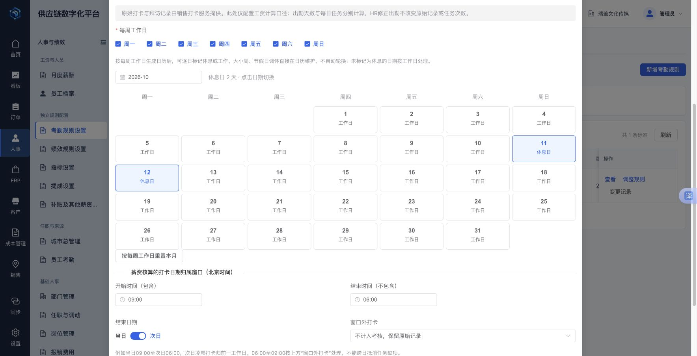
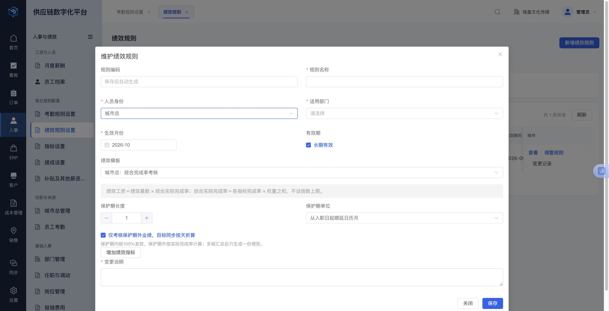
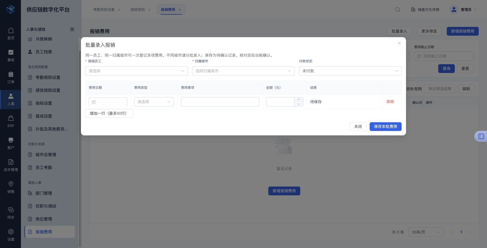

# 人事薪酬与成本归集优化：实现与验收记录

日期：2026-10-19。本文记录本轮代码实现及验证范围，不代表已部署或已由业务验收。

## 1. 本轮确认的业务口径

- 城市总绩效＝绩效基数 × 综合实际完成率；综合实际完成率＝各指标实际值／目标值 × 指标权重之和。新规则不再映射阶梯系数、不设综合倍数上限。
- 销售每天 7 次打卡、3 次有效拜访；过程绩效占 40%，回款达标绩效占 60%。按天考核，超额不抵其他日期的缺口。
- 新版销售规则首月回款免考核；打卡拜访保护期默认从入职日起 10 个自然日，可配置天数；个人免考核日期单独维护。10 天采用自然日的执行口径应纳入业务验收。
- 成本来自现有业务系统台账；报销按费用性质归集，不能因进入看板再生成一笔 ERP 或 Order 成本。
- 工资为税前应发，不新增个税、社保、公积金计算。

## 2. 页面与处理流程

| 入口 | 本轮实现 | 业务处理 |
| --- | --- | --- |
| 人事 → 考勤规则设置 | 部门工作日历，点击切换休息日与工作日；保留每周工作日基准 | 新规则默认全周工作，按日历标记休息；大小周由 HR 标记，不新增自动轮换。移除独立“额外工作日期”输入。既有历史轮换配置仍能读取，不改写历史规则。 |
| 人事 → 员工考勤 → 考勤确认 | 多日期选择、起止日期时间、跨日调休／请假／活动／缺卡说明 | 原始打卡记录保留。异常区间不得重叠；跨月区间可在涉及月份分别登记。HR 同时核定实际出勤、缺勤天数和原因，不把时长擅自换算为工资扣款。确认结果及异常区间一起冻结、审计。 |
| 员工档案 → 薪资标准 | 个人免考核日历、关联补贴方案、试用期比例、个人保护期、月内薪资调整 | 试用期比例默认 80%，结束日期当天恢复正常。固定薪资可设置一次月内调整及调整后底薪、绩效基数。见习与正式城市总的 8000＋4000／8000＋8000 通过个人标准录入，不替业务修改真实员工薪资。 |
| 补贴设置 → 员工薪资标准关联 | 按实际补贴规则版本选择，显示名称、合计金额、生效日期 | 个人关联替代部门补贴，不重复累加。现有 500＋150＋100 已合计 750；也可维护单个 750 项。关联版本需匹配人员身份、任职部门及月份。补贴变更后需同步检查个人关联版本。 |
| 绩效规则设置 | 新城市总规则采用实际完成率；新销售规则配置 10 天过程保护期 | 历史规则继续按历史版本计算；调整规则时创建新版本。不会将旧工资用新公式重新解释。 |
| 月度薪酬 → 绩效明细 | 总部员工按月填写完成率；人工提成补发／扣回及原因 | 总部完成率缺失时进入待核定，不默认为 100%。提成调整保留订单原计算明细；调整后负金额须核对。保存沿用权限、修订号和工资锁定检查。 |
| 月度薪酬 → 人工核定 | 复用已有底薪、绩效、补贴和其他扣款入口 | HR 仅核定需要覆盖的字段，记录原因，重新核算；原业务数据保留。 |
| 提成规则与明细 | 可查看排除分类、商品规格；只读版本也可打开查看 | 数量、数量计提基数、回款计提金额分开标注；保留原有整单付清依据、订单回款跳转及多城市任职归集。 |
| 人事 → 报销费用 → 批量录入 | 一批一个员工、一个城市，最多 50 行；日期、品类、事项、金额、付款状态 | 保存为待确认台账，逐行显示结果。成功行不重复提交；网络结果不明时复用原请求编号重试；明确参数错误允许修改后重新提交。不同城市分批登记。 |
| 成本数据看板 | 报销按性质进入办公、人员相关、运费等分类 | 保留 HR 来源、原单据及权限边界；未知类型显示“待归类费用”。归类版本变化会触发旧 BI 费用快照重建。 |

## 3. 计算规则与示例

### 城市总

两个指标完成率分别为 110%、150%，权重为 40%、60%，则综合实际完成率为 134%。无保护期、无折算时，8000 元绩效基数对应 10720 元绩效；400% 完成率按 4 倍基数计算，不封顶为 3 倍。

入职 10 月 10 日、保护期一个日历月，保护期结束后首日是 11 月 10 日，即覆盖至 11 月 9 日。支持个人指定结束后首日。保护期内按 100%，保护期外按实际完成率。

薪资基数与保护期在月中同时变化时，逐日取当天基数和当天适用完成率，再按自然日／工作日／不折算等已有政策合计；不能简单把“平均基数”乘“平均完成率”。例如 31 天月份，前 15 天基数 4000 且保护期 100%，后 16 天基数 8000、完成率 150%，按自然日合计为 `(4000 × 15 + 8000 × 150% × 16) / 31 = 8129.03` 元。

### 销售

首个自然月沿用铜牌档位规则，回款部分免考核；过程部分排除入职保护日、部门休息日及个人免考核日后逐日计算。少打卡或少拜访按既有规则单价扣减，以过程绩效额度为上限。

新版默认阶段回款目标按当月在职自然日占比折算；“指标设置”已手工调整的当月目标直接使用，避免再次折算。实际业绩继续取整单付清来源，缺失来源不能伪装为零业绩。

### 总部与人工调整

总部实发绩效为基数 × HR 核定完成率，再执行原折算政策；完成率按员工、月份保存。人工提成调整独立记录，可正可负，原订单计提依据保留。

## 4. 数据来源、保存位置及服务职责

| 数据 | 来源与持久化 |
| --- | --- |
| 员工个人薪资、免考核日期、试用期与调整安排 | HR 员工薪资标准；扩展 `hr_payroll_component_version.data_json` 中的个人政策，保留不可变版本。 |
| 部门日历 | HR 考勤规则版本，复用现有 weekdays／restDays／workDays 契约；界面使用日历表达例外。 |
| 考勤异常及确认 | HR → 销售服务读取原打卡；HR 确认时写入 `hr_attendance_note.confirmed_snapshot_json` 和 `hr_attendance_audit`，不修改销售打卡。 |
| 总部完成率、提成调整、人工指标 | `hr_payroll_scheme_month_input.data_json`，以租户、员工、月份隔离；`hr_payroll_scheme_event` 保存变更前后及原因。 |
| 城市总目标 | 复用指标设置的月份目标；实际值按指标配置使用订单销售、整单付清或人工核定来源。 |
| 工资与提成 | HR 调用订单薪酬事实接口，读取整单付清日期、商品数量、有效回款、城市归属；HR 计算并确认工资快照。 |
| 批量报销 | Portal 逐笔调用既有 HR 报销接口；复用 `requestId` 幂等、台账状态、确认、作废、审计。 |
| 成本看板 | Order／ERP／HR analytics-source API → BI 归一化 → `bi_source_cost_record`、`bi_cost_snapshot`、`bi_cost_refresh_state`。数据库访问沿用 MyBatis-Plus，无跨库业务 SQL。 |

费用归类如下：

| HR 报销类型 | 看板归类 |
| --- | --- |
| TRAVEL、ACCOMMODATION、TAXI | 人员相关费用 |
| OFFICE_RENT、OFFICE_SUPPLIES、FIXED_ASSET、CONSUMABLE、NETWORK、OFFICE_MOVING | 办公费用 |
| FREIGHT | 物流费用／运费 |
| 其他未识别类型 | 待归类费用 |

“人员相关费用”目前仅指差旅住宿、交通等已登记费用，**不等同于工资总额或完整人力成本**。办公搬运与货物运输须分别选择；系统不根据“货拉拉”等供应商品牌名称推断科目。

费用归类后仍按 HR 报销权限检查，不能仅持 ERP 办公费用权限就读取 HR 报销；穿透仍回到原 HR 单据。

### BI 刷新与落库

成本刷新与销售经营看板复用 Integration 的同一次调度认领。源码中的 30 秒是轮询频率，不能当成业务刷新间隔；实际间隔由集中调度配置决定，本轮未修改。

成功生成新批次时，在事务中写入费用事实和快照，再切换当前批次指针；源版本校验失败或写入失败保留上一完整批次。源版本、归类口径、截止日期都未变化时复用已落库批次，**并非每次轮询都重复插入全部历史数据**。

新增 `BI_COST_NORMALIZATION=2` 参与快照复用判断。旧快照缺少此版本时，即使源单据未变也会重建费用归类，不受原 4 分钟重复刷新抑制影响。已验证完整写入、复用、升级重建及失败回滚的隔离库测试；本轮未核验共享 DEV 的真实批次。

## 5. 明确保留的边界

1. 部门工作日历用于逐日过程绩效及按工作日折算；员工考勤确认的“月度应出勤天数”继续使用原月度核定规则，没有自动改写该历史规则表。HR 须核对月度总数与部门日历一致。
2. 建联门店、有效门店等目标可通过指标设置维护；本轮未新增这些实际值的 CRM 自动统计。未约定的有效门店判定、杨掌柜品牌对应商品范围，继续走人工核定，不能宣称已自动采集。
3. 月内固定薪资支持一次调整；人员身份／任职城市仍由原任职管理维护，薪资金额变化不会自动变更员工身份。
4. 本次没有重写已确认工资、历史已发布规则，也未创建真实员工工资或报销测试单据。业务应通过新版本启用新口径。
5. 当前仍未完成部署、真实业务走查及正式业务签收；浏览器验证的是页面交互，不是完整服务联调。

## 6. 已执行验证

- HR 考勤、薪酬、版本、权限、工资锁定及持久化回归：126 项通过，0 失败、0 跳过。包括异常跨日区间随确认快照及审计保存、完成率与提成调整的租户／月份隔离、修订号冲突。
- BI 费用归一化、权限、刷新与快照持久化：29 项通过，0 失败、0 跳过。包括源未变时因归类版本升级而重建、分页、回滚保留原批次。
- Portal 9 个相关测试文件共 56 项通过；批量录入的成功跳过、未知结果幂等重试、校验失败修改分别覆盖。
- Portal 类型检查、改动文件 ESLint、生产构建通过。构建保留既有大包告警，不影响本次构建成功。
- Platform `./mvnw -DskipTests package` 全部 47 个模块编译与打包通过；该命令跳过测试执行，不作为全量测试通过证据。
- 数据库迁移冻结基线校验通过：10 个冻结基线、464 个历史迁移未修改。
- 已在 localhost:5100 已登录页面验证部门日历选择／取消、新城市总公式、销售 7＋3／10 天配置、报销批量入口与默认付款状态；未提交真实业务变更。
- 持久化验证使用隔离 H2 MySQL 模式，不能替代共享 MySQL 迁移与真实数据验收。
- 全量 `./mvnw verify` 未通过：IAM 阶段因无 Docker 环境出现 5 项 Testcontainers 初始化错误，IAM 汇总另有 52 项跳过；后续 reactor 模块没有在该次全量命令中运行。该环境没有 `docker` 命令及 `/var/run/docker.sock`。不得将定向测试通过写成全量测试通过。

本机日志：`/tmp/hr-oct19-final-regression2.log`、`/tmp/hr-oct19-bi-persistence.log`、`/tmp/hr-oct19-ui-final-tests.log`、`/tmp/hr-oct19-delivery-build.log`、`/tmp/hr-oct19-platform-verify.log`、`/tmp/hr-oct19-platform-package.log`。

## 7. 启用顺序与业务验收

1. 核对目标环境有效配置、Nacos 命名空间、数据库实例和 Flyway 历史。
2. 校验并执行 Foundation 新迁移 `V42__reimbursement_expense_categories.sql`，增加办公固定资产、办公耗材、网络、办公搬运、货物运输类型。**本轮未在共享数据库执行 V42。**
3. 更新 HR、BI 运行服务及 Portal；HR 个人政策／异常区间／月度核定使用已有 JSON 字段，无额外表结构迁移。本轮未重启现有 Java 服务。
4. HR 为启用月份创建新版绩效规则，核对每人的薪资、保护期、补贴关联、月内调整日期。旧规则按历史版本保留。
5. 触发或等待既有 BI 调度成功，核对新批次及原单据穿透；归类版本会使旧费用快照重建。
6. 用隔离测试员工完成下表，再由业务逐笔复核，确认后发版。

| 验收案例 | 预期 |
| --- | --- |
| 大小周及节假日标休、取消标休 | 日历显示与逐日任务日期一致；其他月份标记保留 |
| 多日期调休、跨日活动、重复区间 | 正常区间保存可回看；重叠区间阻止提交；原打卡不被修改 |
| 销售首月入职、10 天后开始过程考核 | 铜牌；回款免考；保护后按 7＋3 考核，个人免考日不扣过程绩效 |
| 月中离职或手工目标 | 默认目标按在职日折算，人工目标不重复折算 |
| 750 补贴关联 | 仅计算一次 750；过期或部门不匹配版本明确提示 |
| 城市总 134%、400% 完成率 | 分别按 1.34、4 倍计算，不映射阶梯、不套 3 倍上限 |
| 月中保护结束与薪资基数同时变化 | 按日期拆分核算，与人工逐段计算一致 |
| 总部完成率缺失／80% | 缺失待核定；80%按个人基数计算，其他员工不受影响 |
| 人工提成扣回、重复提交、已确认工资 | 留痕；修订号拦截旧请求；锁定工资不可被直接覆盖 |
| 只读提成规则查看排除项目 | 可看分类及规格，不能修改原版本 |
| 批量报销部分成功、网络重试 | 已成功行不再发送；失败行保留结果，不重复生成单据 |
| 报销办公／差旅／运费归集 | 每张单据只计一次；分别进入对应分类，金额与源台账一致 |
| 仅 ERP 费用权限账号 | 不因类别相同而获得 HR 报销访问权限 |
| 无源单据变更的 BI 归类升级 | 新批次落库，旧“报销”事实按性质重建；失败时当前指针不变 |

页面验证截图：

