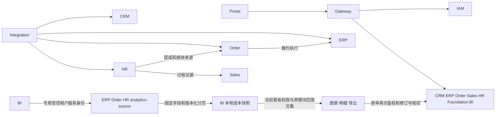

# 六类成本看板及项目接手验收记录

> 阅读顺序：文末「会议调整后的成本与报销规划」是本轮新方案，其中明确标注已确认规则与待定建议。前文“报销独立统计”描述当前代码及此前实现，不是调整后的目标口径。本轮规划没有修改业务代码或数据库。

本轮在现有 Platform 与 Portal 上补齐六类成本看板，入口为「数据看板 → 成本数据看板」`/supply-chain/bi/city-cost`。**激励就是提成，不新增一份激励费用。** 人力沿用已确认月度薪酬；采购和损耗分别展示。代码、隔离回归和组件视觉验证通过，尚不能作为真实角色、共享数据库、正式部署或完整利润核算的验收结论。

## 当前基线和工作区

| 仓库 | 核对基线 | 处理范围 |
|---|---|---|
| Platform | `feature/cost-management`，`6ffd6151f4d86a05b7a95c2c7890a23860cf28b1` | HR 最小薪酬成本源、BI 汇总与权限、定向问题修复、隔离回归、接手文档 |
| Portal | `feature/cost-management`，`5387e0b06cf5fe140e4ff1bbc3a60e646fe27df0` | 六类入口、薪酬组成、原单跳转、交互验证与回归 |
| Workbench | `main`，`819b726eb647f9d3f5bcd58e8cd082d7e2dd5ff3` | 源码定位；无本轮修改 |
| 成本原型、考试系统 | 独立 Git，尚无提交 | 与正式供应链系统分开；无本轮修改 |

工作开始前 Platform 和 Portal 已有大量暂存及未暂存工作。保留这些改动，没有执行 reset、stash、整体暂存、提交或推送。构建期间观察到其他 HR 源码持续变化，因此最终后端在临时目录复制源码进行隔离构建；构建输入与工作区做过逐文件一致性核对。新增项目文件按用户要求单独暂存。

## 架构与调用

当前根 POM 递归纳入 **47 个 Maven 工程、11 个启动应用**。服务数量与启动入口以源码为准，旧文档中协同、城市运营、渠道代理服务和历史 IDEA 运行项不作为当前拓扑。详细业务功能入口沿用 [项目索引](../PROJECT_CONTEXT.md)。

| 服务 | 实现用途 | 主要协作与本轮审查结论 |
|---|---|---|
| Gateway | 路由、JWT、当前会话校验、受信调用上下文 | Portal 请求先过 Gateway 与 IAM，再由领域服务校验权限和数据范围 |
| IAM | 身份、成员、角色、菜单、按钮/API 权限、数据范围 | 工资权限与报销权限独立；老板角色也不能绕过已有授权 |
| Integration | 订货宝/飞书采集、原始数据、映射、导入、调度与核对 | 外部数据通过领域 API 投影，不直接写其他业务库；真实外部同步本轮未执行 |
| CRM | 客户、地址、类型、地区、责任归属 | HR 提供员工，IAM 提供成员，Order 使用订单归属引用；部分独立门店/信用页面仍为占位 |
| ERP | 商品/SKU/价格、供应商、采购、仓库、库存出入调拨、采购/损耗/场地/营销台账 | 是货、场、营销的业务写入方；采购付款、部分采购/库存菜单仍无完整操作页 |
| Order | 订单、履约、发货、回款退款、资金单、发票、物流台账 | 履约向 ERP 发出执行请求并核对回执；物流成本由 Order 持有 |
| Sales | 外勤、拜访计划、定位、证据复核、临时 H5 | PC 接通管控台、拜访计划、主管复核、轨迹对比；其他 pageKey 显示“功能暂未开放” |
| HR | 组织员工、考勤、薪酬规则/核算/确认/发放/补差、报销、经营目标 | 人力读取已确认工资快照，逐商品提成回原工资单追溯；报销保持独立分类 |
| BI | 分析快照、经营/销售/商品/人员看板、对账 | 仅在 BI 库写分析投影；不跨库读取业务表、不修改工资或费用原单 |
| Foundation | 字典及租户覆盖、合并、审计、日历配置 | 动态业务编码由字典提供，历史未知编码保留；在线日历访问属于单独验收 |
| AI | 启动和配置骨架 | 当前无业务 Controller 和迁移，不能描述为已上线 AI 业务能力 |



Gateway 默认 `lb://<服务名>`；领域出站调用使用注入的 `RestClient.Builder` 按 Nacos 注册服务名寻址。DEV 开启 Nacos 配置读取和注册，读取公共及服务专属可选 dataId；本机进程可能进入共享服务池。已修正 [本地开发说明](../SHARED_DEV_LOCAL_RUNTIME.md) 中“Nacos 读取关闭、本机不注册、默认固定本机 Order”等过时描述。

## 六类成本口径和页面

| 类别 | 事实来源及确认条件 | 维度及追溯 | 明确边界 |
|---|---|---|---|
| 人 | `hr_payroll`，仅 `CONFIRMED` / `PAID` 的 `calculation_json.grossPay` | 员工、部门、所属工资月；底薪、绩效、提成含激励、现有津补贴、跨月补差 | 工资月月末归集。READY/REVIEW/DRAFT 不计入。缺分项显示未知；全分项存在时须与应发额核平。不新增社保公积金或薪酬政策 |
| 货 | ERP `erp_cost_entry` 的 PURCHASE / LOSS 确认金额 | 供应商、商品规格、损耗原因；详情显示已登记单价、数量、单位 | 采购和损耗各自统计，不当作销售成本，不自动库存估值、不计入经营费用合计 |
| 运 | Order `order_logistics_cost`，仅公司承担金额 | 厂家至中心仓、中心仓至城市端、城市端至客户端；承运方、方式、类型 | 非公司承担费用不计入；缺环节进入“未记录”，不猜测补齐 |
| 场 | ERP RENTAL，按 WAREHOUSE / OFFICE / 未分类区分 | 仓库或场地、合同；详情展示登记面积 | 面积不能跨月租赁记录直接累加；不自动计算租金、分摊和押金核销 |
| 营销 | ERP MARKETING 确认金额 | 推广/广告/代言等业务字典类型、渠道、负责人 | 有费用数据不等于具备投放归因或 ROI 数据 |
| 报销 | HR `hr_expense` 确认金额 | 办公用品、差旅、打车等类型，员工、部门 | 独立列示，不再从报销类型推断成人力/办公/运费；跨模块重复登记仍需业务核对 |

经营费用合计 = 人力 + 公司运费 + 场地 + 营销 + 报销。以金额非空的确认记录计算，空值与零值不同。金额保持 `BigDecimal`，API 使用十进制字符串，前端不自行用浮点数汇总财务金额。

工资应发成本与付款净额不同：部分发放不把整笔应发额当作欠款。工资在本看板付款状态为“不适用 / 未记录”，实际发放与待发净额回薪酬管理查看。

总览显示六类入口与薪酬构成；分析支持城市、结构、支出对象；支出明细复用同一快照。缺金额、待归属城市、数据更新时间、权限排除范围保留可见。现有原单详情、导出、筛选和异常状态回归继续适用。

## 实现入口与规范

- HR 新增 `MybatisPlusPayrollCostAnalyticsSource`，通过 `JdbcAnalyticsSourceSnapshotStore` 暴露 `HR_PAYROLL_COST`。固定字段、租户绑定、TEXT_UUID 游标，每页最多 1000；不向 BI 复制银行卡、整份计算证据和逐订单薪酬内容。
- `HrPayrollPersistenceSupport.lock` 在原事务锁内推进 `hr_payroll_guard.version`，与工资变更一同提交或回滚。复用现有 guard，本轮没有新增迁移。
- BI `CostSourceDatasets` 加入薪酬源；`CostSourceNormalizer` 按 PAYROLL 与报销分开；分类版本升级到 3，接口口径为 `cost-v6`，旧批次不能用新名称展示。
- `CostDashboardAccess` 使用看板权限和源模块权限交集。薪酬为 `hr:payroll:read`，报销为 `hr:expense:read`；仍要求原有成本看板 read/export 权限。
- `HttpCostSourceDetail` 按 PAYROLL 访问 HR 工资单；已发放状态归一为已确认成本，revision 不一致时要求刷新。Portal `PayrollView` 根据 `sourceId` 打开正式详情。
- 前端手写接口放 `src/api/core/`；不手改 generated API。登录沿用 OIDC PKCE 和内存 Token；后端领域是最终状态写入方。
- 服务分层遵循 interfaces → application → domain；infrastructure 实现端口。跨服务通过 API/事件/本地投影协作。SQL 参数绑定、tenant 隔离、修订号、状态前置条件、审计和事务需要实际测试，不以注解代替行为验证。

## 数据库操作

1. 先核对实际 profile、环境变量、Nacos、目标实例、Schema、Flyway 历史。DEV/local 默认继承共享库，启动不是只读检查。
2. 各服务只操作本领域 Schema；BI 通过 analytics-source 构建本库投影。排查先使用租户限定的只读查询，避免把实际员工资料或凭据写入日志、截图及 Git。
3. 已发布 V/B 不修改。新库使用冻结 B 基线；存量库新增版本向前演进。禁止 clean、自动 baseline、out-of-order 或用 repair 掩盖冲突。
4. 新库、表和字符列使用 `utf8mb4` / `utf8mb4_general_ci`。执行 `python3 scripts/database/prepare-general-ci-baselines.py --check` 后，再按目标环境完成迁移验收。
5. 本轮静态检查通过：10 个冻结基线、464 个历史迁移保持一致。该数量包含历史保留目录，不等于当前运行服务数。本轮未连接或迁移共享数据库，也未重启已有服务。

## 已修问题与尚存缺口

| 优先级 | 问题及影响 | 处理状态 |
|---|---|---|
| P1 | 人力缺少正式工资来源，报销类型归入人力容易造成概念混淆 | 已接已确认薪酬，报销单列；激励与提成只计一次 |
| P1 | 报销查看权限不应推导出薪酬查看能力 | 已拆权限与源数据过滤，增加本人、部门、无薪酬权限测试 |
| P1 | 新旧分类快照可能混用 | 分类版本升级并拒绝旧口径批次，刷新后统一发布 |
| P1 | 缺对象维度时下钻直接解引用可能失败 | 已归入“未记录”，保留金额并可核对覆盖率 |
| P2 | 对比期存在其他类别记录时可能误判当前专题有可比数据 | 改为按当前分类和对象筛选判断可比记录 |
| P2 | 页面初始月份从快照截止日推断，可能与服务返回的历史报告月份不同 | 改用返回的报告期间初始化，增加回归测试 |
| P2 | 总部薪资维护已放开，旧测试仍断言只能销售使用 | 更新总部持久化及审计断言，同时保留未知类别、生效日期拒绝测试；未修改这段业务规则 |
| P2 | 提成范围旧测试按两个选择树断言，当前组件已使用单树排除子类 | 更新为保留父类、排除及恢复子类、历史未知 ID、只读回显测试；未修改提成生产逻辑 |
| P1 | 同一实际费用可能在营销/场地台账与报销分别登记 | 系统无统一跨模块业务费用唯一键，不能可靠自动去重；应按原凭证核对并仅保留一次业务登记 |
| P1 | 仓储、营销等记录缺关键维度会降低分析可信度 | 看板显示“未记录/待归属”；真实缺失比例需实际数据验收，不能用样例推断 |
| P2 | 部分 ERP/CRM/HR 菜单落到 `CapabilityView`，采购付款为专用占位页；Sales 非接通页显示未开放 | 已记录为未完成范围，不能算完整业务闭环；需按业务优先级单独补齐，而非填假数据 |
| P2 | AI 只有骨架、独立 Workbench 部分页面未形成业务提交闭环 | 与现有 Sales 临时 H5 区分；本轮不冒充已完成能力 |
| P2 | 打包仍提示 ExcelJS 单块约 937 kB | 构建成功；当前为包体积提示，不等于已测得用户首屏性能问题 |
| 待验收 | 实际 IAM 角色、共享库迁移、原单追溯、外部同步、冷缓存和端到端压测 | 需要指定 DEV 目标和测试身份；共享压测还需允许负载。用户此前仅同意本地隔离测试 |

## 角色与场景验收矩阵

| 视角 | 场景与应有行为 | 本轮证据 |
|---|---|---|
| 老板 | 六类可见范围明确；分类金额可追溯；采购不等于销售成本；没有历史数据不显示虚假增幅 | 后端计算、独立 Decimal 核对及正式组件隔离预览 |
| 人事 | 已确认工资、待确认工资、已发放、部分发放、补差；底薪绩效提成分项与总额核平 | HR H2 源查询、工作流测试和 BI 汇总测试；未用实际工资数据 |
| 营销 | 仅有营销权限时不看到工资；按渠道/负责人分析缺维度归未记录 | 权限及归一化测试，真实营销角色会话未验收 |
| 普通员工 | SELF 只含本人，不能通过 snapshotId、原单 ID、导出绕过授权 | 既有权限与导出回归及新增薪酬 SELF 测试 |
| 部门负责人 | 当前部门及后代授权规则；看板与源权限取交集 | 部门路径测试；实际组织关系需目标环境核对 |
| 财务 | 报销单独列示；零值与缺值分开；工资应发不推算银行欠款 | 归一化、明细、金额精度、空值、状态测试 |
| 跨租户与变更 | 租户隔离、1000+1 游标分页、回滚不推进版本、源修订变更阻止旧详情 | 新增薪酬源 H2 测试与原单修订号测试 |
| 日期边界 | 月末、闰年、完整历史月、当月截至日、全年同比 | CostPeriod 系列测试；新增 2024-02-29 薪酬归集断言 |
| 交互与响应式 | 六类入口、按员工/部门分析、支出列表、说明弹层、390 像素无页面横向溢出 | 本轮浏览器截图；仅虚构测试数据，不是登录验收 |

## 验证结果与复现

- Portal：`pnpm test:run`，164 个文件、1180 项通过；`pnpm build`（含 vue-tsc）通过；本轮变更文件定向 ESLint 通过。
- Platform：隔离源码目录执行 `./mvnw verify` 并显式排除 18 个必须依赖 Docker 的测试类，330 份测试报告共 2107 项，其中 1817 通过、290 跳过、0 失败/错误，架构门禁通过。
- 290 项跳过细分：285 项 Docker 不可用、3 项无 `BI_TEST_MYSQL_URL`、1 项未开在线日历测试、1 项未开手动性能测试。18 个显式排除类不包含在上述计数内。不能描述为全部 MySQL/迁移测试通过。
- 第一轮工作目录测试发生 ClassNotFound；隔离复制后消失，推测为共享构建产物互相干扰。隔离回归随后暴露总部薪资旧断言，更新测试后全套上述范围通过。
- 对测试原始事实另用 Python `Decimal` 独立复算：9 月经营费用 `282977.52`，人力 `10000.06`，其中底薪 `8000.02`、绩效 `1000.00`、提成 `1000.04`；采购 `505492.06`、损耗 `19410.05` 单列。**这些数值全部是测试样例，不能用于经营决策。**
- 本地性能：10 万条事实、20 并发查询，单轮 P50 `1101.18 ms`、P95 `1116.91 ms`、最大 `1143.96 ms`；70460 行 CSV 构建 `203.76 ms`。只测内存计算，排除数据库加载、IAM/Gateway/HTTP、源刷新、网络下载；没有生产 SLA 结论。当前缓存最多 4 个快照，冷缓存和多租户内存峰值仍需环境压测。

性能可单独执行：

```bash
./mvnw -pl services/rg-scdp-bi/bi-server -am test \
  -Dtest=CostDashboardServiceTest#benchmark100000FactsWith20ConcurrentReaders \
  -Dcost.performance=true -Dsurefire.failIfNoSpecifiedTests=false
```

合成预览由 `CostDashboardServiceTest#writesSixCostPreviewFromSameTestedCalculationContract` 生成，复制到 Portal `tests/fixtures/cost-dashboard-six-costs.json`。访问 `/tests/fixtures/cost-dashboard.html` 运行正式组件，页面明确标注虚构数据，只支持预生成的固定场景；未生成的筛选、原单和写操作明确拒绝，不能视作正式 API 联调成功。

## 页面审查步骤与证据

1. 费用总览：检查人、货、运、场、营销、报销均有入口；薪酬构成与总额相符。六类卡片提高费用查找效率，货的两项保留独立口径。
2. 人力入口 → 员工/部门：验证专题和维度切换，工资金额归属对象；历史缺维度不崩溃。逐商品提成通过原工资单查看，当前原单浏览器链路受登录条件限制。
3. 支出明细：工资显示确认状态、月末日期与不适用付款口径；顶部提醒登记记录不是银行流水。未模拟的原单和导出在隔离页禁止执行。
4. 390 像素视口：六类卡片及薪酬分项排列为单列；DOM 可用宽度与 scrollWidth 均为 375，未发现整页横向溢出。页面较长，桌面运营使用仍是主要场景。
5. 统计说明弹层：窄屏可滚动，关闭按钮可见。截图不能证明屏幕阅读器与键盘全链路符合无障碍标准；需真实浏览器登录态补测。

截图及合成数据均位于 [Portal 页面证据目录](../../../rigour-supply-chain-portal/docs/qa/cost-dashboard-six-costs/)。


后续验收顺序：在指定 DEV 核对真实配置及迁移历史 → 对齐 HR/BI/Portal 版本并刷新成本快照 → HR、营销、老板和普通员工账号分别走总览、筛选、原单、导出 → 抽样与原工资单/费用/报销核平 → 在明确负载内完成含冷缓存的端到端性能测试。

## 2026-10-21 成本管理角色与流程复核

针对用户下午提供的运费页面反馈，本次重新检查正式 Portal 成本页面、导航、API 适配和 ERP / Order 汇总实现。判断：六类数据来源已有实现，但成本工作区的入口组织、待处理任务、金额解释和窄屏录入仍有具体问题。此前“数据接入、测试通过”不足以说明五种角色的工作体验已经验收。

### 五个角色的目标、问题与处理

| 视角 | 必须完成的业务工作 | 本次处理及仍需验收的部分 |
|---|---|---|
| 产品经理 | 找到正确入口，登记、补齐、核对、确认、纠错、查原单；让操作人知道下一步 | 成本导航按人、货、运费、场、营销、报销分组，复用 IAM 已可见的薪酬、报销和看板入口；增加待补金额、待确认、已确认、已作废入口，保留运输环节和其他筛选。缺金额的记录不可直接确认。真实跨服务全流程仍待登录验收 |
| 测试 | 检查零值/缺值、状态、查询失败、导出、权限及桌面/手机操作 | 查询失败清除旧记录数和旧汇总；补测缺金额与零元、状态筛选、导航授权及报销时间契约；实测并修复报销弹窗固定 800px 导致右侧字段和保存按钮不可见的问题。并发修改、租户隔离及真实负载不能由前端隔离测试代替 |
| 人事 | 已确认底薪、绩效、逐商品销售提成可追溯到员工和工资月；激励就是提成，不能另算一份；报销单列 | 增加现有薪酬/报销入口，不改本轮薪酬规则；报销标明确认与付款是不同状态。发现 HR 报销详情只返回修改时间，前端曾用其冒充录入时间，本轮改为缺失值。补齐后台录入人、修改人、录入时间契约仍待处理；真实工资单逐商品提成核对未完成 |
| 营销人员 | 记录投放事项、推广/广告/代言类型、渠道、期间、合作方、经办人与金额，能补资料和核查 | 渠道和服务期间移入主表单，列表展示渠道，缺失显示“未记录渠道”；提示员工底薪/绩效/提成属于人力、与报销避免重复登记。当前未建立投放效果归因或跨模块唯一费用标识，不提供推算 ROI 或自动去重 |
| 老板 | 知道钱花在哪、哪些数已核对、哪些金额未知、统计覆盖哪些记录，并能回到原单 | 有缺金额时将登记汇总标为“已知部分”，显示未计入条数；明确按当前筛选汇总、作废不计金额、确认不等于付款。增加已授权成本看板入口；隔离只读角色无新增/编辑/确认/作废按钮。采购和损耗继续单列，不能由这些台账推算销售成本或真实利润 |

### 截图中“3 条记录、金额为 0”的结论边界

- 已核实源码：Order `MybatisPlusOrderLogisticsCostRepository` 171–184 行及 ERP `MybatisPlusErpCostRepository` 227–238 行，`COUNT(*)` 包含筛选后的作废记录，登记金额排除作废，确认金额只统计 CONFIRMED；缺金额另计。因此三条均作废、或金额都待补时，记录数与金额可以同时为 3 和 0。
- 未核实：用户截图中这三条实际记录的状态、金额和租户数据。本轮未连接共享数据库，不能把截图直接认定为算法错误，也不能认定这些就是以前的测试记录。
- 已修页面解释：展示当前筛选口径、已知金额、未计入条数及作废排除规则，使用户能区分没有支出、金额待补和已作废记录。

### 浏览器验收步骤与证据

所有页面使用正式 `ConsoleShell` 和 `CostManagementView`，请求由独立测试入口拦截；顶部标记“全部为虚构数据、不连接业务服务”，未覆盖请求报错，写入请求全部阻止。角色切换只用于前端入口/按钮验证，**不是 IAM / Gateway 数据授权验收**；工资和看板跳转目标明确为入口占位说明，不宣称已经跑通原工资单或 BI。

1. 业务经办：看到六类已授权入口；运费选择待补金额后只显示一条测试记录，确认按钮禁用、编辑仍可用；全部记录中已确认 1200、作废 99、未知金额一条，已知小计为 1200。此处金额是人工构造样例。
2. 营销：仅保留营销导航；新增表单可直接填写渠道/服务开始/截止，滚动后保存按钮持续可见。
3. 老板只读：列表保留查看记录/导出，新增、编辑、确认和作废不出现；保留已知部分与待补说明。
4. 人事：薪酬/报销入口存在，报销按员工及费用类型登记，确认和付款口径分别显示；未用真实员工工资验证。
5. 390×844：收起二级菜单后页面 DOM 宽 375，无整页横向溢出；报销弹窗宽约 374.4，页面宽 390，取消/保存均在视口内。长表格仍需横向查看，手机不是复杂台账的主要使用场景。

截图目录：[Portal 本次角色与流程证据](../../../rigour-supply-chain-portal/docs/qa/cost-workflow-2026-10-21/)。隔离预览：Portal 开发服务的 `/tests/fixtures/cost-workflow.html`；该文件不属于正式业务路由，不连接业务 API。


### 本次回归结果与范围

- Portal 8 个定向测试文件、105 项通过：cost-navigation、cost-manual-records、cost-management-api、cost-management-view、cost-goods-fields、hr-navigation、console-workspace-tabs、audit-actor-display。覆盖既有员工姓名、年月日时分秒与导出显示回归。
- `pnpm build`（含 vue-tsc）通过；本次变更文件 ESLint 通过。构建仍有既有 ExcelJS 大块提示，不据此推断真实用户加载时间。
- 本轮没有更改后台业务代码、执行数据库迁移、重启业务服务或进行共享环境压测。上文此前全量/内存性能结果不属于此次复测；本次没有新增后台性能结论。
- 新增导航工具、测试、隔离预览和截图加入 Git 暂存区；原有其他未提交工作保留。当前是本地修复，未提交、未推送、未部署。

仍需真实环境验收：角色和数据范围（本人/部门/城市/全租户）、单据修订冲突与重复提交、上传/下载权限、报销审计元数据、工资提成逐商品追溯、跨模块重复费用核对、冷缓存和 HTTP 全链路性能。上述缺口不能以菜单分组和本地通过用例替代。

### 15:16 用户确认的菜单归属修正（替代上文跨模块入口方案）

成本管理下只显示进货记录、损耗记录、运费、仓储费用、办公室费用、营销费用六项，保留货、运费、场、营销分组。薪酬和报销仅保留在人事菜单，成本看板仅保留在数据看板菜单；成本页顶部重复的看板链接一并移除。六类成本统计维度不代表六类功能都需要搬入成本菜单。

导航现只读取当前模块的可见节点；即使其他模块入口可见，也不拼入成本菜单。隔离页面已逐个切换成本、人事、看板菜单验证归属。4 个定向测试文件、28 项通过，类型检查、变更文件 ESLint 通过。截图：[六项成本菜单](../../../rigour-supply-chain-portal/docs/qa/cost-workflow-2026-10-21/08-cost-menu-six-entries.png)。本次未部署。

## 进货、报销与其他成本的字段和页面方案

本节回应“每个功能应该涵盖什么、缺哪些字段、页面怎样展示”。以下明确区分当前代码、建议方案和未验收事项；新增报销业务字段仅在交互评审样例中展示，尚未接入正式接口或数据库。成本菜单仍只有上节六项，报销留在人事菜单。

### 当前代码核实出的关键差距

1. 进货已有商品、规格、单位、进价、数量、供应商、仓库/地点、城市、日期、金额、差异说明、系统采购单/外部凭据和附件。并非这些字段完全不存在。正式实现是“一条记录一项商品规格”，不是“一张进货单含多行商品”。依据 Portal `CostGoodsFields.vue`、ERP `ErpCostGoodsDetails`。
2. ERP 的 `ErpCostService.validateConfirmation` 已要求进货确认前补数量、供应商；零单价及金额不等于四舍五入后的单价乘数量时须说明。表单当前未清楚表达“草稿可暂缺、确认前必补”的阶段要求。
3. HR `HrExpenseCommand` 只有事项、类型、员工、城市、日期、金额、付款状态、备注、原因等通用信息。没有物品、行程、服务期间、费用凭据、付款日期/金额/凭据或关联原成本单字段。后台状态是 DRAFT / CONFIRMED / VOID，不是员工申请、主管审批、财务打款流程。
4. 报销详情明确排除了 `CostAttachments`；HR Expense API 未暴露费用附件端点。页面提示“核对凭据”不代表系统已经支持报销凭据上传。
5. 批量报销按行调用保存接口，一次可录入多项但落为多个独立费用记录，没有报销申请主单、多行合计、统一审批状态。不能向业务方宣称已有“一单多项”。
6. HR 的 `HrPageView` 仅返回 total/begin/step/items，未提供当前筛选的已确认金额、待确认数等汇总。此前隔离夹具额外提供这些字段超出了正式契约，已移除；这些汇总仍需 HR 按授权范围增加正式查询，不能在浏览器把当前分页当全量汇总。
7. 报销类型迁移代码已有差旅、住宿、办公室租赁、办公用品、交通打车，并追加固定资产、办公耗材、网络、办公搬运、货运。目标租户当前启用了哪些选项还需读取实际字典，不能由迁移文件推定已上线。

### 进货记录：字段、阶段规则和展示

| 业务区 | 应涵盖的字段 | 当前情况 / 处理方案 |
|---|---|---|
| 商品 | 商品、规格、计价单位 | 已有。已有商品用授权下拉选择并保留名称快照；手工补录明确标识来源。箱与件不能直接加总或擅自换算 |
| 交易对象 | 供应商、收货仓库或地点、归属城市 | 已有。供应商可暂缺保存，确认前必填；明确哪个仓/地点收货。列表将供应商和收货地放在一起，避免逐行打开详情 |
| 发生时间 | 进货日期、系统录入时间、最后修改时间 | 进货日期由业务填；系统时间显示到秒。若需要区分下单日/实收日，后续增加独立字段，当前不能把进货日期擅自解释为验收入库日 |
| 计价 | 进货单价、数量、登记金额、差异/零单价说明 | 已有。单价和数量按原精度，展示金额到分；参考金额辅助填写，不能覆盖人工登记值；确认前数量大于零、金额已知、差异说明齐全 |
| 经办 | 业务经办员工、系统录入员工、修改员工 | 系统留痕与业务经办分开。业务经办 UI 需补，优先复用公共员工字段和已授权员工来源，不再造同义字段 |
| 来源凭据 | 采购单号/外部单号、来源系统、单据日期、附件、补充说明 | 已有来源结构与费用附件。来源不是强行新增一张采购单；同一外部单据多个商品可关联同一单号。凭据不等于付款凭证 |
| 状态 | 待确认、已确认、已作废；付款信息若有单独展示 | 已有确认/作废。确认只核对成本记录，不自动入库、生成应付或完成转账 |
| 可选追溯 | 批次、生产日期/有效期、单价含税口径、折让/退货关联 | 当前货品成本结构没有这些字段。按实际经营需求分期扩展；退货、折让不能简单以负数混入本轮非负金额台账 |

页面默认列建议：**日期/单号 → 商品/规格 → 供应商/收货地 → 数量与单位 → 进货单价 → 登记金额 → 确认状态 → 操作**。将规格与商品合并、单位与数量合并，优先让主要金额在桌面可见；完整来源单据、经办及录改信息放详情，支持补充列。筛选优先商品、供应商、城市/仓库、日期和处理状态；不能只用通用“费用标题”搜索。

录入按“商品与收货 → 数量与金额 → 来源与核对”分组。保存待确认时不伪造未知金额；确认失败明确指出缺数量、缺供应商或金额差异。修改已确认记录须写原因并回到待确认，已有系统审计继续保留。

### 报销：通用信息和按类型展开的信息

本阶段仍是人工费用登记。建议保持“一项费用一条明细”，一次批量录入可有多项，先保证每项能说明用途、归属、凭据和付款情况。若以后需要“一张申请单、多类费用、审批后付款”，应单独定义申请主单/明细/审批与付款记录，不给现有确认按钮改名冒充审批。

| 所有报销共用 | 当前 / 建议 |
|---|---|
| 报销单号、报销员工、部门、归属城市、费用发生日期、类型、事项、报销金额 | 已有主体字段；员工选择系统档案，部门由档案带出。列表优先显示姓名和部门，内部 ID 不作为业务名称 |
| 具体用途/事由 | 当前只有标题和备注。建议明确用途字段，支持按类型提示，避免所有详细信息混在“备注” |
| 供应商/收款对象 | HR Expense 目前没有，建议补；不因此采集或复制银行账号到普通列表 |
| 费用凭据、无凭据说明、凭据状态 | 需补 HR 附件契约与授权下载、上传人/时间、归属费用关联。建议核对凭据或明确无凭据说明；历史记录保留“待补”，不伪造附件 |
| 确认状态、付款状态 | 当前有。确认与付款必须两列或同单元格明确分层 |
| 实际付款日期、金额、方式、凭据编号、登记人 | 需补付款登记结构及规则。已有“已付款”不能反推出银行支付时间、流水或分次付款；部分付款/退款目前不能认定已支持 |
| 关联已有成本记录、疑似重复线索 | 需补跨模块关联契约、租户/权限校验、计入看板的唯一口径。金额/日期相同只能提示疑似，不能直接删除或自动扣减 |
| 录入人/时间、修改人/时间、确认/作废操作记录 | HR 详情仍缺录入人/时间和修改人，需从现有实体返回并解析员工名称；不能用修改时间代替创建时间 |

| 报销类型 | 应展示的专属信息（建议补充） | 核对重点 |
|---|---|---|
| 办公用品、办公耗材 | 物品名称/规格、数量、单位、单价、用途/领用对象 | 能说明买了什么、给谁用；不能把供应链销售商品进货与办公用品采购混为一类 |
| 差旅 | 出差人员、起止日期、出发地/目的地、出差事由；交通、住宿等费用明细 | 日期先后正确；一次出差多个费用明细能关联同一出差事项；不把总额再次与各项相加 |
| 住宿 | 入住/离店日、地点/酒店、住宿人、间夜或天数、金额 | 住宿可能属于差旅行程，应有明确关联，避免在差旅总额和住宿明细中重复计算 |
| 交通打车 | 乘车时间、起点、终点、出行事由、行程/票据 | 员工是谁、去哪里、为什么去；同一行程凭据再次使用时提醒核对 |
| 网络费用 | 使用场所、服务商、计费期间、用途 | 跨月费用按既定期间口径处理，不擅自自动摊销 |
| 固定资产 | 物品、规格、数量、单价、领用人/场所、凭据；资产编号仅在已有资产流程存在时关联 | 报销登记不自动等同资产入账或折旧 |
| 办公搬运 | 起点/终点、搬运日期、内容、服务商 | 区分办公室搬迁和供应链货运 |
| 办公室租赁、货物运输 | 关联对应办公室费用/运费原记录、代垫员工及凭据 | 已在成本台账登记的同一笔费用只能计一次；现阶段无自动去重，必须显示待核对 |

页面默认列建议：**发生日期/单号 → 员工/部门 → 类型/事项 → 报销金额 → 凭据状态 → 确认状态 → 付款情况 → 操作**。录入先选员工、类型和日期，再动态展开物品/行程/期间字段；类型变化清除不相干的专属字段。详情分“费用信息、凭据、付款、操作记录”，避免一张通用大表要求用户阅读原始 JSON。

当前没有正式全量金额汇总时，页面不补假卡片。需要汇总时由 HR 提供按同一筛选、同一角色数据范围计算的金额和待处理数量，不能只累加当前页。

### 其余成本页同样按业务对象设计

| 页面 | 核心字段与展示主线 | 补强重点 |
|---|---|---|
| 损耗记录 | 商品/规格、数量/单位、发生日期、城市/仓库/地点、原因、登记损耗金额、证据 | 先回答“损了什么、在哪、为什么、损多少”；缺金额待补，不按当前进价自动估值。处理结果/责任经办可后续补字段，不凭原因推断责任人 |
| 三段运费 | 运输环节、实际发货/收货对象、地址、日期、承运方、运单/来源单据、承担方、登记金额 | 三种环节分别显示相关对象；列表直接展示路线、金额和状态。车辆批次/计费重量体积/运费分摊需独立规则，当前不假装已有 |
| 仓储费用 | 仓库、归属城市、租赁面积、地址、费用月份、租金、出租方/合同、租期、押金 | 同仓同月核对重复；面积不随月份累加，押金与租金分开；合同期间与本次费用月份分开 |
| 办公室费用 | 办公室名称、城市/地址、面积、费用月份、租金、合同/出租方、租期、押金 | 与仓储同结构但对象明确。水电物业若要计入场地成本，应明确分项；不能仅改标题继续叫租金 |
| 营销费用 | 推广/广告/代言类型、活动事项、渠道、服务期间、合作/收款方、经办人、城市、金额、凭据 | 以活动与投放为主线；活动编号/合同关联、预算和效果数据按后续需要补。员工提成归人力，激励不另算；没有效果来源不生成 ROI |

### 角色、规则与测试验收

- 产品经理：新增 → 保存待确认 → 补字段/凭据 → 核对确认 → 查看明细与系统留痕 → 修改/作废。每一步说明当前记录状态和下一步；菜单归属与成本统计分类分开。
- 人事：报销员工和部门正确、代录人与费用归属人不同、离职员工历史记录可回显；本人/部门/全域权限分别验证。工资仍核对底薪、绩效、逐商品提成，报销不并入提成。
- 营销：能按活动、渠道、合作方和经办人查费用；差旅打车登记在报销，不能在营销费用再记同一支出。缺渠道必须显露，不能全部归“其他”后宣称统计完整。
- 老板：能追溯每笔金额、看到待补和有效范围，不能把作废、未知金额、重复登记或采购金额混成经营利润。功能尚缺的维度显示缺失，不补推算值。
- 测试：覆盖手工/关联商品、规格切换、不同单位、小数/零/未知金额、数量零值、金额差异、重复请求、版本冲突、已确认变更、类型切换、日期反转、无凭据说明、跨员工/部门/租户访问、付款证据缺失、导出一致性、窄屏和键盘。新增附件要覆盖大小/类型/上传失败/未授权下载与重复上传；相关条件须写入后端校验。
- 性能：列表分页、授权汇总、复杂筛选、批量费用提交和附件应分别测量，再测包含 Gateway/IAM/HR/ERP 的端到端延迟、错误率、冷缓存与并发冲突。共享环境和允许负载尚未指定，本节不提供未经执行的性能结论。

### 实施边界和交互样例

优先顺序：① 进货字段阶段提示及列表主次；② 报销按类型明细、凭据与真实审计字段；③ 付款登记和跨模块关联；④ 完整申请审批/分次付款等有独立规则的功能。已有字段复用，新字段同步更新 HR/ERP 契约、校验、授权、审计、查询/导出及 BI 源投影，不能只在页面放几个输入框。数据库只有确需索引/结构或附件关系时新增前向迁移，不改已发布迁移，不连接共享库试跑。

可操作样例在 Portal 开发服务 `/tests/fixtures/cost-entry-design.html`：包含进货/报销列表、编辑、待确认保存、确认校验、按类型切换字段和详情。所有数据虚构且只存在本页内存，刷新还原，无 API 调用、文件上传或真实付款；标记“建议补充”的能力不是正式功能。输入校验用于演示待议流程，不替代生产后端规则。

已核对样例的进货缺供应商/数量/金额拦截、补数量后参考金额填写并确认；报销类型切换展示专属字段。该浏览器检查是交互样例验证，不能等同业务联调。

补充验证：打车样例选择员工后部门同步，填写行程、用途与示例凭据后确认为“已确认 / 未付款”；390×844 下弹窗宽 356，确认按钮底部约 798.2，页面无横向溢出。正式进货表单已补供应商/数量的“确认前必填”提示和零单价说明提示；5 个相关测试文件、79 项通过，变更文件 ESLint 通过。新增原型脚本通过 Node 语法检查；它不承担生产金额计算、权限或审批功能。

页面证据：[进货列表方案](../../../rigour-supply-chain-portal/docs/qa/cost-workflow-2026-10-21/09-purchase-entry-design.png)、[进货确认缺项](../../../rigour-supply-chain-portal/docs/qa/cost-workflow-2026-10-21/10-purchase-required-fields.png)、[打车专属字段](../../../rigour-supply-chain-portal/docs/qa/cost-workflow-2026-10-21/11-taxi-expense-design.png)、[报销列表方案](../../../rigour-supply-chain-portal/docs/qa/cost-workflow-2026-10-21/12-expense-list-design.png)、[窄屏方案](../../../rigour-supply-chain-portal/docs/qa/cost-workflow-2026-10-21/13-expense-design-mobile.png)。

## 会议调整后的成本与报销规划（2026-10-21，方案，未实施）

### 已确认规则、建议和证据边界

本轮依据用户转述的会议内容、后续明确回复以及两个仓库的本地代码规划。没有取得新的会议原始截图，也没有连接共享数据库核实实际租户字典、负责人账号或线上部署。核对基线仍为前文 Platform / Portal 的 HEAD，并包含现有未提交改动。

用户已经确认：

- 成本管理只保留进货、损耗、运费、仓储、办公室、营销六项菜单；薪酬、报销在人事模块，看板在数据看板模块。
- **人力只统计已确认薪酬**，底薪、绩效、按销售商品计算的提成分项展示；激励就是提成，不再加一份。差旅不并入人力。
- **按费用实际发生或明确的所属月份统计**。财务每月 15—20 日集中处理，不改变费用所属月份；跨月租赁等按明确的月份明细登记，不自动分摊。
- 报销按实际用途归集是本次规划方向；保留报销原单、员工及来源追溯，不能通过复制到另一台账形成第二笔成本。

建议但尚未确认：在看板增加「经营管理费用」，一般采购出差、仓库巡检、行政办事等进入其下的「差旅」；能够明确关联推广活动、展会的差旅进入「营销 → 活动差旅」。这只调整统计分类，不增加成本管理菜单。规则确认前，相关金额显示为「待归集」，不能自动归到人力或营销，也不能从完整性提示中消失。

“场”暂按用户前述仓储与办公室理解。若会议中的“厂”实际指生产工厂，则属于另一业务范围，当前代码没有证据支持将其自动替换为现有场地。

### 重新组织业务：用途、来源和状态分别保存

同一笔费用至少有以下独立维度。不能再用“HR 来源”直接代替“成本类别”，也不能用员工所属部门代替费用归属城市。

| 维度 | 例子 | 作用 |
|---|---|---|
| 成本用途 | 场 / 办公运营 / 办公用品 | 决定看板统计归属 |
| 费用类型 | 办公用品、车票、住宿、打车 | 决定填写内容，也用于跨用途分析 |
| 来源 | ERP 台账、Order 运费、HR 报销、HR 薪酬 | 保留原单、服务责任和访问权限 |
| 归属 | 费用城市、所属月份、受益事项或活动 | 解释为谁、在哪个期间发生 |
| 人员 | 费用归属员工、业务经办人、系统录入人、确认人 | 支持负责人分工和财务代录；这些角色不能合并 |
| 状态 | 待确认 / 已确认 / 作废；未付 / 已付；待归集 / 已归集 / 待核对 | 分别表示费用核对、付款登记和归集质量，不互相冒充 |

例如「员工张某为杭州办公室购买纸张 200 元，次月 18 日录入」：来源为 HR 报销，用途为场—办公运营—办公用品，城市为杭州，费用月份沿用实际发生月份，录入人可以是财务。最终增加 200 元办公运营费用，不再加 200 元“报销成本”。

### 建议分类表：先按用途，再按明细类型

| 看板类别 | 涵盖内容及报销归入规则 | 必须避免的误解 |
|---|---|---|
| 人：薪酬 | 已确认底薪、绩效、商品提成；其他已存在薪酬分项按原薪酬契约解释 | 不把差旅、打车、住宿加到工资；激励与提成只计一次 |
| 货 | 进货登记与损耗登记分别查看；员工代购用于销售的商品，须明确商品用途和原进货记录 | 办公电脑、打印纸不是用于销售的货；采购额不是销售成本，损耗也不能再次叠加成虚构利润扣减 |
| 运 | 厂家/供应商→中心仓、中心仓→城市端、城市端→客户的货物运输；符合这些用途的货运报销归这里 | 打车载人、办公室搬家不能仅因承运平台叫“货拉拉”就算商品配送；环节未知保留待补 |
| 场：仓储与办公 | 租赁、明确用于仓库/办公室的运营支出；办公用品、耗材、网络、办公搬运按实际场所归入相应子项 | 租金与运营费分开；面积只作为场所属性，不按月累加；不能把办公运营费统称租金 |
| 营销 | 推广、广告、代言及明确活动/展会的相关支出；活动差旅作为待确认的子项建议 | 普通客户拜访、采购出差不能仅因经办人属于营销部门就归营销；不凭费用推算 ROI |
| 经营管理（建议新增统计类） | 一般采购、运营巡检、行政办事等差旅，按目的、责任部门/员工细分 | 属于看板分类建议，不新增成本管理菜单；暂不包括未定义的所有“其他费用” |
| 待归集（质量状态） | 用途不清、规则未定、城市/月份待核实的金额与笔数 | 不是一个长期兜底业务大类；需展示原因、责任人和处理入口 |

固定资产购置、押金等须另标「支出性质」，与当期费用分开查看。是否纳入费用及何时计入需要业务口径，当前不做自动折旧、摊销或会计凭证；不能仅凭“报销”二字将全部购置金额扣入期间费用。此处是管理看板的展示方案，没有新增财务制度。

差旅的建议结构是「用途类别 × 明细类型」：在经营管理或营销中只贡献一次金额；另外提供“全部差旅”筛选，把跨用途的交通、住宿、打车汇总用于分析，这个筛选结果不是再次相加的总额。是否有餐补等类型，按实际政策另定，不凭空生成。

### 页面与录入：沿用现有入口，补业务内容

成本六项台账继续各自录入。HR 报销页面增加用途、月份、凭据、原费用关联等字段。优先完善现有页面，不先造一张横跨所有服务的通用费用表。

| 页面 | 主要字段和展示 | 本次规划的补齐重点 |
|---|---|---|
| 进货 | 商品/规格/单位、供应商、数量、单价、登记金额、收货仓/地点、城市、日期、经办、外部单据/凭据 | 大部分主体字段已存在；补经办展示及确认前提示，列表突出商品、供应商和金额；一条一商品，后续一单多行另做主明细模型 |
| 损耗 | 商品/单位、损耗数量、地点、原因、责任经办、日期、登记金额及估值依据 | 未知金额保留未知；不拿现价自动估算历史损耗，不自动扣库存 |
| 运费 | 三段环节、发/收方、承运方、运单、公司承担金额、日期、城市、来源单据 | 环节与路线有业务含义；报销同一运费只做原单关联，不重复登记 |
| 仓储 / 办公室 | 场所、面积、租期、费用月份、费用类型、金额、合同/凭据 | 租赁与运营费用分组；现有租赁校验不能硬套网络费、搬运费，ERP 若支持这些直录类型需扩充契约和校验 |
| 营销 | 推广/广告/代言类型、事项/活动、渠道、合作方、责任员工、城市、发生日期/服务期间、金额 | 活动名先保留可追溯引用或人工快照，不虚构已有活动主档；相关报销作为来源明细展示 |
| HR 报销 | 员工/部门、实际用途、费用类型、归属城市、发生日期、所属月份、金额、凭据、原费用关联、处理状态 | 区分费用归属人和代录人；类型切换后校验相关字段，不让长备注代替结构化行程与用途 |

报销公共字段分组：

1. **费用发生**：报销员工、实际用途、费用类型、事由、发生日期、所属月份、城市、金额、付款对象。
2. **业务明细**：差旅填写出差事项、起止日期、出发地/目的地、交通/住宿明细；办公用品填写物品、数量、单位、用途；货运填写运输环节与路线；网络/租赁填写服务期间或费用月份。缺规则不自动补金额。
3. **凭据与原费用**：附件或无凭据说明、外部单号、是否已经在别的台账登记、原单引用。凭据审核要求作为可配置业务规则，不将旧记录一律认定无效。
4. **财务处理**：费用确认状态、付款登记、处理批次、核对备注；付款日期/金额/凭证要有真实契约才能展示，现有已付款标记不等于系统转账成功。
5. **系统留痕**：员工可识别姓名，必要时辅以员工编码；录入、修改、确认时间按 Asia/Shanghai 显示 `YYYY-MM-DD HH:mm:ss`。未绑定或已离职等情况保留明确说明，不能猜姓名或将修改时间冒充录入时间。

报销列表默认显示「发生日期 / 所属月份、员工、费用事项 / 类型、归属城市、预计归集类别、金额、确认 / 付款状态、待处理原因、操作」。详细行程、附件和留痕进入详情抽屉。顶部汇总必须由 HR 按全量筛选和授权计算，不能把当前分页金额当全部。

### 财务集中处理与负责人分工

现有报销列表内增加「全部、待补资料、待核对、已确认未付、已付款」筛选视图。它们是工作列表，不把原有确认按钮改成虚假的审批系统。草稿和待确认沿用现有业务状态，待补/待归集是独立质量标签。

| 角色 | 日常操作与范围 | 重点限制 |
|---|---|---|
| 采购 / 仓储 / 运营负责人 | 在本人负责的台账和城市录入，补商品、路线、场所与凭据 | 菜单可见不等于有全城市录入权；字段和服务端都校验范围 |
| 人事 | 员工、部门、薪酬核对；在授权范围协助报销资料 | 不因能处理报销就获得全部工资明细；薪酬与差旅统计分开 |
| 营销人员 | 查看活动/渠道费用及有关报销，补事项和业务用途 | 不因费用归入营销就获得所有报销、工资或其他员工行程 |
| 财务 | 按 15—20 日工作安排代录、核对用途/城市/月、处理重复、确认和登记付款 | 单独授予确认、作废、导出及必要跨域读取权限；是否禁止本人确认本人录入作为制度选项，当前未确认 |
| 老板 | 看授权范围内的费用结构、趋势、城市对比和待核对金额，逐级追原单 | 看板权限不自动授予薪酬原单明细；只在已有明细授权内钻取，汇总专属权限另设计 |

第一步复用当前“同员工、同城市、最多 50 行”批量入口，并补每行用途、日期/月、凭据与校验反馈。它是一组独立费用记录，不是一张已审批报销单。后续财务需要跨员工/城市批次时，再增加批次头及逐行归属；批次只组织工作，不再贡献费用总额。

成功行不重发；失败行显示原因；结果不确定的行继续复用原 requestId 核对，不能换编号重建。批量确认、付款登记须逐行检查权限、版本、资料和关联状态，返回逐行结果；实际付款或多级审批不在本阶段自动完成。

### 城市与月份：可核对的明确归属

- 一个经理负责多城，费用按受益城市分别登记，不能跟随其员工部门自动归城。保存时后端校验有效城市及可录入范围，城市名称取可信来源快照，不能只校验非空。
- 当前 BI 在明确费用城市与员工部门城市不同的时候可能标为 CONFLICT；新版应把真实费用城市映射与员工组织归属分开。差异本身是提示，不应一律否定合法跨城费用；无效编码、映射歧义仍需核实，不能仅按名字猜归属。
- 当前 HR 主要按员工/部门权限处理，不能声称配置一个城市负责人就天然具备城市费用隔离。需要费用专用的城市范围约束与 IAM 策略契约，并同步列表、详情、附件、汇总、写入和导出，不能扩宽全 HR 的薪酬权限。
- 跨城市、跨月份支出由业务提供明确拆分金额及依据；每个成本明细只有一个城市和一个月份。相同原凭据可关联多行，但拆分合计必须等于原金额，原凭据总额不重复计费。当前没有拆分组校验，补齐前不得声称系统能验证跨批次合计。
- 确认后修改城市、月份、用途、金额或关联原单，需要原因、版本校验和重新确认；重新刷新看板，并提示历史月份发生变化。当前没有月结制度，不凭空声称已锁账。
- 例如 10 月 28 日发生、11 月 18 日登记的 300 元费用，统计到 10 月。11 月付款仅影响付款维度。10—12 月的费用需明确三个月各多少，不由系统平均分。

### 一笔费用只统计一次：第一阶段做确定关联

requestId 只防同一请求重试，不能识别“员工报销一次、财务又在运费台账登记一次”。不建议依赖相同日期和金额自动删除或合并。

第一阶段支持两种明确情况：

- **独立费用**：原业务台账未登记，HR 报销作为唯一成本事实，按用途归集；例如办公用品 200 元只在 HR 录入，看板办公运营增加 200 元。
- **已登记费用的报销**：财务选中真实原费用，服务端核验同租户、权限、确认状态、金额、城市、月份与用途一致，保存引用及版本。第一阶段只支持一对一全额关联，并防止同一原费用被多条报销全额关联。原费用贡献一次金额，HR 原单保留为报销处理来源，新增成本贡献为 0。

例如 Order 已确认运费 500 元，再登记员工垫付报销 500 元并明确关联：运费仍为 500 元；报销工作台保留报销额 500 元。看板筛选“来源：报销”应区分「报销登记额」「独立新增成本」「关联已有成本」，不可把来源筛选中的登记额再与成本相加。

金额不等、一报多单、一单多人、部分报销、不同城市或月份，第一阶段进入待核对，不能直接把整笔 HR 金额置零。后续确有需求才实现逐项关联金额模型；不得用“备注关联”冒充金额匹配。

原费用作废、变更或撤回确认后，关联需失效并重新核对；不得悄悄把报销重新当作独立成本。同步版本变化和关联检查结果必须在发布快照前一致。跨域服务不可用时标记核验失败并阻止产生已核实关联，不能以查不到数据作为“没有原单”的证据。

疑似重复只是线索，由有权限的财务判断。尚未判定的金额显示在待核对区域；如果影响已核对合计，明确提示当前不是完整费用总额。所有来源登记额、已核对贡献、关联不再计入金额和待核对金额应可逐笔对账。

### 老板看板：从汇总到原单

页面顺序建议为「月份 / 城市 / 统计范围 → 口径和完整性 → 类别结构 → 月度及城市对比 → 明细」。报销保留来源筛选，不再作为与用途分类相加的费用卡片。

| 区域 | 展示及计算规则 |
|---|---|
| 期间费用 | 人、运、场、营销，以及获确认后新增的经营管理类别；只统计已确认、归属和口径明确且无未解决重复的费用贡献 |
| 货 | 进货和损耗两个独立视图，不与期间费用合成“净利润”或“销售成本” |
| 完整性 | 待确认、待归集、待核对重复、缺城市/月、金额未知；各标签可能重叠，不将标签金额直接相加。需要合计时按唯一事实键去重 |
| 类别下钻 | 用途子项 → 城市/员工/活动 → 原费用；人力继续有薪酬分项，不混入差旅 |
| 差旅分析 | 按交通、住宿、打车和出差用途筛选；与各用途分类是同一批明细的不同视角，不再计入总额 |
| 来源与对账 | 原服务、原单号/版本、报销关联、归类依据与规则版本；列表、图表、汇总、导出使用相同授权集合及同一快照 |
| 数据时效 | 快照时间、来源同步状态、规则版本、缺失范围。无权查看不展示为零；无可比完整期间时不输出误导性的涨跌百分比 |

「已核对期间费用」等于符合上述条件的独立费用贡献之和。付款状态不改变所属月份及成本是否已发生；已确认未付款可以进入费用统计。实际付款总额若没有逐笔付款事实，不通过 PAID 标记推导为真实现金流。

### 服务、数据与规则实现范围

保留现有边界：Portal 经 Gateway 访问 HR / ERP / Order；HR / ERP / Order 各写自己的业务数据，通过 analytics-source 供 BI 建本地投影。BI 不写报销原单，不跨 Schema 做业务 SQL，不复制费用到另一个台账。

| 组件 | 需要的改动 |
|---|---|
| Foundation | 费用类型与成本用途分开编码；维护有效选项与映射版本。当前只有费用字典，新的用途映射不是已完成功能；不能用中文标签或“货拉拉”品牌字符串写死分类 |
| HR | 扩展报销用途、所属月份、类型明细、凭据和关联原费用；持久化确认时的分类依据/版本；增加归集质量状态、可信操作人/时间、全量授权汇总。使用费用专用权限约束，不改薪酬定义 |
| ERP / Order | 提供权限受控的原费用查询/核验及变更版本信息；扩充确有需求的办公/仓储运营类型，保留原分类职责。仅关联不重复创建费用 |
| BI | source/sourceCategory 与统计 category 分离；扩充用途、所属月份、关联贡献和质量投影；调整类别过滤、授权可见类别、来源说明、钻取路径、导出、规则版本和旧快照兼容 |
| Portal | 在现有表单、列表和详情补字段/提示；财务工作视图；看板用途分类及来源筛选；请求、状态、权限失败都有明确反馈 |

可检索字段如用途编码、所属月份、归集状态需要明确存储/索引；类型专属明细可继续用版本化 JSON。费用附件、原单关联、跨城市/月拆分组按真实需求建关系结构，保留租户、版本、操作者、时间和变更原因，不能只存在浏览器里。

HR 保存原单引用，ERP / Order 仍为原费用单一写者；核验通过可信服务 API 或明确的本地投影，不跨库读写。用途规则可以给出建议，但由服务端在确认时校验并保存依据；人工改归属需有权限及原因，BI 不凭关键词覆写已确认事实。

规则变更需预览影响月份、金额及原单，再生成新版本；旧已确认记录不因字典改名静默重分类。历史重分类是可审计的专项处理。新的归集快照与此前 `BI_COST_NORMALIZATION=3` / `cost-v6` 隔离，前后端同时升级契约，不拼接新旧口径。

数据库变更只新增向前迁移；金额使用 BigDecimal / 精确十进制。按实际查询验证复合索引及分页，不预先堆索引。运行或迁移前核对有效 Nacos、目标库和 Flyway 历史；不能以“本地启动”作为隔离依据，不改已发布迁移或运行 repair/clean。

### 历史数据与分期交付

1. **规则与影响清单**：确认经营管理类别、差旅分类和场的运营费用边界；导出只读核对结果，列出旧报销类型、用途缺失、月份不一致、城市冲突和疑似重复。没有明细依据的不自动补历史分类。
2. **最小可用版本**：补 HR 用途/月/凭据与留痕、按费用城市授权、财务核对视图、一对一全额原费用关联及失效检测；同步 BI 用途归集/权限/完整性/月份。只有这条链路一起通过后，才切换新统计口径。此前仍显示旧口径，不能提前隐藏独立报销总额造成漏计。
3. **集中处理增强**：在明确需要后支持跨员工/城市批次、拆分组及金额平衡、批量确认与逐行结果、付款登记凭据；完整多级审批及分次付款另行设计。
4. **自动同步**：来源系统、接口、权威字段、附件获取、历史覆盖、删除/撤销含义、负责人映射和同步频率确定后再接入。Integration 按外部唯一键幂等写领域服务，业务服务校验并保留同步日志；同步不是 BI 直接写 HR。

首轮上线前对同一月份做新旧并行核对：原来源合计与新用途贡献、明确重复不再计入金额、专项支出和待核对部分逐笔解释。确认后才启用新口径；回退应恢复旧读取方式并保留新数据及审计，不删除业务事实。

### 验收：场景、角色与性能

下面是验收设计，**不是本轮已执行的测试结果**。

| 场景 | 预期 |
|---|---|
| 薪酬底薪 3000、绩效 500、提成 200，激励为同一提成 | 人力 3700；差旅不加入薪酬；薪酬来源确认状态符合现有规则 |
| HR 办公用品 200，确认、用途及月份齐全 | 场—办公运营贡献 200；来源可筛到 HR；不再加一次报销总额 |
| Order 运费 500 + HR 同笔报销 500，已核实全额关联 | 运费贡献 500；报销工作台登记额 500、追加成本贡献 0；作废原运费后关联进入待核对 |
| 相同员工/日期/金额的两笔真实费用 | 只提示核对，不自动合并或删除；财务可保留两笔并记录依据 |
| 一般差旅 300，分类规则未定 | 人力不变；显示待归集 300，期间费用明确不完整；规则确认后按版本归集 |
| 10 月费用，11 月 18 日登记并付款 | 成本归 10 月；系统留痕和付款日期仍在 11 月 |
| 杭州部门员工为宁波发生费用 | 在有效城市映射和授权成立时归宁波；不因员工部门不同强制归杭州或标无效 |
| 原凭据 600，杭州 200、宁波 400 | 完整拆分组校验后两市分别计入，合计 600；父凭据不另计 600；明细合计 601 应拒绝确认 |
| HR 报销归营销；用户有营销读取但无 HR 报销读取 | 不因分类改变泄露员工行程、附件或原单；反向亦不解锁 ERP 营销数据 |
| 普通员工、跨城经理、人事、营销、财务、老板 | 分别核对列表/搜索/详情/附件/汇总/导出/写入；改 URL、传其他员工或租户 ID 不越权；每项权限按测试账号核验 |
| 批量 50 行含校验失败、超时和重复点击 | 成功行唯一、超时沿用原编号核对、失败行可修复；不把部分成功报为全成功 |
| 原单变更与快照刷新并发、两个财务同时关联 | 版本冲突可见，无一笔原费用被重复全额关联；快照不发布相互矛盾的来源版本 |
| 金额为空、合法零、作废、退款/冲正待议 | 空值不补零，合法零有依据，作废不贡献有效成本；退款不以随意负数绕过现有校验 |
| 小屏、长姓名、多附件、键盘及错误提示 | 主要金额和操作可见；标签与输入关联；错误指向具体行/字段，取消与重试不会丢失已保存结果 |

性能在隔离环境使用合成数据分层测量：先 1 万 / 10 万条费用及多租户、跨城市分布，再从 1 / 10 / 30 个并发请求逐步增加；分别测试分页、组合筛选、全量授权汇总、50 行批量录入、导出、首次/增量快照及源服务超时。记录环境、p50/p95/p99、错误率、数据库扫描量/锁等待、内存和快照耗时。

可作为初始讨论目标：常用列表/汇总在约定数据规模和并发下 p95 不超过 2 秒；最终阈值须结合隔离基线和目标环境确定，不是当前性能承诺。金额、权限、幂等和对账必须正确，不能为达延迟目标跳过校验。特别验证 HR 保存中的租户锁在批量录入时的竞争，先测证据再优化。共享环境压测需明确环境与允许负载，本轮未执行。

### 本轮源码证据和剩余决策

本轮重点核实的代码入口：

- [六项菜单组织](../../../rigour-supply-chain-portal/src/utils/cost-navigation.ts)：成本管理仅组织本模块可见入口。
- [HR 报销字段](../../services/rg-scdp-hr/hr-api/src/main/java/com/rigour/hr/api/v1/model/HrExpenseCommand.java)及[服务校验](../../services/rg-scdp-hr/hr-server/src/main/java/com/rigour/hr/application/service/HrExpenseService.java)：目前没有独立用途、所属月份、行程、附件或原费用关联字段。
- [报销持久化](../../services/rg-scdp-hr/hr-server/src/main/java/com/rigour/hr/infrastructure/persistence/repository/MybatisPlusHrExpenseRepository.java)及[HR 数据范围](../../services/rg-scdp-hr/hr-server/src/main/java/com/rigour/hr/infrastructure/persistence/repository/HrDataScope.java)：独立记录、幂等、版本与确认状态已存在；员工/部门范围不等于按费用城市授权。
- [批量录入](../../../rigour-supply-chain-portal/src/views/supply-chain/cost/CostExpenseBatch.vue)：同员工、同城市最多 50 行，逐行保存，不是统一审批主单。
- [成本归一化](../../services/rg-scdp-bi/bi-server/src/main/java/com/rigour/analytics/infrastructure/persistence/scope/CostSourceNormalizer.java)：HR 非薪酬仍归 expense；费用城市与员工城市不同可能冲突；BI 当前按源 cost_date 取日期。
- [ERP 成本源字段](../../services/rg-scdp-erp/erp-server/src/main/java/com/rigour/erp/infrastructure/persistence/repository/MybatisPlusCostAnalyticsSource.java)：独立列目录没有 cost_month；ERP 原记录已有 costMonth，但上述 BI 归一化未据此改变统计月份，因此新口径需要同步源契约及 BI，不能只改 HR 页面。
- [看板访问控制](../../services/rg-scdp-bi/bi-server/src/main/java/com/rigour/analytics/application/service/CostDashboardAccess.java)、[查询服务](../../services/rg-scdp-bi/bi-server/src/main/java/com/rigour/analytics/application/service/CostDashboardService.java)、[分析类别](../../services/rg-scdp-bi/bi-server/src/main/java/com/rigour/analytics/domain/cost/CostAnalysis.java)：原单权限已有校验，但可见类别/筛选仍与旧来源类别集合耦合，需同步调整。
- [新增报销类型字典](../../services/rg-scdp-foundation/foundation-server/src/main/resources/db/migration/V42__reimbursement_expense_categories.sql)：类型存在不代表当前租户启用，更不代表已完成成本映射。

剩余业务决策：经营管理及营销活动差旅的建议是否采用；“场”是否扩为租赁加明确场所运营；固定资产/押金等专项支出的管理口径；跨城/跨月明细的依据由谁核定；自录自确认是否允许；自动同步来源。前两项决定分类，后续项按对应阶段明确，不阻塞本轮形成完整方案。

本轮交付为源码核对后的规划文档。没有修改生产业务代码、数据库或原型，未运行新的功能/性能测试，前文测试结果不能当作该方案已实现的证据。

## 16:07 截图补充：各台账录入后自动计算并展示（需求与链路核对）

用户补充要求：成本各入口分别录入，系统直接计算并展示到现有成本数据看板，无需再手工汇总、导入或在看板录一遍。保留截图中的年月/城市筛选、费用总览、费用分析和支出明细结构；重点完成从业务记录到可追溯统计的闭环。此要求不等于草稿立即变为已确认成本，也不自动确认前节尚待讨论的差旅分类建议。

### 截图可以证明什么，代码目前怎样计算

截图显示商品采购 178.00 元、商品损耗 7.80 元，以及本期已确认经营费用 0.00 元。现有代码把 purchase / loss 单列，经营费用使用 opex 范围；所以这些数字并不相互矛盾，不能将 185.80 元直接当作遗漏的经营费用。截图只能证明页面当时展示这些值，不能验证底层记录、确认状态或快照是否已包含最新录入。

当前 Portal 六类卡片读取 BI report：采购/损耗用独立汇总字段，其他类别用分类金额；BI 从 ERP / Order / HR 的 analytics-source 读取事实，基于授权、城市、日期和状态计算。CostFact.confirmed 要求状态 CONFIRMED 且金额非空。该统计骨架已存在，新增工作是补齐归属、更新时效和对账，不是另建手工填数看板。

### 各录入入口到看板的明确对应

| 业务入口 | 保存与计算依据 | 看板展示 |
|---|---|---|
| 进货记录（ERP） | 汇总已确认的实际登记金额；数量×单价用于核验，存在差异时保留确认后的金额和依据，不在 BI 悄悄重算 | 货 → 进货金额；按商品/规格、供应商、仓库/城市、月份下钻 |
| 损耗记录（ERP） | 汇总已确认损耗登记金额；金额缺失保留待补，不用当前进价推导历史损失 | 货 → 损耗金额；按商品、原因、城市分析，和进货分列 |
| 运费（Order） | 汇总已确认、公司承担的费用；三段运输分别汇总 | 运 → 总额及厂家/供应商到中心仓、中心仓到城市、城市到客户分项 |
| 仓储费用（ERP） | 按费用所属月份汇总已确认金额，场所/面积是明细属性 | 场 → 仓储；按仓库、费用类型、城市下钻 |
| 办公室费用（ERP） | 按所属月份汇总已确认金额；租赁和办公运营须有不同子项 | 场 → 办公室；租金、办公运营分列，HR 办公报销按已确认用途规则归入 |
| 营销费用（ERP） | 已确认登记金额，按推广/广告/代言、活动/渠道分类 | 营 → 营销总额及子项；同一费用的报销关联不追加一笔成本 |
| 月度薪酬（HR） | 已确认月度应发薪酬及原计算分项；激励已在提成内 | 人 → 薪酬及底薪、绩效、提成等原有组成；不需要到成本模块重复录入 |
| 员工报销（HR） | 原单保留；依据用途、城市、月份及是否关联已有费用计算新增成本贡献 | 归入相应用途类别，来源仍可筛报销；规则未定的差旅显示待归集 |

每个金额都必须可以走通「类别卡片 → 分项/城市 → 费用明细 → 原台账单据」。来源记录与 BI 明细保留稳定键和版本，不能靠事项名称拼接关联。

### 状态与统计响应

- 保存待确认：进入该类别的待确认笔数/已知金额，不增加已确认金额。缺金额显示待补，不能显示成一笔零元费用。
- 确认成功：校验用途、所属月份、城市和关联关系后，纳入下一次完整计算结果；已有付款状态独立展示。
- 修改已确认记录：按现有流程回到待确认，旧已确认贡献需要在新快照撤出，直至重新确认。不能只追加修改后的金额。
- 作废：新快照撤除对应有效贡献；保留原单、原因和历史。撤出后金额允许回到 0，但应能追溯变化。
- 报销关联原成本：工作台显示报销金额，看板只保留一次成本贡献；待核实关联不能擅自全额扣除。

页面类别卡片建议显示「已确认金额 + 待确认笔数/已知金额 + 待补/待归集提示」。不要让有待处理记录的类别只呈现一个 0.00。无权限、无记录、金额未知、来源更新失败使用不同文案。各质量标签可能重叠，不能把标签金额直接相加。

### 本次新增发现：源数据更新与页面刷新没有闭环

Portal 的 refreshBoard 当前只调用 load(true)，清除前端 snapshotId 后重新请求 overview。后端已有快照且归一化版本符合时会继续读已发布快照；CostDashboardApi 没有独立的主动更新源数据端点。定时/集中调度可以刷新来源，但不能据此保证用户刚确认的费用立即出现在页面。旧定时入口源码默认每小时一次，实际 Nacos 与集中调度配置未核验，不能把默认值说成线上刷新频率。

建议实现以下更新契约：

1. 业务服务写入成功后推进来源版本；费用保存、确认、修改、作废以及相关薪酬/归属变更都纳入版本更新测试。
2. 看板首次打开、返回已打开标签或点击刷新时，检查来源版本；有变化则由 BI 发起受权限及租户并发控制的更新。前端当前仅 onMounted 读取，返回缓存标签需补刷新检查。
3. 合并同一租户同时发起的更新，继续使用来源版本前后核验和完整快照原子发布；不能让一个用户连点刷新导致并行全量拉取。主动更新与集中调度共享互斥及运行状态，并明确各自授权，不绕过计划禁用约束。
4. UI 区分「记录已保存」「看板更新中」「已更新」和失败状态。更新未完成时保留最后成功快照并标明时间及延迟；失败不能把全部类别改成 0 或提示更新成功。
5. 更新完成后，类别、总额、图表、明细和导出同时切到同一快照。不能只在前端给一个卡片临时加金额，留下其他图表不一致。

业务确认不必等待所有 BI 计算完成；确认成功是原台账事务的结果。用户随后打开/刷新看板可观察更新状态，只有包含该来源版本的快照发布后才宣称已反映本次变更。目标是自动归集、无需人工转录，不承诺当前尚未验证的零延迟。

### 本次新增发现：月份与“截至今天”的筛选需要分开

HR 的 MybatisPlusPayrollCostAnalyticsSource 当前把工资月份转换成月末 cost_date；CostPeriod 又把当月查询截止到快照当天。例如 10 月 21 日读取时，已确认的 10 月工资被投影为 10 月 31 日，落在查询截止日之外。这是可由代码推导的漏展示条件，不能据此断言截图里的薪酬 0 元一定由它导致。

新版需增加明确的期间语义：月度总览按费用所属月及当前已确认事实统计，保留实际发生日期和快照时间。薪酬、月租等月度事实不能伪造为月初发生，也不能为了日曲线自动均摊到每日。日趋势仅统计具有实际日粒度的费用，并单列月度事实或改用月趋势，不能声称日曲线已覆盖全部月度费用。

月份标签改为「10 月已确认费用，截至某更新时间」，与“10 月 1—21 日实际发生费用”区分。未完整月份与上月全月比较必须说明覆盖差异；数据不具备同口径可比条件时不显示涨跌率。ERP 租赁 costMonth 与 BI 的日期投影差异按前节一并修正。

### 按截图落地的顺序与验收样例

先接通“确认/修改/作废 → 来源版本 → 新快照 → 整板一致更新”，同时修复月份问题；再按已确定规则做报销用途归集及防重复关联，最后完善分项图表、待办提示和财务批量操作。当前独立报销卡片是旧口径，切换前需完成新旧对账，不能先删卡片造成费用漏计。

隔离验收样例（虚构，不是截图真实数据）：同一城市/月，已确认薪酬 5000、进货 1000、损耗 20、运费 100、仓租 200、办公室租金 300、营销 400，另有独立办公用品报销 50，以及关联上述运费的报销 100。新口径应展示期间费用 6050，进货 1000、损耗 20 单列；关联运费报销不再加 100。差旅建议未确认时，不把其金额自动加到任何已确定类别。

验收必须从真实接口的隔离录入开始，依次覆盖草稿、确认、修改、重新确认和作废，核对每一步类别金额、总额、城市/月筛选、原单、图表及导出。另覆盖来源刷新失败、旧快照、并发更新、重复点击和跨角色读取。仅修改 fixture 里的数字不能证明此链路完成。

补充源码证据：[卡片与刷新按钮](../../../rigour-supply-chain-portal/src/views/supply-chain/bi/CostDashboardView.vue)、[页面加载逻辑](../../../rigour-supply-chain-portal/src/views/supply-chain/bi/cost/use-cost-dashboard.ts)、[读取已发布快照](../../services/rg-scdp-bi/bi-server/src/main/java/com/rigour/analytics/application/service/CostDashboardService.java)、[刷新调度](../../services/rg-scdp-bi/bi-server/src/main/java/com/rigour/analytics/application/service/CostDashboardRefreshService.java)、[薪酬日期投影](../../services/rg-scdp-hr/hr-server/src/main/java/com/rigour/hr/infrastructure/persistence/repository/MybatisPlusPayrollCostAnalyticsSource.java)、[期间截止规则](../../services/rg-scdp-bi/bi-server/src/main/java/com/rigour/analytics/domain/cost/CostPeriod.java)。本补充仅更新规划与源码结论，没有修改上述业务代码，也没有完成目标环境数据验收。

## 基于现有系统的开发任务与交付边界（2026-10-21）

建议按两批交付：A 完成现有台账到看板的自动更新及月份核对；B 完成报销用途归集、凭据、财务核对及原费用防重复关联。A 可以先按现有分类验收，B 通过新旧对账后再切换报销统计分类。尚未确定的差旅类别不妨碍 A，也不能由开发人员默认为已批准。

### 能直接复用和必须补齐的内容

| 交付项 | 直接复用 | 必须补齐 | 完成的判定 |
|---|---|---|---|
| A1 业务台账 | 六入口、ERP/Order/HR 分域保存、DRAFT/CONFIRMED/VOID、revision、requestId、审计 | 核对每个写入路径都推进源版本；按分类明确确认必填及提示 | 保存/确认/修改/作废均能被 BI 识别；不重复创建业务单 |
| A2 看板更新 | CostDashboardRefreshService、CostSnapshotProjector、源版本 API、现有 BI 本地事实及租户锁 | 主动版本检查及更新状态契约；缓存标签重新激活时检查；合并并发更新 | 用户确认后返回看板，能观察更新并读到包含该版本的完整快照 |
| A3 期间归属 | ERP costMonth、HR payrollMonth、现有 costDate 和年月筛选 | 统一费用月份与日期粒度契约；HR 报销费用月份；月度事实与每日趋势分开 | 同月工资不因尚未到月末漏显示；跨月录入不挪到录入月 |
| A4 看板展示 | CostDashboardView 的三页签、类别卡片、城市/类别分析、明细及导出 | 待确认/待补提示、更新状态、同一快照整板切换、真实姓名及时间 | 每个数字可回溯，列表/卡片/图表/导出对账一致 |
| B1 报销记录 | HR 报销员工、城市、类型、日期、金额、状态、批量逐行录入 | 用途、费用月份、类型明细、附件及无凭据说明、操作人时间、全量授权汇总与独立详情读取 | 财务能判断费用为什么发生、归哪个城市/月以及依据是否齐全 |
| B2 归集规则 | Foundation 现有有效字典与租户配置；BI source/sourceCategory | 独立用途编码、规则版本和确认依据；按用途分类同时保留源权限 | HR 办公报销进入场的相应子项，源记录不复制；规则未定显示待归集 |
| B3 原费用关联 | ERP/Order 原费用、确认状态及 revision；HR 原单与审计 | 权限受控的原费用检索/核验，一对一全额关联及原单变更失效 | 已记运费 100 再报销同笔 100，成本仍为 100；并发关联不重复 |
| B4 财务处理 | HR 报销列表、筛选、现有同员工同城市批量入口 | 待补/待归集/待确认/已确认未付工作视图，逐行处理结果和授权汇总 | 财务可在每月集中处理时完成核对，批量部分成功不误报全成功 |

### A2 的接口与更新实现建议

建议新增 `POST /api/v1/analytics/supply/cost-dashboard/refresh` 和对应的运行状态查询契约。接口名称是设计建议，当前不存在。请求身份与租户从 Gateway/IAM 上下文取得，不能由浏览器指定；以看板权限和明确的更新策略控制执行，状态查询同样校验访问范围。

返回或状态结果需要表达：运行标识、RUNNING/SUCCEEDED/UNCHANGED/FAILED、可用 snapshotId、数据生成时间、最近版本核对时间、可读错误原因。源版本不变时返回 UNCHANGED，不能每次点击都新建全量快照。新任务能力应在现有 BI 刷新机制中扩展，不另外创建一个跨库聚合服务；前台主动检查和后台集中计划分别定义触发策略，并共享租户互斥，避免绕过集中计划的权限/禁用约束。

现有 `MybatisPlusCostSnapshotProjector.refresh` 在上次成功不足 4 分钟时会直接 return，发生在读取来源版本之前。因此新增 API 不能仅调用现方法后宣称完成更新：主动检查必须能检查新版本，只有确认源版本与口径、业务截止日一致时才复用旧快照。节流应限制重复任务，而不能掩盖已发生的业务变更。

Portal 的 `ConsoleTabPane.vue` 使用 KeepAlive；`use-cost-dashboard.ts` 目前只在 onMounted 读取。需在标签重新激活时执行合并后的新鲜度检查，并避免首次 onMounted/onActivated 双请求。前端可发送本页费用写入成功的更新提示，但该提示只是刷新优化，服务端源版本才是正确性依据；其他浏览器或财务代录同样必须被识别。用户离开页面时取消无用查询，不能把已提交的后端更新误当成取消成功。

更新失败保留最后成功快照及延迟标识；变更日期/城市筛选期间按现有竞态保护丢弃过期响应。只在同一 snapshotId 的新结果到齐后切换卡片、分析和明细，导出固定该快照并继续核验当前权限。

### A3 与 B1 的最小数据契约

| 字段或结构 | 使用方式 |
|---|---|
| `costDate` | 沿用实际业务日期；不改成录入日期，不为月度费用伪造日级发生时间 |
| `costMonth` | 沿用 ERP 命名，扩展至报销和 BI；薪酬由 payrollMonth 明确映射；日级费用由发生月默认带出，调整须依据与审计 |
| 日期粒度/依据 | 区分实际日级费用与月度事实，月度汇总与日趋势分别处理；旧数据不可确定时标记待核对 |
| 用途编码、用途子项 | 与 typeCode 分开，驱动成本归集；前端展示建议，后端校验并保存确认依据和规则版本 |
| 类型明细 | 差旅行程、办公物品、服务期间、运输环节等采用明确的类型结构；禁止用一段备注替代全部业务字段 |
| 归集状态 | 表达资料/用途/关联是否待核对，与现有确认状态、付款状态独立；未定义规则不能随意确认已归集 |
| 关联费用引用 | 原服务/数据集、原单 ID、原单版本、核验金额及处理原因；先做一对一全额，不伪装已有分摊能力 |
| 附件关系与审计视图 | HR 自有附件关系及鉴权；详情真实返回录入/修改人和时间，复用现有人员名称解析规范 |

Portal `saveCost` 对 HR 报销会重建 ExpenseCommand，目前明确只发送旧字段。因此上述新增内容必须同时调整 Portal 类型及映射、HR API/校验/实体持久化/审计、analytics-source 列契约及 BI 计算，不能只在公用表单增加输入框。HR 当前没有独立费用详情 GET 或附件端点，需一并补服务端权限校验；不能长期依赖当前列表行充当完整详情。

可筛选的用途、费用月份和归集状态应有明确数据库列及按查询验证的索引；类型明细可用版本化 JSON。原费用关联与附件使用关系结构，租户和唯一约束不可省略。BI 只保留分析投影，不能借此成为业务记录第二写者。新增迁移须在隔离数据库验证，按依赖顺序升级源 API 和 BI 版本；历史记录缺字段保留兼容与待核对，旧已确认数据不得无依据回填新用途。

### 角色和逐笔验收决定是否可交付

负责人只在获授权的员工/城市/仓库范围录入；财务分别授予核对、确认、作废、导出和必要跨域读取权限；人事保持员工与薪酬职责；营销人员按活动/渠道查看相关费用；老板看汇总和授权内原单。用途类别不能代替源权限，新增费用城市范围也不能扩宽薪酬可见范围。

第一批最小端到端用例：录入一笔运费 100，草稿时已确认金额不变、待确认增加；确认后看板增加 100；修改为 120 后旧确认贡献撤出，重新确认后为 120；作废后撤回本笔贡献。逐步核对相同城市/月的卡片、明细、图表和导出，同时确认源单没有多出第二笔。

第二批最小端到端用例：独立办公用品报销只增加一次办公运营费用；关联已记运费的报销不再新增运费；原费用撤销后报销关联转待核对；费用实际发生月与财务处理月不同仍正确归属。按普通员工、跨城负责人、人事、营销、财务、老板及跨租户拒绝场景逐一验收。

性能先测隔离环境的源版本检查、并发刷新合并、全量投影、权限汇总和批量录入；刷新期间源数据变化不能发布混合版本。数据规模、机器配置、并发与 p95/p99 一起记录，不把单元测试通过说成性能达标。完整审批、部分付款、多单金额分摊、外部自动同步放在有明确制度及来源后扩展。

以上为开发前任务分解；其历史状态由下方本轮实现记录更新，不应再用作当前完成状态。

## 2026-10-21 本轮实现与隔离验收更新

按最新决定，差旅、住宿、打车保留报销统计，人力只取薪酬。已实现 HR 用途/月份/凭据与详情附件接口、按当前权限选择并核验原费用、BI 同批次关联去重和月度费用统计、看板源版本刷新，以及 Portal 动态报销表单和自动带入。已有员工、城市、商品、仓库等继续复用原接口。

新增迁移仅保存于源码，未在共享库执行。已完成前端 126 项成本测试和 HR/BI 52 项定向测试，另有单独性能样本及桌面/窄屏隔离页面检查。全量 Maven verify 因本机无 Docker 在 IAM 测试中断；真实账号、MySQL 回填、COS 和跨服务完整链路未验收。

业务字段、归集规则、市场参考合成数据、逐项计算、角色与性能边界见 [本轮实现及验收记录](COST_BUSINESS_ACCEPTANCE_2026-10-21.md)。浏览器测试写入仅在内存，看板使用真实 BI 测试计算出的固定快照，不能当成已部署实时系统。
