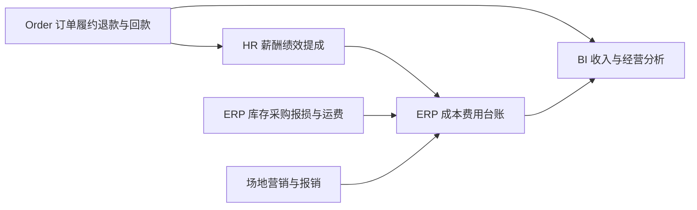

# 经营成本核算与人事绩效落地方案

本方案覆盖人力、货品、运费、场地、营销及报销，目标是让每一笔成本有业务来源、归属城市、所属期间和审核记录，并能从经营看板追溯到单据。建议沿用现有 HR、ERP、Order 和 BI 服务，在 ERP 内新增成本费用管理子模块，先完成真实费用归集，再逐步接通自动核算。

核对日期：2026 年 10 月 9 日。下文“现状”指当前工作区源码和用户截图确认的能力；“建议”指待实现方案。尚未进行数据库、运行接口或登录页面验收。

## 1 当前实现与图片对应

| 范围 | 已确认的现状 | 需要补齐 |
|---|---|---|
| 人事与绩效 | 截图中的绩效核算显示“当前页面尚未开放”。Portal 的薪酬与提成、绩效核算、月结与冲回均落到通用占位页；HR 已有员工、部门、岗位、任职数据 | 薪酬规则、商品提成、绩效结果、激励、工资月结与冲回 |
| 员工薪资 | `regular_salary`、`probation_salary` 是花名册原始文本，迁移明确标注仅作档案记录 | 数值化薪酬标准、生效期间、调薪历史和核算结果，不能直接把档案文本当作工资引擎 |
| 商品进货价 | ERP 商品规格已有 `purchasePrice` 采购参考价；采购单明细已有 `unitPrice`，入库明细有单价和金额 | 完整库存金额账、实际出库成本及计价快照；参考价不能替代历史采购和出库成本 |
| 库存与损耗 | 已有采购、调拨、出入库、库存余额和流水；出库类型支持 `INVENTORY_LOSS` 及外部通用出库投影 | 原生报损申请、证据、审核、处置、成本确认闭环，不能把枚举等同于完整报损功能 |
| 运费 | 当前采购单、调拨单、销售发货单保存契约没有完整运费明细；销售发货已有物流公司、运单号、出库单关联 | 运输费用、承担方、分摊、应付及结算；历史同步中的运费字段不能证明现有业务已支持 |
| 仓库与场地 | 仓库已有名称、地区、地址、联系人等资料，当前保存契约没有面积和租赁合同字段 | 场地面积、租赁合同、价格版本、分期费用、办公室场地 |
| 营销与报销 | 本次检索未发现完整的营销费用、员工报销业务实现；Workbench 当前没有报损和报销路由 | 预算、申请、实际费用、审核、付款核销及移动入口 |
| BI | 已有城市成本导入接口和成本快照；商品毛利使用采购参考价估算。Portal 对缺少实际城市成本的场景生成带“样例”标记的成本分项 | 真实分类明细、成本覆盖状态、与来源单据的核对；正式核算不能使用演示样例 |

## 2 先统一成本口径

“报销”是费用办理和支付方式，不是与人力、营销、运费并列且可以再次求和的费用性质。例如销售垫付广告费，归属营销费用，支付渠道为员工报销；这笔广告费只计一次。办公用品、差旅、打车按实际用途归入办公、差旅或交通费用。

每笔记录分开保存：费用类别、业务来源、申请人、受益城市或部门、所属期间、发生日期、付款日期、审核状态、付款状态、金额口径及附件。预算、预估、已确认费用和已付款分别统计，付款不再生成第二笔成本。

经营城市沿用现有 BI 的 HR 销售部直属启用城市部门，新增费用显式关联 `operatingCityDepartmentCode`；仓库地址所在地区与经营归属分开。总部、非城市部门、待归属费用单独保留，不能默认分配给某个城市。城市、员工、商品和单位使用稳定编码，名称只作快照。

建议管理看板采用以下口径，并展示费用覆盖程度：

> 经营结余 = 销售净收入 − 已售商品成本 − 当期确认损耗净额 − 当期物流费用 − 人力费用 − 场地费用 − 营销费用 − 其他经营费用。

其中，已计入商品成本的采购运费不能再次计入当期物流费用；调拨不形成集团销售收入；采购付款不等于当期已售商品成本。物流发生总额可单独分析，但不能直接整项再次扣减结余。该管理口径不直接命名为财务净利润。

采购运输费用的存货归集、发出存货计价与普通仓储费用需要区分。财政部《企业会计准则第 1 号——存货》第六、九、十四条分别规定采购成本构成、部分费用不计入存货，以及发出存货的计价方法。系统应保留“计入存货／计入期间费用”和已结转金额，具体映射按企业适用制度确定。[财政部原文](https://www.mof.gov.cn/zhengwuxinxi/zhengcefabu/2006zcfb/200805/t20080519_23107.htm)

## 3 人力费用

建议继续使用截图中的人事菜单，把规则配置、月度核算和结算结果分别放置。

| 菜单 | 承担内容 | 核算依据 |
|---|---|---|
| 员工档案及任职 | 员工、岗位、部门、入离职及调动历史 | HR 员工编码和有效任职期间 |
| 薪酬与提成 | 底薪、绩效基数、按品提成规则、激励方案；页内分标签 | 员工／岗位／城市适用范围、生效起止、规则版本 |
| 绩效核算 | 月度目标、完成情况、评分、提成明细、激励确认、异常清单 | 已确认的订单行、履约、退款、回款分配和绩效事实 |
| 月结与冲回 | 工资汇总、审核、锁定、付款状态、跨期补发或冲回 | 经复核的核算结果及来源快照 |

底薪按有效薪酬标准及确定后的计薪规则计算；绩效建议采用“绩效基数 × 考核系数”；激励分为规则触发奖励和一次性审批奖励。同一业绩可以按制度同时触发提成和激励，但系统必须显式配置可叠加，不能重复导入同一奖励。

按销售售卖的品计算提成，建议一期优先支持“每个 SKU、每个计奖单位固定金额”，并可扩展“商品销售净额 × 比例”。毛利提成等实际成本完整后再接入。规则至少包含商品及规格、单位、适用人员、城市、生效期间、阶梯、退货处理和叠加方式；一条订单行只能匹配一个基础提成规则，冲突时进入待核对。

计算链路为：订单行 → 固化销售归属 → 单位换算 → 匹配生效规则 → 净履约数量或净销售额 → 提成结果。来源在 Order，计算和结果在 HR；商品编码、规格及换算取 ERP。未关联商品、单位或销售人员时不猜测，也不把缺失项算成零后结算。

建议“已确认净履约形成预提，符合回款条件后释放可发提成”，分别展示预提、可发和已发。如果采用回款释放，现有订单级回款必须补充商品行分配记录，明确优惠、退款及代收运费的排除口径，累计分配不超过可分配净额；不能把全单回款重复用于每个商品。只退款不退货、退货未退款等情况分别影响金额规则、数量规则和可发余额。

示例仅说明算法：某商品规则为 2 元／箱，已确认履约 100 箱、已确认退货 5 箱，则基础预提为 95 × 2 = 190 元；可发金额还需按选定回款规则核定。箱、包、件必须来自 ERP 换算，不从商品名称推断。

月结保存规则版本、销售归属、成本归属和订单行快照。员工跨城市调动后，不按当前部门重写已锁定月份；已发提成发生后续退货时，建立关联原明细的冲回记录。正式考勤能力尚未闭环时，底薪和绩效可先接收审核后的月度输入，不直接将外勤轨迹或签到当作完整计薪考勤。

如需完整的人力成本，还应预留企业承担的社保公积金、福利和兼职费用；员工应发工资、实发工资及企业总人力成本分别展示。

## 4 货品进货价与损耗

**进货价放 ERP 商品管理是合理的，现有字段可继续使用，但其角色是采购参考价。** 实际采购价来自采购明细，实际入库成本来自入库确认和可归属费用，已售商品成本来自出库计价快照。修改商品参考价不能改变已结算历史成本。

建议以“租户＋仓库＋SKU＋基本单位”为库存计价维度，一期采用移动加权平均管理计价：入库前库存金额加本次入库成本，除以合计数量，形成新平均单价。采购退货、销售退回、调拨、迟到运费及期初库存均需相应金额处理；调拨保留原库存价值，销售退回关联原出库成本。不能只增加一个平均价字段就宣称完成计价。

启用前需要核对期初数量与金额。缺少采购或期初成本的库存标记待核价；可单独展示参考价估算，但不能进入真实毛利或毛利提成结算。已锁期内迟到的运费和价格差异形成可追溯调整，并区分剩余库存与已售部分。

**损耗建议通过明细报损单形成，城市负责人承担审批和汇总职责。** 销售和仓库都可上报，流程为：

1. 销售或仓库提交：仓库、商品及 SKU、单位、数量、原因、发生时间、照片、相关订单或运单；有批次体系时关联批次。
2. 仓库复核实物、库存归属、可用数量及处置方式，必要时先转待处理状态。
3. 城市负责人按权限审核；大额或特殊报损增加指定复核人。
4. ERP 确认报损出库，库存流水与成本记录关联同一报损来源，幂等执行一次。
5. 承运商、供应商赔偿另行关联追踪，区分待索赔、已确认和已收款，保留损失原额与赔偿额。

报损毛额按对应存货账面成本计算，不按销售价；净损失扣除已确认的残值或赔偿。盘点差异通过盘点单复核后形成盘亏出库。试吃、赠品和推广领用归营销用途出库，不能伪装为损耗；客户已经拥有的商品不能直接扣公司库存，须先核实售后责任和退回入库情况。

城市月报由上述已确认单据自动汇总。损耗率必须命名分母，例如“同 SKU 同单位的仓储损耗数量／期初数量及本期入库数量之和”，不同商品不能直接相加数量；金额损耗率单独定义，分母为零显示不适用。

## 5 三段运输费用

**三段运输都需要费用记录，但不建议仅在单据上放一个可反复覆盖的运费总额。** 新增统一运输费用单和分摊明细，原单据展示关联运费及确认状态；付款方式、费用承担方与受益城市分别保存。

| 运输段 | 业务入口及关联单据 | 建议处理 |
|---|---|---|
| 厂家到中心仓 | ERP 采购单、采购入库单 | 记录承运商、运单、运费、承担方和收货批次；本企业承担且符合采购归集口径的费用分配到入库商品。供应商包邮或含在采购价中时明确标记，不重复计费 |
| 中心仓到城市仓 | ERP 调拨单及调拨出入库单 | 支持一个运输批次关联多张调拨单，按受益城市和商品分摊。是否计入存货按既定制度及运输用途映射，不能仅根据“调拨”字样统一判断；承运应付与集团内部归属分开 |
| 城市端到客户端 | Order 销售发货单 | 发货页增加运费入口，关联实际运输费用单；拆单发货、合单配送均能分摊。向客户收取的配送费由 Order 管理，支付给承运商的成本另行记录 |

厂家到中心仓**不必为了录运费强制新建供应商发货单**。一期通过采购单、入库单和运输费用关联即可；确有多次发货、在途跟踪、预约收货需求时，再增加供应商发货通知单，归 ERP 采购域，不复用客户销售发货单。

运输费用单至少保存：运输段、承运商、运单或运输批次、服务日期、来源单据、含税金额及税额口径、承担方、预估／已确认状态、分摊依据、受益城市、应付及付款核销。数据未知与确认零运费分别表示。

分摊按实际计费依据选择重量、体积、标准件数或货值；缺乏可靠基础时明确记录人工分摊理由，不默认为等分。分摊合计必须等于费用单金额，尾差固定落到一条明细。一个运单多笔费用、一笔费用关联多张业务单据都保留关系；发货、调拨及报销入口不能重复确认同一承运费用。

## 6 仓储与办公室

**仓库面积放在仓库资料中维护；租金通过关联租赁合同管理。** 仓库详情可展示当前租金及历史合同，但不能只保存一个“月租金”覆盖历史。办公室作为独立场地类型管理，不建立虚假的库存仓库。

| 对象 | 主要字段 | 核算方式 |
|---|---|---|
| 仓库及办公室场地 | 场地类型、地址、面积、归属部门、受益城市、启停用日期；共用场地关联统一场地标识 | 支持一个场地服务多个部门或城市 |
| 租赁合同 | 出租方、租期、计价方式、金额、调价及免租期间、付款周期、押金、附件 | 固定月租或面积乘单价，按合同版本及服务期间生成费用 |
| 其他场地费用 | 物业、水电、保洁、仓储服务费及账期 | 按账单确认，明确是否已包含在租金或第三方仓储报价内 |

管理费用按受益月份分摊，季度或年度付款另行核销；押金单列往来，不能支付时直接全部计作房租。租期不足整月时按选定规则折算，变更合同保留生效期间。仓库与办公室共用一份租约时只生成一笔来源费用，再按面积或经审核比例分摊；中心仓服务多城市可按库容占用天数等可取得的依据分摊。

## 7 营销费用

**需要独立的营销费用入口，建议一期作为成本费用管理下的业务模块。** 单纯“营销配置”只能维护类型，不能说明实际花了多少、由谁承担及是否付款。

流程建议为：营销项目或活动 → 预算申请 → 合同或支出申请 → 实际执行及费用确认 → 付款或报销核销 → 按受益期间和城市分摊。

费用类型包括推广、广告、代言、活动执行、物料及试吃。项目至少包含负责人、活动期间、渠道、受益城市、商品或品牌、预算、供应商、合同、实际金额及凭证。预算、已承诺、已确认、已付款分别展示，不能把预算直接当作实际成本。

试吃、赠品通过 ERP 出库按成本归集到营销项目；采购活动物料、员工代垫广告费均关联同一项目，按业务事实去重。代言或投放合同跨期时按确定的服务期间分配管理费用。没有可靠订单归因链路时，不把活动同期销售额直接解释为营销带来的增量收入。

## 8 报销及其他经营费用

建议新增“费用报销”页面，Portal 负责复核与结算，Workbench 增加“我的报销”及附件提交。报销主体是员工，业务分类按费用明细处理，一张报销单可以包含多种费用和多个受益城市。

建议流程：草稿 → 提交 → 部门或城市审核 → 财务复核 → 费用确认 → 待支付／部分支付／已支付；驳回退回修改。已确认单据通过撤销或冲回修正，不能删除后重新计费。

明细包含费用类型、实际用途、发生日期、所属期间、金额及税额口径、受益城市／部门、关联客户／订单／活动／场地、票据或其他凭证。差旅可关联出差申请；打车注明业务事由；办公用品注明领用归属。票据与附件查重用于提示复核，不把相同金额直接认定为重复。

员工借款和备用金先记往来，报销审核后再核销，多退少补。已由企业确认的运费或营销费用，员工报销只补偿垫付款并关联原费用，不再次确认成本；工资和提成由 HR 工资单结算，不借用普通报销单重复生成。

## 9 模块边界与统一台账

下列为建议扩展，当前尚不存在完整的统一成本台账。ERP 现有职责已包含采购、应付和成本，可在其内部划分费用子模块；办公室、营销和员工报销属于进一步扩展，实施前应同步更新服务边界及服务说明，避免默认视为已有能力。暂不为每类费用拆分微服务。

| 主写服务 | 主数据及业务事实 | 协作方式 |
|---|---|---|
| HR | 薪酬规则、绩效、商品提成、激励、工资月结和冲回 | 接收 Order 交易事实和 ERP 商品引用；向 ERP 提供已确认工资成本及冲回 |
| ERP | 库存成本、报损、运输费用、场地租约、营销项目、报销、应付及统一成本台账 | HR 来源成本保留来源标识且只读，不能在 ERP 再编辑薪酬；统一提供费用事实给 BI |
| Order | 销售订单行、销售归属、履约、售后退款、客户收费和回款核销 | 提供带版本事实；发货页面通过 Gateway 操作 ERP 运输费用，Order 只保留引用或只读汇总 |
| BI | 收入及成本投影、期间快照、汇总、下钻和核对 | 收入取 Order 投影，成本统一取 ERP 台账投影，不再同时叠加 HR 工资原额 |
| Foundation 与 IAM | 费用类型等公共字典；身份、权限和数据范围 | 金额规则、合同、费用及审批状态仍由领域服务持有，不能放入通用字典或 Nacos |
| Integration | 外部来源采集、Raw Landing、映射、重试 | 外部费用和薪酬数据通过领域接口落库，不绕过领域规则直接写 BI 正式成本 |

统一台账保存来源单据及明细、版本、费用类别、确认期间、服务起止、经营城市、员工／仓库／SKU、币种、金额口径、归集到存货或期间费用、分摊明细和冲回关系。支付及核销另表关联。敏感工资明细仅授权 HR 和指定财务人员可见，经营看板按权限展示汇总。

每个来源金额只保留一份有效确认结果；来源版本用于顺序控制，不能每来一个新版本就全额累加。跨服务采用版本化 API 或领域事件，按来源与业务动作幂等，保存处理回执并可重试；冲回以独立负向记录关联原记录。ERP 库存和成本变动在本域事务内处理，跨域发布失败进入待同步核对，不宣称分布式事务已经完成。

现有 `/api/v1/analytics/supply/city-cost-records/import` 可以保留为过渡期已审核历史费用的导入入口，但目前契约不能表达完整审核、分摊及负数冲回。正式台账接入后，以来源编号和期间逐笔核对历史导入，标记被替代记录；未核对部分保留“未分项／待核对”，禁止与自动台账整批相加。

## 10 实施顺序与验收

| 阶段 | 实现范围 | 达到的结果 |
|---|---|---|
| 第一期 费用归集基础 | 费用分类、城市归属、来源标识、审核与付款分离、统一台账、租约、营销、报销和运费关联；支持经审核工资结果导入 | 六类业务入口可形成可追溯费用，BI 展示真实费用和缺口，不宣称已得到完整实际利润 |
| 第二期 商品与人力核算 | 期初成本、库存计价、报损、运输分摊、底薪绩效、按 SKU 提成、回款释放及退货冲回 | 已售商品成本及工资费用能由业务单据生成 |
| 第三期 月结及看板 | 各域对账、工资锁期、成本锁期、迟到调整、来源替代、BI 分类下钻和覆盖检查 | 在数据齐备的城市和期间形成可复核经营结余 |

月结先检查缺失费用、待核价库存、未分摊运费、未关联人员商品和跨域同步失败，再锁定各域版本及 BI 快照。工资月结在 HR，经营成本月结在 ERP；次月退款、补票、调价按制度形成关联调整，不修改已发布快照。正式看板缺少成本时显示“未完整核算”，不将缺失当作已确认零成本，也不回填演示比例。

验收至少覆盖以下业务场景：商品改价不改历史出库成本；箱件换算与部分退货正确冲提成；部分回款不超额释放；重复回调不重复扣库存或计费；合单运输分摊守恒；广告费报销不重复计入营销；季度付租金按服务月份归属；员工调动不改锁期归属；跨期冲回可追溯；缺成本、零成本、估算成本可以区分。

## 11 实施前需要冻结的业务选择

以下按建议口径展开，不代表已经确认了公司的薪酬或核算制度：

| 决策 | 建议起点 |
|---|---|
| 按品提成采用数量还是金额 | 优先每 SKU 每计奖单位固定金额；金额比例作为独立规则类型 |
| 提成何时可发 | 净履约预提，按确认回款条件释放；退货退款按原规则调整 |
| 库存计价及期初成本 | 一期移动加权平均；先取得经核对的期初数量金额 |
| 三段运费如何承担及分配 | 合同承担方与受益城市分开，按实际计费基础分配，费用归集类别显式配置 |
| 共享仓库办公室及总部费用 | 优先直接归属，剩余按能核验的面积、库容天数或人工比例分摊 |
| 审核权限、结算时间及金额口径 | HR、城市负责人和财务分别确认权限；统一含税／不含税比较口径和关账周期 |

## 12 源码依据

核对基线为本地工作区：Platform `2b3204b8a5225e831c53b001c68a30a418f1205a`，Portal `fc5ec51be278b2a8b308b83c816236226aa7050c`，Workbench `819b726eb647f9d3f5bcd58e8cd082d7e2dd5ff3`。Platform 另有本任务前已存在的未跟踪文件，本方案未修改这些文件。

- [服务职责](SERVICE_BOUNDARIES.md)与[跨服务协同规范](TEAM_DEVELOPMENT_GUIDE.md)：领域唯一主写者、版本化契约、禁止跨库业务访问。
- [Portal 路由](../../rigour-supply-chain-portal/src/router/routes.ts)、[菜单目录](../../rigour-supply-chain-portal/src/views/supply-chain/domain/catalog.ts)和[通用占位页](../../rigour-supply-chain-portal/src/views/supply-chain/domain/CapabilityView.vue)：人事菜单及占位状态。
- [HR 薪资档案迁移](../services/rg-scdp-hr/hr-server/src/main/resources/db/migration/V7__hr_employee_job_grade.sql)：薪资文本的档案用途。
- [商品规格价格契约](../services/rg-scdp-erp/erp-api/src/main/java/com/rigour/erp/api/v1/model/ProductVariantCommand.java)、[商品保存服务](../services/rg-scdp-erp/erp-server/src/main/java/com/rigour/erp/application/service/product/ErpProductManagementService.java)：采购参考价配置。
- [仓库契约](../services/rg-scdp-erp/erp-api/src/main/java/com/rigour/erp/api/v1/model/InternalInventoryWarehouseCommand.java)、[采购契约](../services/rg-scdp-erp/erp-api/src/main/java/com/rigour/erp/api/v1/model/InternalProcurementOrderCommand.java)、[调拨契约](../services/rg-scdp-erp/erp-api/src/main/java/com/rigour/erp/api/v1/model/InternalTransferOrderCommand.java)及[销售发货契约](../services/rg-scdp-order/order-api/src/main/java/com/rigour/order/api/v1/model/SalesShipmentCommand.java)：现有字段与扩展位置。
- [ERP 内部库存模型](../services/rg-scdp-erp/erp-server/src/main/resources/db/migration/V19__erp_internal_product_inventory_baseline.sql)、[出库类型](../services/rg-scdp-erp/erp-server/src/main/java/com/rigour/erp/domain/enums/ErpStockOutType.java)和[出库接口](../services/rg-scdp-erp/erp-api/src/main/java/com/rigour/erp/api/v1/ErpStockOutOrderApi.java)：库存基础和盘亏出库边界。
- [BI 查询定义](../services/rg-scdp-bi/bi-server/src/main/java/com/rigour/analytics/application/service/SupplyDashboardQueryService.java)、[成本导入服务](../services/rg-scdp-bi/bi-server/src/main/java/com/rigour/analytics/application/service/SupplyDashboardCityCostImportService.java)和[前端成本模型](../../rigour-supply-chain-portal/src/views/supply-chain/bi/cockpit-costs.ts)：估算成本、实际总额、样例分项与导入约束。
- [经营城市目录代码](../services/rg-scdp-bi/bi-server/src/main/java/com/rigour/analytics/infrastructure/persistence/scope/OperatingCitySql.java)和[业务日期约定](BI_BUSINESS_DATE_BOUNDARY.md)：经营城市使用部门目录，业务期间使用北京时间。
- [Workbench 路由](../../rigour-sales-workbench/src/router/index.ts)：当前移动业务入口。
